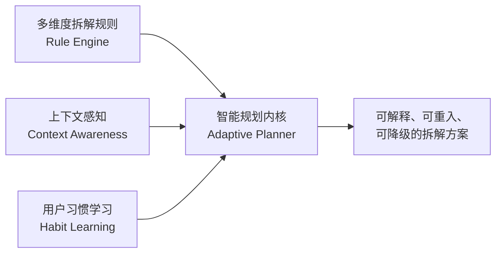
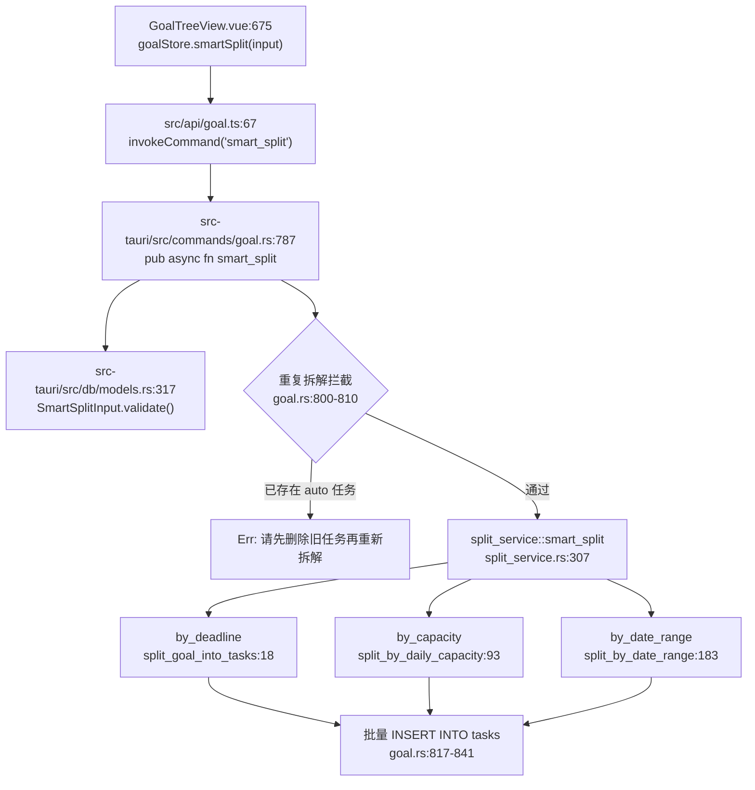
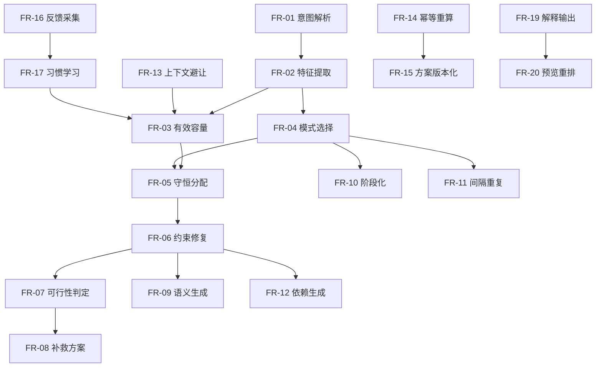
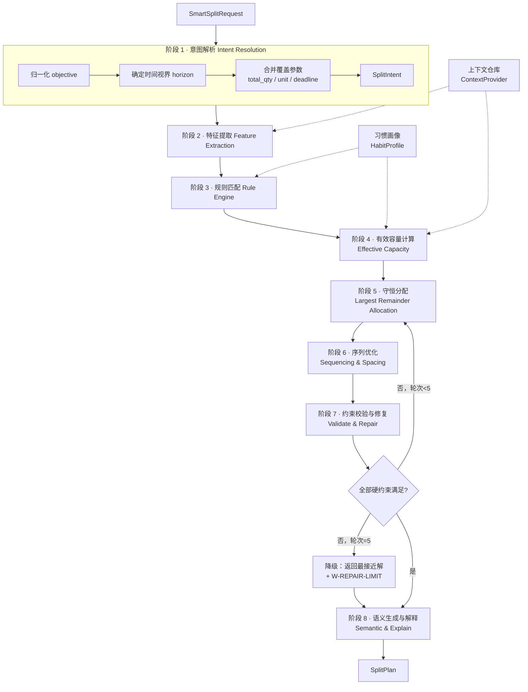
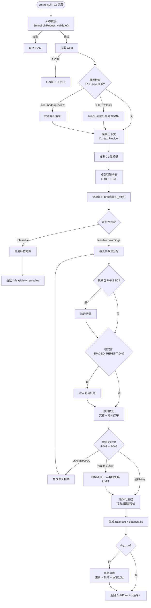
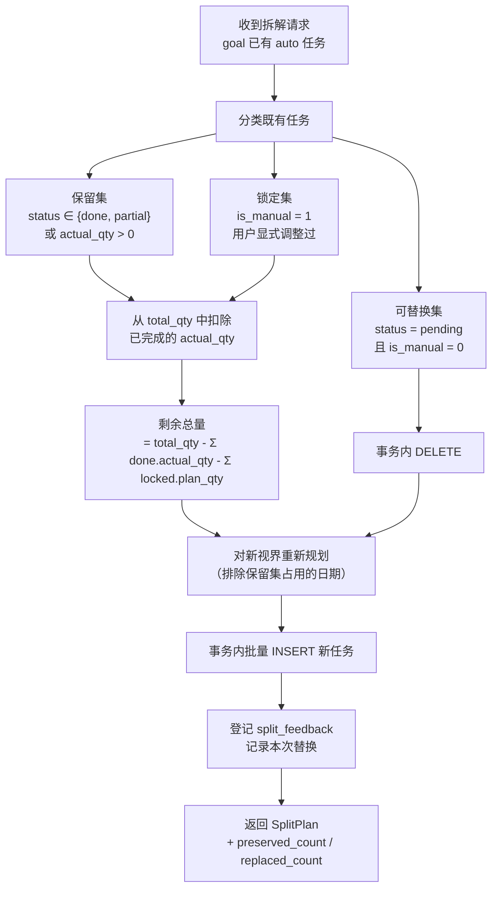
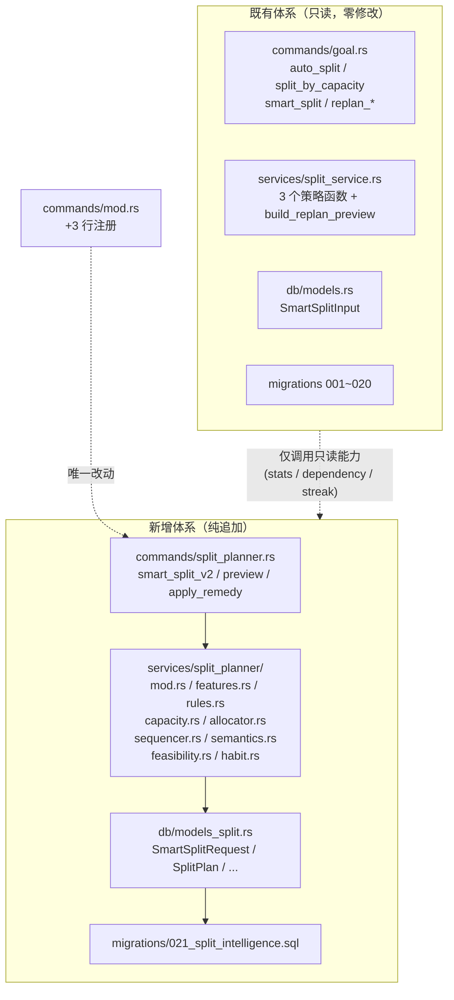
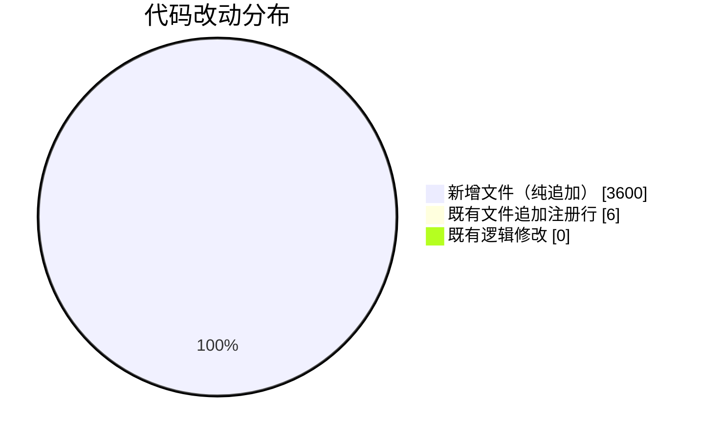
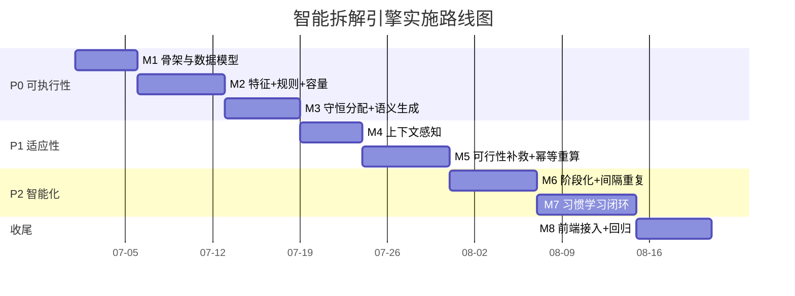
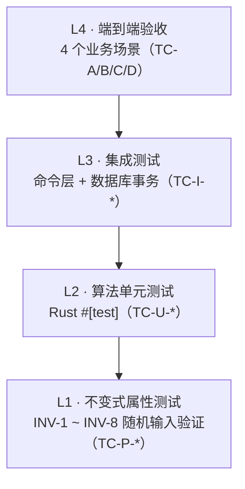

# SelfPilot 目标树智能自动拆解功能重设计方案

> **文档版本**：v1.0
> **文档类型**：算法重设计方案 + 功能需求规格说明书 + 测试用例设计
> **适用系统**：SelfPilot 离线个人任务规划桌面应用（Tauri 2 + Vue 3 + SQLite）
> **兼容性目标**：**零侵入式扩展** —— 不修改任何现有函数体、结构体定义、数据库迁移与既有 UI 流程；新能力以新增文件 + 少量注册行的方式交付
> **状态**：待评审

---

## 目录

| 章节 | 内容 | 对应需求 |
| --- | --- | --- |
| [第 1 章](#第-1-章-现状分析与痛点诊断) | 现状分析与痛点诊断 | 需求 1 |
| [第 2 章](#第-2-章-功能需求规格说明书) | 功能需求规格说明书（SRS） | 需求 3 |
| [第 3 章](#第-3-章-智能拆解算法设计) | 智能拆解算法设计 | 需求 2、4 |
| [第 4 章](#第-4-章-架构兼容性与实施建议) | 架构兼容性与实施建议 | 需求 7 |
| [第 5 章](#第-5-章-测试用例设计) | 测试用例设计 | 需求 5 |
| [第 6 章](#第-6-章-附录) | 附录（术语表、配置样例、验收清单） | — |

---

## 0. 阅读导引

### 0.1 本方案要解决的核心问题

SelfPilot 的产品承诺是「把宏大目标自动拆解为可执行的每日任务」。但当前实现（`split_service.rs`，913 行，3 个策略函数）本质上是一个**单维度算术均分器**：它把总量除以剩余天数，然后按自然日连续铺开。

这个实现对于「30 天背 300 个单词」这类**同质、匀速、单目标、无中断**的理想场景是成立的。但真实自学场景几乎从不满足这四个前提。本方案要做的，是把「均分器」升级为**约束感知的自适应规划器**。

### 0.2 方案的三条主线



| 主线 | 解决什么 | 对应章节 |
| --- | --- | --- |
| **多维度拆解规则** | 拆解结果「千篇一律」、无法表达真实约束、不建目标树 | §3.2、§3.3 |
| **上下文感知能力** | 与既有计划互相踩踏、忽略真实可用时间 | §3.4 |
| **用户习惯学习机制** | 零学习能力、每次都要重复手动调整 | §3.5 |

### 0.3 术语约定

| 术语 | 含义 |
| --- | --- |
| **拆解（Split）** | 把一个 Goal 的总量（`total_qty`）分配到具体日期的 Task 序列 |
| **有效容量 `C_eff(d)`** | 第 `d` 天在扣除黑名单日、既有负载、按用户真实产能修正后可承担的计划量 |
| **拆解方案（SplitPlan）** | 一次拆解的完整产物：任务草稿序列 + 可行性报告 + 诊断信息 |
| **模式（Pattern）** | 拆解的宏观形状：均分 / 容量约束 / 阶段化 / 间隔重复 / 里程碑倒推 / 混合 |
| **习惯画像（HabitProfile）** | 从用户历史调整行为中学习到的参数集 |
| **零侵入扩展** | 现有文件仅新增注册行，不改动任何既有逻辑分支 |

---

## 第 1 章 现状分析与痛点诊断

### 1.1 现有实现全景（代码级证据）

#### 1.1.1 调用链路



#### 1.1.2 关键代码资产索引

| 层次 | 文件 | 关键符号 | 行号 |
| --- | --- | --- | --- |
| 前端视图 | `src/views/GoalTreeView.vue` | `handleSmartSplit` / `LOAD_THRESHOLD` | 675 / 647 |
| 前端 API | `src/api/goal.ts` | `smartSplit` / `autoSplit` / `splitByCapacity` | 67 / 42 / 55 |
| 前端类型 | `src/types/index.ts` | `SmartSplitInput` / `SplitStrategy` | 69 / 66 |
| 输入模型 | `src-tauri/src/db/models.rs` | `SmartSplitInput` | 317 |
| 输入校验 | `src-tauri/src/db/models.rs` | `validate_split_strategy` / `validate_qty` | 86 / 46 |
| 命令层 | `src-tauri/src/commands/goal.rs` | `smart_split` / `replan_goal` / `auto_split` | 787 / 871 / 297 |
| 算法层 | `src-tauri/src/services/split_service.rs` | `smart_split`（调度） | 307 |
| 算法层 | `src-tauri/src/services/split_service.rs` | `split_goal_into_tasks` | 18 |
| 算法层 | `src-tauri/src/services/split_service.rs` | `split_by_daily_capacity` | 93 |
| 算法层 | `src-tauri/src/services/split_service.rs` | `split_by_date_range` | 183 |
| 算法层 | `src-tauri/src/services/split_service.rs` | `build_replan_preview` | 372 |
| 注册点 | `src-tauri/src/commands/mod.rs` | `build_handler` | 17-100 |
| 数据表 | `src-tauri/migrations/001_init.sql` | `goals` / `tasks` / `stages` | 5 / 27 / 15 |
| 数据表 | `src-tauri/migrations/006_task_dependency.sql` | `task_dependencies` | 6 |

#### 1.1.3 三种既有策略的算法实质

| 策略 | 位置 | 核心公式 | 任务命名 | 依赖/阶段 |
| --- | --- | --- | --- | --- |
| `by_deadline` | `split_service.rs:18` | `base = ⌊total ÷ remaining_days⌋`，余数前置 | `{goal.name} - 第N天` | 无 |
| `by_capacity` | `split_service.rs:93` | `num_tasks = ⌈total ÷ daily_capacity⌉`，逐日铺开 | `{goal.name} - 第N天` | 无 |
| `by_date_range` | `split_service.rs:183` | 有 `per_day_qty` 则 `⌈total ÷ qty⌉`；否则按 `span_days` 均分 | `{goal.name} - 第N天` | 无 |

三者的共同点，也正是局限所在：**输入只有标量，输出只有「日期 + 数量」，中间没有任何决策智能**。

### 1.2 能力矩阵：现状 vs. 真实需求

| 能力维度 | 当前支持度 | 代码证据 | 缺口 |
| --- | --- | --- | --- |
| 总量均分 | ✅ 完整 | `split_service.rs:39-40` | 仅线性匀速 |
| 容量约束 | ⚠️ 部分 | `split_service.rs:112-131` | 超限直接报错，无降级 |
| 自定义区间 | ✅ 完整 | `split_service.rs:183-297` | 不感知区间内可用性 |
| 任务命名语义化 | ❌ 缺失 | `split_service.rs:66` 硬编码模板 | 全部同名，无法执行 |
| 工作日/周末区分 | ❌ 缺失 | `for i in 0..span_days` 连续铺开 | 无 `weekday` 判断 |
| 节假日/黑名单 | ❌ 缺失 | 输入模型无对应字段 | `models.rs:317-346` 仅 7 个标量 |
| 既有负载避让 | ❌ 缺失 | `split_service.rs:295` `let _ = today;` | today 参数被显式丢弃 |
| 跨目标预算 | ⚠️ 前端提示 | `GoalTreeView.vue:647` `LOAD_THRESHOLD = 5` | 仅弹窗警告，不参与决策 |
| 阶段化拆解 | ❌ 缺失 | `smart_split` 返回 `Vec<Task>` | 无法产出子目标结构 |
| 间隔重复/复习 | ❌ 缺失 | 无 review 相关字段 | 记忆型目标无复习计划 |
| 任务依赖生成 | ❌ 缺失 | `task_dependencies` 表存在但拆解不写入 | 生成后需手工连依赖 |
| 缓冲日预留 | ❌ 缺失 | 无 `buffer_days` 概念 | 无容错空间 |
| 幂等重算 | ❌ 缺失 | `goal.rs:313/379/806` 硬拦截 | 只能全删重建 |
| 保留手动调整的重排 | ⚠️ 部分 | `build_replan_preview:394,399` | 只改 `plan_qty`，不改 `plan_date` |
| 可行性补救建议 | ❌ 缺失 | `split_service.rs:127-130` 直接 `Err` | 用户只得到错误 |
| 用户习惯学习 | ❌ 缺失 | `is_manual` 字段从未被算法读取 | 重复劳动 |
| 拆解可解释性 | ❌ 缺失 | 返回值无 rationale 字段 | 用户不知为何这样排 |
| 数量守恒不变式 | ❌ 缺失 | `split_service.rs:40` `.round()` + `:50` `continue` | 分配总量可能 ≠ `total_qty` |

### 1.3 实际应用场景中的拆解痛点

以下 9 个痛点均来自真实自学场景，每一项都附有当前代码的直接证据。

---

#### 痛点 P1 —— 拆解结果「千篇一律」，无法回答「今天到底做什么」

| 项目 | 内容 |
| --- | --- |
| **场景** | 考证党：「3 个月通过 PMP，官方教材 300 页 + 35 小时视频课」 |
| **用户操作** | 创建目标 → 填总量 300、单位「页」、截止日期 → 点击【自动拆解计划】 |
| **实际结果** | 生成 90 个任务，名称依次为「PMP备考 - 第1天」…「PMP备考 - 第90天」，`description` 全部为 `NULL` |
| **代码证据** | `split_service.rs:66`：`name: format!("{} - 第{}天", goal.name, day_index)`；`:62`：`description: None` |
| **业务后果** | 拆解产物**不可直接执行**。用户打开今日待办，看到「PMP备考 - 第37天」，仍不知道今天该看哪几页。用户被迫手工重命名 90 个任务，或干脆放弃使用拆解功能、退化回纯手动记任务——**拆解功能的核心价值归零** |
| **根因** | 命名模板硬编码，且输入模型中没有承载「内容大纲」的字段（`models.rs:317-346`） |

---

#### 痛点 P2 —— 匀速假设违背真实学习曲线

| 项目 | 内容 |
| --- | --- |
| **场景** | 考研党：「90 天刷完 1800 道数学题」 |
| **真实节奏** | 前 30 天在学新知识点，每天只能做 10 道；后 60 天进入刷题模式，每天能做 25 道 |
| **当前行为** | `base = ⌊1800 ÷ 90⌋ = 20`，于是**每天都排 20 道，90 天一个节奏** |
| **代码证据** | `split_service.rs:39-40`：`let base = (total / remaining_days as f64).floor();` —— 全流程无任何分段或斜率参数 |
| **业务后果** | 前 30 天每天欠 10 道，累计欠 300 道，进度条从第 3 天起就持续飘红；用户产生「我一直在落后」的挫败感，而实际上这是**拆解算法强加的、不存在的落后**。该产品本身有 P1-2 挫折安抚机制，但此处算法正在**主动制造挫折** |
| **根因** | 无 `phases`（阶段）概念，无法表达「前轻后重 / 前重后轻」的非线性节奏 |

---

#### 痛点 P3 —— 零上下文感知，与新拆解的目标互相踩踏

| 项目 | 内容 |
| --- | --- |
| **场景** | 多目标并行：用户已有「背单词 60 天 × 50 词」，又新建「学 Vue 30 天 × 2 小时」并拆解 |
| **当前行为** | 第二个目标拆解时**不查询任何已有任务**。第 1~30 天每天被叠加 2 小时视频任务，而这些天早已排满 50 个单词 |
| **代码证据** | ① `split_service.rs:295`：`let _ = today;` —— `split_by_date_range` **显式丢弃**了 `today` 参数，连「今天」都不看；② `commands/goal.rs:800-804` 的唯一查询是 `SELECT COUNT(*) FROM tasks WHERE goal_id = ? AND source = 'auto'`，**只统计目标自己**，对全局负载一无所知 |
| **现有缓解** | 前端 `GoalTreeView.vue:647` 硬编码 `const LOAD_THRESHOLD = 5`，在拆解前查 `getDailyLoad` 并弹窗警告。但这只是**事后告知**：既不阻止、不建议、也不重新排布，用户只能选「继续」或「取消」 |
| **业务后果** | 「今日待办」爆炸，用户当天无法完成，触发逾期 → 逾期任务堆积 → `listOverdueTasks` 列表膨胀 → 用户体验崩塌。这是多目标用户**最高频的失败模式** |
| **根因** | 拆解算法是无状态纯函数（`fn(goal, today) -> Vec<Task>`），签名里根本没有「上下文」的位置 |

---

#### 痛点 P4 —— 不可重入：「拆解一次定终身」

| 项目 | 内容 |
| --- | --- |
| **场景 A** | 备考中途官方改版，教材从 300 页变 400 页 |
| **场景 B** | 用户出差一周，回来后进度落后，需要把剩余内容压缩到更少天数 |
| **当前行为** | 场景 A：再次点击拆解 → 报错「该目标已有自动拆解任务，请先删除旧任务再重新拆解」。用户若照做删除，**90 天的完成记录全部丢失**（`ON DELETE CASCADE`，`001_init.sql:45`）。<br/>场景 B：调用 `replan_goal`，但它只执行 `UPDATE tasks SET plan_qty = ?`（`commands/goal.rs:901`），**完全不改 `plan_date`**——计划量变了，但任务还是散落在原来 90 天里，无法「压缩到更少天数」 |
| **代码证据** | 重复拦截三处：`goal.rs:313-317`、`goal.rs:379-383`、`goal.rs:806-810`（三份完全相同的代码块）；重排限制：`goal.rs:896-907` 循环体内只有 `plan_qty` 一个赋值目标 |
| **业务后果** | 目标一旦拆解就丧失了「随现实调整」的能力。对于一个**长期**自学工具，计划必然需要调整，而系统在架构上拒绝调整。用户最终把目标删掉重建，历史进度归零，连续打卡（streak）断裂 |
| **根因** | 拆解被建模为**一次性不可逆操作**，而非「可版本化的方案（Plan）」。数据库中没有 `split_plans` 之类的方案表，任务与方案之间没有归属关系，因此无法「保留进度、替换计划」 |

---

#### 痛点 P5 —— 无法表达真实约束（缓冲、上限、复习、依赖、黑名单日期）

| 项目 | 内容 |
| --- | --- |
| **场景** | 在职备考者：① 只有工作日晚上和周末有整块时间；② 国庆 7 天要回老家，完全不能学；③ 考前要留 7 天纯冲刺复习；④ 每天最多 3 小时，再多会崩；⑤ 单次任务不能少于 30 分钟，否则切换成本太高 |
| **当前输入能力** | `SmartSplitInput` 共 7 个字段：`goal_id` / `strategy` / `total_qty` / `deadline` / `daily_capacity` / `start_date` / `end_date` / `per_day_qty`（`models.rs:317-346`）。**全部是标量**，没有数组、没有嵌套对象 |
| **以上 5 条约束的可表达性** | ① 部分（`daily_capacity` 是全局单值，无法按星期几区分）<br/>② ❌ 无 `blackout_dates` 字段<br/>③ ❌ 无 `buffer_days` 字段<br/>④ ❌ 无 `max_daily_hours` 字段<br/>⑤ ❌ 无 `min_chunk_qty` 字段 |
| **另两项结构性缺失** | ① **阶段**：`stages` 表存在（`001_init.sql:15`）但拆解时 `stage_id: None` 恒成立——拆解从不创建阶段<br/>② **依赖**：`task_dependencies` 表存在（`006_task_dependency.sql:6`）且已有完整命令支持（`set_task_dependency` 等 6 个），但**拆解算法从不写入依赖**。用户拆出 90 个任务后，若要表达「先看完第 1-3 章才能做题」，需要手工连 90 次依赖 |
| **业务后果** | 拆解产物与真实生活脱节，用户只能拆解后再逐条手工修正。当修正成本超过手工建任务的成本时，拆解功能被弃用 |
| **根因** | 输入契约过于扁平，无法承载约束；算法也没有消费 `stages` / `task_dependencies` 的能力 |

---

#### 痛点 P6 —— 失败即终止，无补救路径

| 项目 | 内容 |
| --- | --- |
| **场景** | 「40 小时课程，我每天能学 2 小时，截止日期是 5 天后」 |
| **当前行为** | 直接返回错误：`按每日2小时拆解需要20天，但截止日期前仅剩5天，请调整每日可用时长或截止日期`（`split_service.rs:127-130`） |
| **代码证据** | `split_by_daily_capacity`：`if num_tasks > remaining_days { return Err(...) }`；`split_by_date_range` 同构：`:218-223` `if num_tasks > span_days { return Err(...) }` |
| **业务后果** | 用户收到的是一条**陈述问题的错误信息**，而非**解决问题的方案**。用户必须自己心算：要每天几小时？要延期到哪天？要砍掉多少内容？——这正是用户当初想交给工具去算的事情。**工具在最需要它的时刻拒绝了工作** |
| **根因** | 算法把「不可行」当作异常，而不是当作一个需要求解的新优化问题（最小化与原意图的偏离度） |

---

#### 痛点 P7 —— 零学习能力，用户重复劳动

| 项目 | 内容 |
| --- | --- |
| **场景** | 用户是「计划偏乐观」型：每次拆解后，都会习惯性地把每天的任务量下调约 20% |
| **当前行为** | 第 1 个目标这样调，第 10 个目标还是这样调。系统记录了每一次调整（`is_manual` 字段被置 1），但**从未读取它来改进下次拆解** |
| **代码证据** | `is_manual` 定义于 `001_init.sql:40`（`is_manual INTEGER NOT NULL DEFAULT 0`）。在 `split_service.rs` 中出现 2 次，均在 `build_replan_preview` 中，且只用于**布尔判断「是否保留」**：`:394` `filter(|t| t.is_manual == 0)`、`:399` `filter(|t| t.is_manual == 1)`。**三个拆解算法函数中，`is_manual` 出现 0 次** |
| **业务后果** | 完全相同的手工修正被重复执行几十次。用户感受不到工具「越用越懂我」，产品无法形成使用黏性。这也是迭代计划中已识别但未实现的方向（`SelfPilot_功能迭代计划.md:516`：「基于历史完成速度，自动建议拆解粒度」） |
| **根因** | 缺少「反馈采集 → 参数估计 → 参数回流」的闭环。数据库中有原始信号（`is_manual`、`actual_qty`、`status`），但没有沉淀为可复用的用户模型 |

---

#### 痛点 P8 —— 名为「目标树」拆解，实为单层摊派

| 项目 | 内容 |
| --- | --- |
| **场景** | 大目标：「6 个月掌握机器学习」——自然分解为「数学基础（线代/概率）」「经典算法」「项目实战」三个子目标，各自节奏完全不同 |
| **当前行为** | 拆解只能把 `total_qty` 铺成任务，**从不生成子目标**。用户必须先手工创建 3 个子目标、分别填总量和截止日期，再对每个子目标单独执行一次拆解（共 4 次操作） |
| **代码证据** | `smart_split` 返回类型为 `Vec<Task>`（`split_service.rs:307`），**结构上就无法返回子目标**；生成的每个任务都是 `parent_id: Some(goal.id.clone())`、`stage_id: None`（`split_service.rs:63-64`）——**永远平铺在目标下，深度恒为 1** |
| **业务后果** | ① 操作繁琐：4 次手工操作 vs. 期望的 1 次；② **跨层级总量不守恒**：用户手工填的 3 个子目标总量之和，系统不校验是否等于父目标的 600 小时，进度汇总失真；③ 「目标树」这一产品核心心智模型在拆解环节断裂 |
| **根因** | 拆解的输出契约只有 Task，没有 Goal；算法层没有「总量在树上的守恒分配」这一概念 |

---

#### 痛点 P9 —— 数值完整性隐患（隐性缺陷）

| 项目 | 内容 |
| --- | --- |
| **缺陷 1：浮点舍入** | `split_service.rs:40`：`let remainder = (total - base * remaining_days as f64).round() as i64;`。当 `total` 为小数（如「2.5 小时/天」场景）时，`round()` 可能使分配总量漂移 |
| **缺陷 2：静默丢任务** | `split_service.rs:50-52`：当 `total < remaining_days` 时 `base = 0`，`plan_qty <= 0.0` 的任务被 `continue` 跳过。生成的任务数**少于剩余天数**，任务跨度自动缩短，但接口不返回任何提示 |
| **缺陷 3：无守恒断言** | 三个算法函数均无 `assert_eq!(Σ plan_qty, goal.total_qty)` 一类的不变式校验 |
| **业务后果** | ① 进度分母（`goal.total_qty`）与实际计划量之和可能不等，进度百分比出现微小但持续的系统性偏差；② 缺陷 2 让「90 天的计划」实际只排出 60 个任务，用户以为排满了 |
| **根因** | 采用「先算基数、再补余数」的启发式分配，而非具备守恒保证的**最大余数法**；且缺少后置校验阶段 |

---

### 1.4 痛点优先级评估

按「发生频次 × 业务影响 × 用户可感知度」评分（1-5 分，越高越严重）：

| 痛点 | 频次 | 影响 | 可感知 | 综合 | 优先级 | 本方案对应模块 |
| --- | --- | --- | --- | --- | --- | --- |
| **P1** 命名无语义 | 5 | 5 | 5 | 15 | **P0** | §3.6 语义化生成 |
| **P3** 无上下文感知 | 5 | 5 | 4 | 14 | **P0** | §3.4 上下文感知层 |
| **P4** 不可重入 | 4 | 5 | 5 | 14 | **P0** | §3.3 幂等重算 |
| **P2** 匀速假设 | 5 | 4 | 4 | 13 | **P0** | §3.3 阶段化模式 |
| **P5** 约束缺失 | 4 | 4 | 4 | 12 | **P1** | §2.4 输入契约扩展 |
| **P6** 无补救路径 | 3 | 4 | 5 | 12 | **P1** | §3.7 可行性补救 |
| **P9** 数值隐患 | 3 | 3 | 2 | 8 | **P1** | §3.5 最大余数法 |
| **P7** 无学习能力 | 4 | 3 | 3 | 10 | **P2** | §3.5 习惯学习 |
| **P8** 不建目标树 | 2 | 4 | 3 | 9 | **P2** | §3.3 阶段化模式 |

> **结论**：P0 级痛点（P1/P2/P3/P4）集中在「拆解产物的可执行性」与「拆解的可重入性」——这两点决定了拆解功能**是否有人用**。P1 级（P5/P6/P9）决定**用起来是否顺手**。P2 级（P7/P8）决定**长期黏性**。本方案的模块划分与实施路线图（§4.3）严格按此优先级排序。

---

## 第 2 章 功能需求规格说明书

### 2.1 目标与非目标

#### 2.1.1 设计目标

| 编号 | 目标 | 可验证的判定标准 |
| --- | --- | --- |
| G-1 | 拆解产物可直接执行 | 每个任务名称含内容范围，无需用户重命名 |
| G-2 | 拆解感知真实上下文 | 拆解后单日任务数不超过用户设定的全局预算 |
| G-3 | 拆解可安全重入 | 同一目标可重复拆解，已完成任务与其 `actual_qty` 100% 保留 |
| G-4 | 拆解支持非线性节奏 | 支持 ≥3 个阶段的差异化节奏配置 |
| G-5 | 拆解可表达完整约束 | 黑名单日、星期几、单日上限、最小粒度、缓冲日均可表达 |
| G-6 | 不可行时给出解决方案 | 返回 ≥3 个量化补救方案并按偏离成本排序 |
| G-7 | 拆解越用越准 | 反馈样本 ≥10 后，习惯参数参与容量计算并影响输出 |
| G-8 | 数量严格守恒 | 任意合法输入下 `Σ plan_qty == total_qty`（浮点误差 < 1e-6） |
| G-9 | 拆解可解释 | 每个任务带 `rationale`，方案带 `diagnostics` |
| G-10 | 支持跨层级拆解 | 可一次产出子目标结构，且子目标总量之和守恒 |

#### 2.1.2 非目标（明确不做）

| 不做的事 | 理由 |
| --- | --- |
| 不引入云端 LLM 生成内容大纲 | 产品定位为**离线**桌面应用（`README.md:5`），需保持零网络依赖 |
| 不修改既有 `smart_split` / `auto_split` / `split_by_capacity` 行为 | 兼容性硬约束，见 §4.1 |
| 不做自动执行/打卡提醒 | 属于通知子系统，与本功能正交 |
| 不做日历拖拽后的自动重排 | 拖拽是显式用户意图，不应被算法覆盖（保留 `is_manual` 语义） |

### 2.2 用户角色与典型场景

| 角色 | 特征 | 首要痛点 | 典型目标 |
| --- | --- | --- | --- |
| **考证冲刺者** | 截止日期刚性，内容有明确章节 | P2、P6 | PMP 90 天 / 考研 180 天 |
| **语言学习者** | 需要大量重复记忆 | P1、P5、P7 | 100 天背 3000 词 |
| **多目标并行者** | 同时推进 3-5 个目标 | P3 | 背单词 + 健身 + 学框架 |
| **项目实践者** | 内容分阶段，前后依赖强 | P5、P8 | 6 个月掌握机器学习 |
| **在职碎片时间者** | 只有工作日晚上和周末 | P5 | 每天 1.5 小时 |

### 2.3 功能需求清单

#### 2.3.1 核心功能点（FR）

| 编号 | 功能点 | 描述 | 优先级 | 对应痛点 |
| --- | --- | --- | --- | --- |
| **FR-01** | 拆解意图解析 | 将用户输入归一化为 `SplitIntent`（目标函数 + 时间视界 + 覆盖参数），支持 5 种目标函数 | P0 | P2 |
| **FR-02** | 多维特征提取 | 从目标、日历、历史、负载四类来源提取 ≥18 个特征，构成 `FeatureVector` | P0 | P2、P3 |
| **FR-03** | 有效容量计算 | 计算每日有效容量 `C_eff(d)`，融合声明容量、学习容量、负载余量、可用性因子 | P0 | P2、P3、P5 |
| **FR-04** | 拆解模式选择 | 规则引擎按优先级选择拆解模式：EVEN / CAPACITY_BOUND / PHASED / SPACED_REPETITION / MILESTONE_BACKWARD / HYBRID | P0 | P2 |
| **FR-05** | 守恒分配 | 用最大余数法在可用日之间分配总量，保证 `Σ plan_qty == total_qty` | P0 | P9 |
| **FR-06** | 约束求解与修复 | 校验全部硬约束，违反时进入修复循环（≤5 轮），仍不可行则降级 | P0 | P5、P6 |
| **FR-07** | 可行性判定 | 计算 `slack_ratio`，输出 feasible / feasible_with_warnings / infeasible 三态 | P1 | P6 |
| **FR-08** | 补救方案生成 | 不可行时生成 ≥3 个量化补救方案（提容量/延期/缩范围/开周末），按偏离成本排序 | P1 | P6 |
| **FR-09** | 语义化内容生成 | 依据内容大纲或阶段划分，生成含范围描述的任务名称与描述 | P0 | P1 |
| **FR-10** | 阶段化拆解 | 支持把目标切分为 2-6 个阶段，各阶段独立节奏与单位提示 | P0 | P2、P8 |
| **FR-11** | 间隔重复注入 | 对记忆型内容按 `[1,2,4,7,15]` 天间隔自动生成复习任务 | P1 | P5 |
| **FR-12** | 依赖关系生成 | 依据大纲顺序或阶段顺序，自动生成 `depends_on_seq`，落库为 `task_dependencies` | P2 | P5 |
| **FR-13** | 上下文避让 | 拆解时查询全局负载，对超载日降权或跳过 | P0 | P3 |
| **FR-14** | 幂等重算 | 同一目标可重复拆解；已完成任务保留，未完成任务按新方案替换 | P0 | P4 |
| **FR-15** | 方案版本化 | 每次拆解生成 `plan_id`，保留历史方案与反馈关联 | P1 | P4 |
| **FR-16** | 反馈采集 | 记录用户对拆解产物的每一次调整（改量/改期/删除/改名） | P1 | P7 |
| **FR-17** | 习惯参数学习 | 用 EWMA 从反馈中估计 5 类参数，含冷启动门控与半衰期衰减 | P2 | P7 |
| **FR-18** | 子目标树生成 | 可一次产出子目标结构，校验子目标总量之和守恒 | P2 | P8 |
| **FR-19** | 拆解解释输出 | 每个任务带 `rationale`，方案带 `applied_rules` 与 `warnings` | P1 | P1、P6 |
| **FR-20** | 预览与即时重排 | 支持 `dry_run` 预览（不落库），以及「重新排期」操作 | P1 | P4 |

#### 2.3.2 功能点依赖关系



### 2.4 输入规格

#### 2.4.1 设计原则

1. **全字段可选**：未提供的字段由系统从目标属性、习惯画像、上下文自动推导，用户可零配置直接拆解。
2. **向后兼容**：`request.legacy` 子对象可直接承载原 `SmartSplitInput` 的全部字段（`models.rs:317`），语义完全一致。
3. **显式优于隐式**：所有影响结果的参数在输出 `diagnostics` 中回显，用户可审计。

#### 2.4.2 `SmartSplitRequest` 完整定义

```jsonc
{
  "goal_id": "8f3a...",              // 必填，UUID
  "api_version": 2,                  // 必填，=2 走新引擎
  "mode": "auto",                    // auto | assisted | preview
                                     //  auto=全自动；assisted=返回候选方案供选；
                                     //  preview=只算不落库（等价 dry_run）

  // ---------- 1. 意图层 ----------
  "intent": {
    "objective": "finish_by_deadline",
    // finish_by_deadline  在截止日前完成（默认）
    // steady_pace         保持稳定节奏，不追求提前
    // maximize_retention  记忆留存最大化（触发间隔重复）
    // minimize_daily_load 最小化单日负担（尽量摊平拉长）
    // maximize_throughput 吞吐最大化（尽早完成，前重后轻）
    "horizon": {
      "start_date": "2026-07-01",    // 可选，默认=明天
      "end_date":   "2026-09-30"     // 可选，默认=goal.deadline
    },
    "buffer_days": 7,                // 可选，末尾预留缓冲天数，默认 0
    "total_qty_override": 400,       // 可选，覆盖 goal.total_qty
    "unit_override": "页"            // 可选，覆盖 goal.unit
  },

  // ---------- 2. 约束层 ----------
  "constraints": {
    "hard": {                        // 违反即失败（或触发修复循环）
      "blackout_dates": ["2026-10-01", "2026-10-02"],   // 完全不可用日
      "blackout_ranges": [{"from": "2026-10-01", "to": "2026-10-07"}],
      "allowed_weekdays": [1,2,3,4,5],                  // 0=周日；不填=全周可用
      "max_daily_qty": 25,                              // 单日计划量上限
      "min_chunk_qty": 5,                               // 单任务最小粒度
      "max_daily_hours": 3,                             // 单日时长上限
      "max_tasks_per_day": 1,                           // 单日任务条数上限
      "global_daily_task_budget": 6                     // 跨目标：单日总任务数上限
    },
    "soft": {                        // 尽量满足，允许打折
      "weekend_factor": 0.5,         // 周末容量系数
      "phase_factors": [0.6, 0.9, 1.2],   // 各阶段节奏系数（前轻后重示例）
      "prefer_skip_dates": ["2026-08-15"],
      "interleave": true             // 是否按类型交错排布
    }
  },

  // ---------- 3. 结构层 ----------
  "structure": {
    "shape": "auto",                 // auto | even | front_loaded | back_loaded
                                     // | phased | spaced_repetition | milestone
    "phases": [                      // shape=phased 或 auto 判定为阶段化时使用
      { "name": "基础精读", "ratio": 0.35, "pace": 0.7, "unit_hint": "页" },
      { "name": "强化练习", "ratio": 0.40, "pace": 1.2, "unit_hint": "题" },
      { "name": "冲刺模考", "ratio": 0.25, "pace": 1.0, "unit_hint": "套" }
    ],
    "review": {                      // 间隔重复配置
      "enabled": true,
      "intervals": [1, 2, 4, 7, 15], // 相对首次学习日的复习间隔（天）
      "review_ratio": 0.2,           // 复习任务量 = 首次任务量 × 该系数
      "max_review_per_day": 3
    },
    "allow_sub_goals": false         // 是否允许生成子目标结构（FR-18）
  },

  // ---------- 4. 语义层 ----------
  "semantic": {
    "outline": [                     // 内容大纲（可选，驱动语义化命名与依赖）
      "第1章 引论",
      "第2章 项目生命周期",
      "第3章 过程管理"
    ],
    "naming_template": "{goal} · {phase} · 第{n}天（{scope}）",
    "description_template": "范围：{scope}；累计 {cum}/{total}{unit}；预计 {hours} 小时"
  },

  // ---------- 5. 学习层 ----------
  "learning": {
    "use_habit_profile": true,       // 是否启用习惯画像修正
    "adapt_strength": 1.0,           // 0.0~1.0，对习惯修正的整体信任度
    "record_feedback": true          // 是否为本次拆解开启反馈采集
  },

  // ---------- 6. 兼容层 ----------
  "legacy": {                        // 可选；提供时完全等价于旧 smart_split 语义
    "strategy": "by_deadline",
    "total_qty": 300,
    "deadline": "2026-09-30",
    "daily_capacity": 2,
    "start_date": null,
    "end_date": null,
    "per_day_qty": null
  },

  "explain": true,                   // 是否生成 rationale / diagnostics（默认 true）
  "dry_run": false                   // true 时不落库
}
```

#### 2.4.3 输入校验规则

| 字段 | 规则 | 违反时行为 |
| --- | --- | --- |
| `goal_id` | 非空，且目标存在 | `AppError::NotFound` |
| `api_version` | 必须 = 2 | `AppError::Param("不支持的 api_version")` |
| `intent.objective` | ∈ 5 个枚举值 | `AppError::Param` |
| `intent.horizon.*` | `yyyy-MM-dd` 格式 | `AppError::Param` |
| `intent.buffer_days` | `0 ≤ v < 总天数` | `AppError::Param` |
| `blackout_*` | 合法日期 / `from ≤ to` | `AppError::Param` |
| `allowed_weekdays` | 元素 ∈ `0..=6`，去重后非空 | `AppError::Param` |
| `max_daily_qty` / `min_chunk_qty` | `> 0` 且 `min ≤ max` | `AppError::Param` |
| `phases[].ratio` | 全部 `> 0`，且 `Σ ratio ≈ 1.0`（容差 1e-3） | `AppError::Param` |
| `review.intervals` | 正整数、严格递增、≤20 个 | `AppError::Param` |
| `outline` | 元素非空，≤500 项 | `AppError::Param` |
| 模板占位符 | 仅允许白名单 `{goal}{phase}{n}{scope}{cum}{total}{unit}{hours}{date}` | 未识别占位符原样保留 |

> **实现提示**：以上校验全部落在**新增**的 `SmartSplitRequest` 结构体上（`#[derive(Validate)]`），与既有 `SmartSplitInput` 的 `validate_split_strategy`（`models.rs:86`）完全独立、互不影响。

### 2.5 输出规格

#### 2.5.1 `SplitPlan` 完整定义

```jsonc
{
  "plan_id": "b71c...",              // 本次拆解方案 UUID（FR-15）
  "goal_id": "8f3a...",
  "api_version": 2,
  "generated_at": "2026-06-24T10:30:00",
  "engine_version": "2.0.0",

  // ---------- 方案级元信息 ----------
  "resolved": {
    "pattern": "PHASED_SPACED_REPETITION",   // 实际采用的拆解模式
    "objective": "finish_by_deadline",
    "horizon": { "start": "2026-07-01", "end": "2026-09-30", "buffer_days": 7 },
    "total_qty": 300,
    "unit": "页"
  },

  // ---------- 可行性报告（FR-07）----------
  "feasibility": {
    "status": "feasible",            // feasible | feasible_with_warnings | infeasible
    "effective_days": 62,            // 扣黑名单/周末/缓冲后的可用天数
    "effective_capacity_total": 372.0,  // Σ C_eff(d)
    "required_capacity": 300.0,
    "slack_ratio": 0.24,             // (capacity - required) / required
    "peak_day_load": 25.0,
    "avg_day_load": 4.84,
    "remedies": []                   // infeasible 时非空，见 §2.5.2
  },

  // ---------- 诊断信息（FR-19）----------
  "diagnostics": {
    "applied_rules": [
      { "id": "R-03", "dimension": "capacity", "note": "检测到 daily_capacity=2，启用容量约束模式" },
      { "id": "R-06", "dimension": "structure", "note": "检测到 3 阶段配置，启用阶段化拆解" },
      { "id": "R-07", "dimension": "structure", "note": "objective=maximize_retention，注入间隔重复" },
      { "id": "R-13", "dimension": "user", "note": "习惯画像样本 47 条，速度系数 0.83 已生效" }
    ],
    "habit_profile": {
      "version": 12,
      "samples": 47,
      "adapt_strength": 0.85,
      "speed_factor": 0.83,
      "weekday_capacity": [2.0, 2.0, 2.0, 2.0, 2.0, 1.6, 1.2],
      "preferred_chunk": 18.5
    },
    "warnings": [
      { "code": "W-LOAD", "date": "2026-08-05", "message": "该日既有 5 个任务，已降至 1.0 小时" },
      { "code": "W-MERGED", "date": "2026-08-20", "message": "3 个复习任务合并为 1 个" }
    ]
  },

  // ---------- 任务序列 ----------
  "items": [
    {
      "seq": 1,
      "name": "PMP备考 · 基础精读 · 第1天（第1-2章）",
      "description": "范围：第1章 引论、第2章 项目生命周期；累计 24/300页；预计 1.5 小时",
      "plan_date": "2026-07-01",
      "plan_qty": 24,
      "unit": "页",
      "estimated_hours": 1.5,
      "task_type": "learn",          // learn | review | practice | milestone
      "phase": "基础精读",
      "stage_hint": "基础精读",       // 供落库时创建 stage
      "depends_on_seq": [],          // 同批次内前置任务序号（FR-12）
      "rationale": "周三，历史完成率 0.92；当日既有负载 0；阶段节奏系数 0.7 已应用",
      "confidence": 0.86             // 0~1，方案对该任务估算的置信度
    }
    // ... 共 items.length 项
  ],

  // ---------- 汇总与守恒校验 ----------
  "summary": {
    "task_count": 62,
    "learn_task_count": 44,
    "review_task_count": 12,
    "practice_task_count": 6,
    "total_allocated_qty": 300,      // 学习类任务之和；不变式：必须 == resolved.total_qty
    "review_qty_total": 16.3,        // 复习量之和（≈ Σ 学习量 × review_ratio 0.2），不参与守恒
    "conservation_ok": true,         // Σ plan_qty（排除 review）== total_qty
    "date_span": ["2026-07-01", "2026-09-22"],
    "explanation": "共 44 个学习任务、12 个复习任务，跨 84 天（含 7 天缓冲）。日均 4.8 页，峰值 25 页（2026-08-12）。"
  }
}
```

#### 2.5.2 补救方案 `remedies` 结构

`feasibility.status == "infeasible"` 时，`remedies` 返回 ≥3 个按 `cost`（偏离成本，越小越推荐）升序排列的方案：

```jsonc
{
  "type": "increase_capacity",       // increase_capacity | extend_deadline
                                     // | reduce_scope | allow_weekends | relax_constraint
  "label": "提高每日容量至 8.0 小时",
  "delta": { "daily_capacity": 8.0 },// 应用该方案所需的参数变化
  "resulting_slack_ratio": 0.05,     // 应用后的松弛度
  "cost": 0.35,                      // 与原意图的偏离成本，0~1
  "tradeoff": "每日负担加重 4 倍，按历史完成率 0.83 校正后实际需 9.6 小时"
}
```

#### 2.5.3 输出不变式（必须恒成立）

| 编号 | 不变式 | 校验时机 |
| --- | --- | --- |
| INV-1 | `Σ items[].plan_qty == resolved.total_qty`（误差 < 1e-6），求和**排除 `task_type == "review"` 的项** | 每次返回前 |
| INV-2 | `items[].plan_date` 严格递增（或非递减）且互不重复 | 每次返回前 |
| INV-3 | 任意 `items[].plan_date ∉ blackout_dates` | 每次返回前 |
| INV-4 | 任意 `items[].plan_date` 的星期 ∈ `allowed_weekdays`（若指定） | 每次返回前 |
| INV-5 | 任意 `items[].plan_qty ≤ max_daily_qty` | 每次返回前 |
| INV-6 | 任意 `items[].plan_qty ≥ min_chunk_qty`（合并后） | 每次返回前 |
| INV-7 | 单日任务数 ≤ `max_tasks_per_day`（若指定） | 每次返回前 |
| INV-8 | `depends_on_seq` 无环，且 `∀ dep ∈ depends_on_seq: dep < seq` | 每次返回前 |

### 2.6 错误码与降级策略

| 错误码 | 触发条件 | 用户可见文案 | 降级行为 |
| --- | --- | --- | --- |
| `E-PARAM` | 入参校验失败 | 具体字段错误 | 无 |
| `E-NOTFOUND` | 目标不存在 | 目标不存在 | 无 |
| `E-NO-HORIZON` | 既无 `deadline` 也无 `intent.horizon` | 请设置截止日期或时间范围 | 无 |
| `E-ZERO-QTY` | `total_qty ≤ 0` | 目标总量必须大于 0 | 无 |
| `E-INFEASIBLE` | 硬约束下无解，且用户选择不采纳补救 | 无法在给定约束下完成，请查看建议方案 | **返回 `SplitPlan` 并携带 remedies**，而非仅抛错 |
| `W-LOAD` | 某日负载超全局预算 60% | — | 该日降权 ×0.5 |
| `W-OVER-BUDGET` | 某日负载已超全局预算 | — | 该日权重置 0，顺延 |
| `W-MERGED` | 同类型任务在同一日冲突 | — | 合并任务并累加 `plan_qty` |
| `W-REVIEW-DROPPED` | 复习任务无法在视界内安排 | — | 丢弃该复习任务并记 warning |
| `W-CHAPTER-UNPARSED` | 大纲无法与总量对齐 | — | 回退到按天数生成名称 |
| `W-HABIT-COLD` | 习惯样本 < 10 | — | `adapt_strength` 线性门控至 0 |
| `W-REPAIR-LIMIT` | 修复循环 5 轮仍未满足全部硬约束 | 部分约束无法满足，已尽量贴近 | 返回最接近的解 + 明确 warning 列表 |

### 2.7 性能指标（NFR）

#### 2.7.1 计算性能

| 编号 | 指标 | 目标值 | 测量条件 |
| --- | --- | --- | --- |
| **NFR-P1** | 单次拆解端到端耗时 | **p95 ≤ 300 ms** | 任务数 ≤ 500，视界 ≤ 365 天 |
| **NFR-P2** | 大规模拆解耗时 | **p95 ≤ 800 ms** | 任务数 ≤ 2000，视界 ≤ 730 天 |
| **NFR-P3** | 极端规模不劣化 | **≤ 2 s** | 任务数 5000，视界 1825 天（5 年） |
| **NFR-P4** | 上下文查询耗时 | ≤ 120 ms | 单次 `get_daily_load` 等价查询覆盖 730 天 |
| **NFR-P5** | 落库耗时 | ≤ 150 ms / 500 行 | 单事务批量 INSERT |
| **NFR-P6** | 反馈采集写入 | ≤ 5 ms | 单条 INSERT |
| **NFR-P7** | 习惯参数更新 | ≤ 5 ms | 增量 EWMA，O(1) |
| **NFR-P8** | UI 响应性 | 拆解期间主线程阻塞 < 16 ms | 重计算在 Tauri 异步命令中执行 |

#### 2.7.2 资源占用

| 编号 | 指标 | 目标值 |
| --- | --- | --- |
| NFR-R1 | 峰值内存增量 | ≤ 32 MB（2000 任务规模） |
| NFR-R2 | 新增数据库体积 | ≤ 2 KB / 次拆解（方案 + 反馈元数据） |
| NFR-R3 | 新增表数量 | ≤ 4 张（见 §4.2） |
| NFR-R4 | 新增索引数量 | ≤ 6 个 |

#### 2.7.3 正确性与稳定性

| 编号 | 指标 | 目标值 |
| --- | --- | --- |
| **NFR-C1** | 数量守恒 | 100% 满足 INV-1（误差 < 1e-6） |
| **NFR-C2** | 确定性 | 相同输入 + 相同画像 → 输出逐字段相同（无随机源） |
| **NFR-C3** | 幂等性 | 同一 `goal_id` 连续拆解 2 次，产出任务集合等价 |
| **NFR-C4** | 无 panic | 全部输入（含畸形）返回 `AppResult`，无 `unwrap()` panic |
| **NFR-C5** | 单元测试覆盖 | 新增算法模块行覆盖 ≥ 85% |
| **NFR-C6** | 修复循环收敛 | 5 轮内收敛率 ≥ 99%；不收敛时必返回明确 warning |

#### 2.7.4 兼容性与安全

| 编号 | 指标 | 目标值 |
| --- | --- | --- |
| **NFR-K1** | 旧命令行为不变 | `auto_split` / `split_by_capacity` / `smart_split` 的现有单测 100% 通过且无需修改 |
| **NFR-K2** | 旧数据可读 | 新增表对旧库无影响；旧库自动迁移成功 |
| **NFR-K3** | 前端渐进接入 | 新命令可独立使用，旧 UI 不改也能跑 |
| **NFR-K4** | 无新增网络访问 | 保持离线（`README.md:5` 定位） |
| **NFR-K5** | 输入长度受控 | `outline` ≤ 500 项；模板 ≤ 200 字符；JSON 请求 ≤ 256 KB |
| **NFR-K6** | 无 SQL 注入 | 全部走 `sqlx` 绑定参数 |
| **NFR-K7** | 备份兼容 | `export_data` / `import_data` 不因新增表而失败 |

### 2.8 兼容性约束（对应需求 7）

| 约束 | 具体要求 |
| --- | --- |
| **C-1** | 不修改 `split_service.rs` 中 `split_goal_into_tasks` / `split_by_daily_capacity` / `split_by_date_range` / `smart_split` / `build_replan_preview` / `split_repeat_tasks` / `repeat_dates` / `repeat_name` 的**任何一行** |
| **C-2** | 不修改 `models.rs` 中 `SmartSplitInput` / `validate_split_strategy` 及全部既有结构体 |
| **C-3** | 不修改 `commands/goal.rs` 中 `auto_split` / `split_by_capacity` / `smart_split` / `replan_*` / `repeat_split` 的**任何一行** |
| **C-4** | 不修改 `001_init.sql` ~ `020_repeat_series_description.sql` 的任何既有迁移文件 |
| **C-5** | 不修改 `GoalTreeView.vue` 现有拆解流程（`handleSmartSplit` 及 `LOAD_THRESHOLD` 弹窗逻辑保持可用） |
| **C-6** | 允许的改动仅限：**① 新增文件**；**② `commands/mod.rs` 增加新命令注册行**（Tauri 命令必须注册，属结构性必要追加）；**③ 新增迁移文件 `021_*.sql`**；**④ `lib.rs` 无需改动** |

### 2.9 验收标准（用户故事形式）

| 编号 | Given | When | Then |
| --- | --- | --- | --- |
| AC-01 | 目标「PMP 备考」300 页 / 90 天，含 3 阶段配置 | 执行智能拆解 | 生成 ≥60 个任务，每个任务名称含阶段名与章节范围，无「第N天」式空泛命名 |
| AC-02 | 用户已有 5 个任务在 2026-08-05 | 对新目标拆解且视界覆盖该日 | 该日新增任务 ≤1 个，且 `diagnostics.warnings` 含 `W-LOAD` |
| AC-03 | 目标已拆解 90 天，其中 30 个任务已完成 | 修改总量为 400 页后重新拆解 | 30 个已完成任务及其 `actual_qty` 全部保留；未完成任务被替换；无报错 |
| AC-04 | 总量 40 小时，每日 2 小时，截止仅剩 5 天 | 执行拆解 | 返回 `status=infeasible` 且 `remedies.length ≥ 3`，含「提高容量」「延长截止」「缩减范围」三类 |
| AC-05 | 目标总量 300 页，配置 `blackout_ranges=[国庆 7 天]` | 执行拆解 | 生成任务中无任何任务落在 10-01~10-07 |
| AC-06 | 同一输入连续执行 2 次 | 对比两次输出 | `items` 序列逐字段相同（除 `plan_id` / `generated_at`） |
| AC-07 | 任意合法输入 | 执行拆解 | `summary.conservation_ok == true` 且 `Σ plan_qty == total_qty` |
| AC-08 | 习惯画像样本 47 条，`speed_factor=0.83` | 执行拆解 | `diagnostics.applied_rules` 含 R-13，实际分配量按 0.83 修正 |
| AC-09 | 目标「背 3000 词」100 天，`review.enabled=true` | 执行拆解 | 生成学习任务 + 复习任务，复习任务落在 `+1/+2/+4/+7/+15` 天 |
| AC-10 | 使用旧 `smart_split` 命令，参数与升级前一致 | 执行拆解 | 输出与升级前**逐字节相同** |

---

## 第 3 章 智能拆解算法设计

### 3.1 总体架构：八阶段规划流水线

新引擎的核心思想：**把「拆解」从一次算术运算，重构为一个带反馈的约束规划过程**。



| 阶段 | 输入 | 输出 | 职责 | 是否可跳过 |
| --- | --- | --- | --- | --- |
| 1 意图解析 | `SmartSplitRequest` | `SplitIntent` | 归一化目标函数、视界、覆盖参数 | 否 |
| 2 特征提取 | `SplitIntent` + `Goal` | `FeatureVector`（18+ 维） | 从 4 类来源采集决策依据 | 否 |
| 3 规则匹配 | `FeatureVector` | `PatternPlan` + 命中规则列表 | 按优先级选择拆解模式 | 否 |
| 4 有效容量计算 | `FeatureVector` + 日序列 | `Vec<f64>` 每日容量 | 计算 `C_eff(d)` | 否 |
| 5 守恒分配 | 总量 + 容量向量 | `Vec<f64>` 每日分配量 | 最大余数法保证守恒 | 否 |
| 6 序列优化 | 每日分配量 | 有序 `TaskDraft` 序列 | 阶段切分、复习注入、交错、依赖 | 按模式 |
| 7 校验与修复 | `TaskDraft` 序列 | 合规序列 / 修复指令 | 硬约束校验，违反则回退重算 | 否 |
| 8 语义与解释 | 合规序列 | `SplitPlan` | 生成名称、描述、理由 | 否 |

---

### 3.2 多维度拆解规则（FR-02 / FR-04）

#### 3.2.1 六维特征模型

拆解决策必须建立在充分的特征之上。本方案定义 **6 个维度、21 个特征**：

| 维度 | 特征 | 类型 | 来源 | 用途 |
| --- | --- | --- | --- | --- |
| **① 时间维度** | `remaining_days` | i64 | 视界计算 | 可行性判定 |
| | `available_days` | i64 | 扣除黑名单/非允许星期 | 容量分母 |
| | `weekend_days` | i64 | 日历 | 周末系数 |
| | `workday_days` | i64 | 日历 | 主分配池 |
| | `buffer_days` | i64 | 输入 | 末尾预留 |
| | `horizon_span` | i64 | 视界 | 模式判定 |
| **② 容量维度** | `declared_capacity` | f64? | `goal.daily_capacity` | 容量基线 |
| | `total_qty` | f64 | `goal.total_qty` | 分配总量 |
| | `unit` | String | `goal.unit` | 语义与粒度 |
| | `required_daily_avg` | f64 | `total_qty / available_days` | 基线需求 |
| | `qty_granularity` | enum | 单位推断 | 整数/小数分配 |
| **③ 结构维度** | `has_outline` | bool | 输入 `outline` | 语义化命名 |
| | `outline_len` | usize | 输入 | 章节分配 |
| | `has_phases` | bool | 输入 `phases` | 阶段化模式 |
| | `shape_hint` | enum | 输入 `shape` | 形状偏好 |
| | `is_divisible` | bool | 单位推断 | 可否拆分 |
| **④ 认知维度** | `task_type` | enum | 目标名/描述关键词 + 单位 | 复习策略 |
| | `is_memory_intensive` | bool | `objective` 或 `task_type` | 间隔重复触发 |
| | `max_attention_span` | f64 | 习惯画像或默认 2h | 单任务上限 |
| **⑤ 上下文维度** | `existing_load[date]` | Map | 查询 `tasks` 表 | 避让决策 |
| | `global_budget` | usize | 输入或默认 6 | 负载阈值 |
| | `dependency_hint` | Option | 大纲顺序 | 依赖生成 |
| **⑥ 用户维度** | `habit_profile` | Struct | 学习得到 | 容量修正 |
| | `adapt_strength` | f64 | 样本数门控 | 修正权重 |
| | `strategy_affinity` | Map | 历史选择 | 模式加权 |

#### 3.2.2 任务类型自动识别

`task_type` 决定是否注入复习，识别规则如下（按序匹配，首个命中生效）：

| 优先级 | 匹配条件 | 判定类型 | 复习策略 |
| --- | --- | --- | --- |
| 1 | `objective == maximize_retention` | `memory` | 强制注入间隔重复 |
| 2 | 目标名/描述含「背/记/单词/词汇/公式/条文/口诀」 | `memory` | 注入间隔重复 |
| 3 | 目标名/描述含「刷/练/题/真题/模考」 | `practice` | 不注入复习，允许高节奏 |
| 4 | 目标名/描述含「项目/实战/开发/搭建/作品」 | `project` | 阶段化 + 里程碑 |
| 5 | 目标名/描述含「看/读/学/课程/视频/教材」 | `learn` | 可选轻量复习 |
| 6 | 单位 ∈ {个, 词, 道, 页} 且无其他线索 | `learn` | 默认 |
| 7 | 兜底 | `learn` | 默认 |

> **设计说明**：采用「关键词 + 单位 + 显式意图」三级线索，是因为本产品为离线应用，无法调用语义模型。关键词匹配虽朴素，但**可解释、可预测、零延迟**，且用户可随时通过 `objective` 显式覆盖。这比引入不确定性更高的隐式推断更符合离线工具的定位。

#### 3.2.3 拆解模式（Pattern）

| 模式 | 语义 | 触发条件 | 分配特征 |
| --- | --- | --- | --- |
| `EVEN` | 经典均分 | 无约束、无阶段、无容量 | 权重全 1 |
| `CAPACITY_BOUND` | 容量受限 | 有 `declared_capacity` 或 `max_daily_qty` | 权重 = 容量 |
| `PHASED` | 阶段化 | `has_phases` 或大纲可分章 | 分阶段独立分配 |
| `SPACED_REPETITION` | 间隔重复 | `task_type == memory` | 学习 + 复习双轨 |
| `MILESTONE_BACKWARD` | 里程碑倒推 | `shape == milestone` 或 `task_type == project` | 从里程碑倒排 |
| `HYBRID` | 混合 | 同时命中 ≥2 个模式 | 组合：阶段内再做容量+复习 |

#### 3.2.4 规则引擎规格

规则格式：`Rule { id, dimension, priority, condition, action, note }`。按 `priority` 降序求值，**全部命中规则都会执行 action**（非首个命中即停），最终模式由 action 累积决定。

| 规则 ID | 维度 | 优先级 | 触发条件 | 动作 |
| --- | --- | --- | --- | --- |
| **R-01** | 时间 | 100 | `horizon_span < 7` | 禁用间隔重复；模式降级为 EVEN 或 CAPACITY_BOUND |
| **R-02** | 时间 | 100 | `blackout_ranges` 非空 | 展开为日期集合，`avail(d)=0` |
| **R-03** | 容量 | 90 | `declared_capacity.is_some()` | 启用 CAPACITY_BOUND，`base(d)=declared_capacity` |
| **R-04** | 容量 | 80 | `\|speed_factor - 1.0\| > 0.15` | 对全部 `base(d)` 乘以 `speed_factor` |
| **R-05** | 上下文 | 85 | `existing_load(d) > 0.6 * global_budget` | 该日权重 ×0.5 |
| **R-06** | 结构 | 70 | `has_phases \|\| outline 可分章` | 启用 PHASED，按 `ratio` 切分总量与天数 |
| **R-07** | 认知 | 75 | `is_memory_intensive` | 启用 SPACED_REPETITION，注入 `intervals` 复习 |
| **R-08** | 用户 | 60 | `preferred_chunk` 已学到且偏离默认 > 30% | 用 `preferred_chunk` 作为 `min_chunk_qty` 默认值 |
| **R-09** | 用户 | 50 | `strategy_affinity` 显著偏向某模式 | 该模式优先级 +10 |
| **R-10** | 结构 | 65 | `outline` 有序且 `len ≥ 2` | 生成 `depends_on_seq` 线性链（FR-12） |
| **R-11** | 时间 | 100 | `available_days < ceil(total_qty / max_capacity)` | 触发可行性补救流程（§3.7） |
| **R-12** | 用户 | 55 | 周末 `weekday_capacity` 显著低于工作日 | `weekend_factor` 取 `min(输入值, 学习值)` |
| **R-13** | 安全 | 100 | 任意硬约束将被违反 | 进入修复循环（阶段 7），最多 5 轮 |
| **R-14** | 结构 | 45 | `task_type == project` | 启用 MILESTONE_BACKWARD，按阶段末设里程碑 |
| **R-15** | 时间 | 40 | `buffer_days > 0` | 从可用日尾部剔除 `buffer_days` 天 |

#### 3.2.5 规则引擎伪代码

```text
FUNCTION evaluate_rules(features) -> PatternPlan
    rules   ← ALL_RULES sorted by priority DESC
    matched ← []
    plan    ← PatternPlan { pattern: EVEN, flags: {}, weights: {} }

    FOR EACH rule IN rules DO
        IF rule.condition(features) THEN
            plan ← rule.action(plan, features)     # 副作用式累积
            matched.append(rule.id)
        END IF
    END FOR

    # 模式合成：按命中强度决定最终模式
    IF plan.flags.phased AND plan.flags.spaced_repetition THEN
        plan.pattern ← HYBRID
    ELSE IF plan.flags.phased THEN
        plan.pattern ← PHASED
    ELSE IF plan.flags.spaced_repetition THEN
        plan.pattern ← SPACED_REPETITION
    ELSE IF plan.flags.capacity_bound THEN
        plan.pattern ← CAPACITY_BOUND
    ELSE IF plan.flags.milestone THEN
        plan.pattern ← MILESTONE_BACKWARD
    END IF

    plan.matched_rules ← matched
    RETURN plan
END FUNCTION
```

> **为何规则「全命中执行」而非「首命中即停」**：不同维度的规则作用于不同环节（时间维度改可用日集合、容量维度改权重、结构维度改分段方式），彼此**正交**而非互斥。全命中累积能自然表达「阶段化 + 间隔重复 + 容量约束」的复合场景，这正是 HYBRID 模式的价值。

---

### 3.3 上下文感知能力（FR-13）

#### 3.3.1 上下文来源

新引擎引入了独立的 `ContextProvider`，在拆解前一次性采集全部上下文：

| 上下文 | 查询 | 用途 | 复用既有能力 |
| --- | --- | --- | --- |
| **全局日负载** | 按日期范围统计每日任务数与总量 | 避让超载日 | 等价于 `stats::get_daily_load` |
| **既有任务明细** | 视界内全部任务的 `plan_date` / `plan_qty` | 精确避让 | `list_tasks_by_date_range` |
| **历史完成速度** | 过去 7 天 `actual_qty` 统计 | 容量修正 | 等价于 `get_completion_predictions` |
| **连续打卡状态** | `current_streak` | 避免打击积极性（连续多日时略降强度） | `encouragement::get_streak` |
| **任务依赖图** | 目标内 `task_dependencies` | 保留既有依赖不被破坏 | `dependency_service` |
| **工作日偏好** | 历史按星期几完成率 | 容量曲线 | `split_feedback` 表（新增） |

#### 3.3.2 负载避让算法

```text
FUNCTION compute_load_factor(date, ctx) -> f64
    load ← ctx.existing_task_count(date)        # 该日既有任务条数
    budget ← ctx.global_daily_task_budget       # 默认 6

    IF load = 0 THEN
        RETURN 1.0                              # 空日，全额可用
    ELSE IF load < 0.6 * budget THEN
        RETURN 1.0                              # 轻负载，不干预
    ELSE IF load < budget THEN
        RETURN 0.5                              # 中负载，降半权
                                     # 同时记 W-LOAD
    ELSE
        RETURN 0.0                              # 已满，权重置零
                                     # 同时记 W-OVER-BUDGET
    END IF
END FUNCTION
```

**与现有前端逻辑的关系**：现有 `GoalTreeView.vue:647` 的 `LOAD_THRESHOLD = 5` 弹窗是**事后提醒**；新引擎的 `load_factor` 是**事前决策**。两者可共存——前端弹窗保留，后端在用户确认后按新逻辑实际避让。

#### 3.3.3 严苛约束下的松弛策略

当视界内**所有**日期都处于满载（`load_factor = 0`）时，会陷入无解。处理策略按序尝试：

| 层级 | 策略 | 说明 |
| --- | --- | --- |
| L1 | 提高到 `budget × 1.5` 再试 | 轻微超预算可接受 |
| L2 | 允许 `max_tasks_per_day` 超限 1 条 | 有限度让步 |
| L3 | 把 `weekend_factor` 提到 1.0 | 启用周末 |
| L4 | 返回 `infeasible` + 补救方案 | 明确告知用户需调整 |

---

### 3.4 用户习惯学习机制（FR-16 / FR-17）

#### 3.4.1 反馈信号采集

每当用户对拆解产物做出调整，记录一条 `split_feedback`：

| 信号 | 采集方式 | 含义 | 是否被现有系统捕获 |
| --- | --- | --- | --- |
| **数量调整** | `update_task_plan_qty` 调用时对比原 `plan_qty` | 用户认为排多了/排少了 | 部分（`is_manual` 置 1，但值未留存） |
| **日期调整** | `update_task` 修改 `plan_date` | 用户希望任务挪到别的日子 | 否 |
| **任务删除** | `delete_task` 针对 `source='auto'` 的任务 | 该任务多余 | 否 |
| **提前完成** | `actual_qty > plan_qty` | 排少了，可加压 | 否（`actual_qty` 有记录但未回流） |
| **未完成** | `status='pending'` 且 `plan_date < today` | 排多了，需减压 | 否（逾期有记录但未回流） |
| **跳过** | `skip_task` | 该类型任务被排斥 | 否 |
| **方案采纳** | 用户选中了 `assisted` 模式的哪个候选 | 模式偏好 | 否 |

#### 3.4.2 习惯参数集 `HabitProfile`

| 参数 | 符号 | 含义 | 默认值（冷启动） | 影响 |
| --- | --- | --- | --- | --- |
| `speed_factor` | `σ` | 实际完成量 / 计划量 | 1.0 | 全局容量修正 |
| `weekday_capacity[7]` | `w_d` | 各星期几的相对产能 | 全 1.0 | 按天差异化 |
| `preferred_chunk` | `κ` | 用户偏好的单任务粒度 | 由单位推断 | `min_chunk_qty` |
| `date_bias` | `δ` | 用户平均挪动天数（正=总是往后推） | 0.0 | 起始日缓冲 |
| `strategy_affinity` | `α_p` | 对各模式的采纳率 | 均匀 | 模式加权 |
| `samples` | `n` | 累计样本数 | 0 | 门控强度 |

#### 3.4.3 EWMA 更新公式

采用指数加权移动平均（Exponentially Weighted Moving Average），以半衰期控制历史影响衰减：

$$
\alpha = 1 - 0.5^{\frac{1}{H}}, \qquad H = 20 \text{（样本）}
$$

$$
S_t = \alpha \cdot x_t + (1 - \alpha) \cdot S_{t-1}
$$

其中 `H = 20` 意味着一份 20 个样本之前的数据，其权重衰减到当前样本的 50%。选择 EWMA 而非简单平均的原因：**用户习惯会随时间变化**（学期初 vs. 期末的产能完全不同），EWMA 能自动遗忘过时数据，且更新是 `O(1)` 的增量操作（满足 NFR-P7）。

#### 3.4.4 冷启动门控

样本不足时，让习惯参数过早生效会产生「越学越偏」的负反馈。采用**线性门控**：

$$
\text{adapt\_strength}(n) = \min\left(1.0, \frac{n}{N_{\text{warmup}}}\right), \qquad N_{\text{warmup}} = 10
$$

最终生效的容量修正系数：

$$
\text{correction} = 1 + \text{adapt\_strength}(n) \cdot \text{input.adapt\_strength} \cdot (\sigma - 1)
$$

| 样本数 `n` | 门控值 | 效果 |
| --- | --- | --- |
| 0 | 0.00 | 完全使用默认值，学习机制静默 |
| 5 | 0.50 | 学习修正减半生效 |
| 10 | 1.00 | 完全生效 |
| 47 | 1.00 | 完全生效（如 §2.5.1 示例） |

#### 3.4.5 学习机制伪代码

```text
CONST HALFLIFE ← 20.0
CONST WARMUP   ← 10

FUNCTION ewma_alpha() -> f64
    RETURN 1.0 - pow(0.5, 1.0 / HALFLIFE)
END FUNCTION

FUNCTION update_profile(profile, feedback) -> HabitProfile
    a ← ewma_alpha()
    wd ← weekday_of(feedback.plan_date)

    # 1. 完成率信号：实际 / 计划（防除零）
    x_speed ← feedback.actual_qty / max(feedback.planned_qty, EPS)
    x_speed ← clamp(x_speed, 0.1, 3.0)          # 防异常值污染

    profile.speed_factor ← a * x_speed + (1 - a) * profile.speed_factor
    profile.weekday_capacity[wd] ← a * x_speed + (1 - a) * profile.weekday_capacity[wd]

    # 2. 粒度信号：用户最终接受的单任务量
    IF feedback.final_qty > 0 THEN
        profile.preferred_chunk ← a * feedback.final_qty + (1 - a) * profile.preferred_chunk
    END IF

    # 3. 日期偏移信号
    IF feedback.date_shift IS NOT NULL THEN
        profile.date_bias ← a * feedback.date_shift + (1 - a) * profile.date_bias
    END IF

    # 4. 模式偏好信号
    IF feedback.chosen_pattern IS NOT NULL THEN
        profile.strategy_affinity[feedback.chosen_pattern] += 1
    END IF

    profile.samples ← profile.samples + 1
    RETURN profile
END FUNCTION

FUNCTION apply_profile(base_capacity, date, profile, adapt_input) -> f64
    gate ← min(1.0, profile.samples / WARMUP)
    IF gate = 0.0 THEN RETURN base_capacity

    corr ← 1.0 + gate * adapt_input * (profile.speed_factor - 1.0)
    wd_adj ← profile.weekday_capacity[weekday_of(date)]   # 相对系数
    RETURN base_capacity * corr * wd_adj
END FUNCTION
```

---

### 3.5 核心算法：有效容量与守恒分配（FR-03 / FR-05）

#### 3.5.1 有效容量公式

对时间视界内的每一天 `d`，其可承担的计划量为：

$$
C_{\text{eff}}(d) = \mathrm{clip}\Big( \underbrace{B(d)}_{\text{基线}} \cdot \underbrace{A(d)}_{\text{可用性}} \cdot \underbrace{L(d)}_{\text{负载因子}} \cdot \underbrace{P(d)}_{\text{阶段节奏}}, \ \ c_{\min},\ c_{\max}(d) \Big)
$$

其中：

$$
B(d) = \min\Big( \text{declared\_capacity},\ \max\_daily\_qty,\ \text{learned\_capacity}(d) \Big)
$$

$$
A(d) = \begin{cases}
0 & d \in \text{blackout} \\
0 & \text{weekday}(d) \notin \text{allowed\_weekdays} \\
\text{weekend\_factor} & \text{weekday}(d) \in \{\text{Sat}, \text{Sun}\} \\
1 & \text{otherwise}
\end{cases}
$$

$$
P(d) = \text{phase\_pace}(\text{phase}(d))
$$

`L(d)` 即 §3.3.2 的 `load_factor`。`c_min = min_chunk_qty`，`c_max(d) = min(max_daily_qty, remaining_budget(d))`。

> **关键设计点**：`C_eff(d)` 是**乘性**的。这意味着任一因子为 0（黑名单日、满载日）该日自动退出候选集，无需额外分支判断——这让「排除日期」与「降低权重」统一为同一套数学表达。

#### 3.5.2 最大余数法（Hamilton 法）

朴素做法「先算 `floor` 再补余数」无法保证守恒（见痛点 P9）。改用**最大余数法**，在数学上保证分配总量精确等于目标总量：

给定总量 `T`、可用日集合 `D = {d_1..d_n}`、权重 `w_i = C_eff(d_i)`：

**步骤 1** —— 计算理想配额：

$$
q_i = T \cdot \frac{w_i}{\sum_{j=1}^{n} w_j}
$$

**步骤 2** —— 取整并记录余数：

$$
f_i = \lfloor q_i \rfloor, \qquad r_i = q_i - f_i
$$

**步骤 3** —— 计算缺口：

$$
\Delta = T - \sum_{i=1}^{n} f_i \quad (\Delta \in \mathbb{Z},\ 0 \le \Delta < n)
$$

**步骤 4** —— 把 `Δ` 个单位分配给余数最大的 `Δ` 天（**并列时按日期升序**，保证确定性 NFR-C2）：

$$
f_{i^*} \mathrel{+}= 1 \quad \text{for } i^* \in \operatorname{Top}_\Delta(r)
$$

**步骤 5** —— 守恒断言：

$$
\sum_{i=1}^{n} f_i = T \quad \checkmark
$$

**与旧算法的对比**：

| 项目 | 旧：基数+余数前置 | 新：最大余数法 |
| --- | --- | --- |
| 守恒性 | 浮点 `round()` 可能漂移 | 数学上严格守恒 |
| 权重支持 | 仅等权 | 任意实数权重 |
| 确定性 | 依赖浮点舍入 | 显式并列规则 |
| `total < days` | 静默丢任务（`split_service.rs:50`） | 自动合并到 `min_chunk` |

#### 3.5.3 数量粒度处理

`plan_qty` 在数据库中是 `REAL`（`001_init.sql:35`），但用户的认知粒度因单位而异：

| 单位类型 | 示例 | 粒度 | 处理 |
| --- | --- | --- | --- |
| **离散可数** | 个/词/道/页/章 | 整数 | 分配后取整，用最大余数法补偿 |
| **连续** | 小时/分钟/公里 | 小数（保留 1 位） | 四舍五入到 0.1，残差并入最大权重日 |
| **套/份** | 套/份/篇 | 整数 | 同离散 |

**粒度推断规则**：单位 ∈ {个, 词, 道, 页, 章, 套, 份, 篇, 题, 遍} → 整数；单位含 {小时, 分钟, 时, 分, 公里, 千米, kg} → 连续；空单位或未知 → 整数（保守）。

#### 3.5.4 分配伪代码

```text
FUNCTION largest_remainder_allocate(total, days, weights, granularity) -> Map<date, f64>
    ASSERT total > 0
    ASSERT days.length > 0

    W ← sum(weights)
    IF W ≤ 0 THEN
        # 全部权重为 0：退化策略，均匀铺开而非失败
        weights ← [1.0] * days.length
        W ← days.length
        RECORD_WARNING("W-ALL-ZERO", "所有日期权重为 0，已退化为均匀分配")
    END IF

    quotas ← []; floors ← []; rems ← []
    FOR i IN 0..days.length-1 DO
        q ← total * weights[i] / W
        f ← floor(q)
        quotas.append(q); floors.append(f); rems.append(q - f)
    END FOR

    gap ← round(total) - sum(floors)              # 整数缺口 Δ

    # 确定性排序：余数降序，并列按日期升序
    order ← indices sorted BY (rems[i] DESC, days[i] ASC)

    FOR k IN 0..gap-1 DO
        floors[order[k]] ← floors[order[k]] + 1
    END FOR

    # 粒度规整
    result ← {}
    residual ← 0.0
    FOR i IN 0..days.length-1 DO
        v ← apply_granularity(floors[i], granularity)
        residual ← residual + (floors[i] - v)
        result[days[i]] ← v
    END FOR

    # 残差并入权重最大的可用日，保证守恒
    IF abs(residual) > 1e-9 THEN
        target ← argmax(weights)
        result[days[target]] ← result[days[target]] + residual
    END IF

    ASSERT abs(sum(result.values()) - total) < 1e-6      # INV-1
    RETURN result
END FUNCTION
```

---

### 3.6 阶段化与间隔重复（FR-10 / FR-11）

#### 3.6.1 阶段切分

给定 `phases = [{name, ratio, pace}]`，切分规则：

```text
FUNCTION split_into_phases(total_qty, available_days, phases) -> Vec<PhaseSlice>
    ASSERT sum(phases.ratio) ≈ 1.0

    slices ← []
    remaining_qty  ← total_qty
    remaining_days ← available_days.length
    day_cursor ← 0

    FOR idx, ph IN phases DO
        IF idx = phases.length - 1 THEN
            # 最后阶段吸收全部余数，避免浮点累积误差
            ph_qty  ← remaining_qty
            ph_days ← remaining_days
        ELSE
            ph_qty  ← round(total_qty * ph.ratio)
            ph_days ← round(available_days.length * ph.ratio)
        END IF

        slices.append(PhaseSlice {
            name:  ph.name,
            pace:  ph.pace,
            days:  available_days[day_cursor .. day_cursor + ph_days - 1],
            quota: ph_qty
        })

        day_cursor     ← day_cursor + ph_days
        remaining_qty  ← remaining_qty  - ph_qty
        remaining_days ← remaining_days - ph_days
    END FOR

    ASSERT sum(slices.quota) == total_qty      # 阶段层守恒
    RETURN slices
END FUNCTION
```

**关键点**：**最后一个阶段吸收全部余数**。这消除了「按 `ratio` 逐段取整」导致的累积误差，让阶段层也满足守恒不变式。

#### 3.6.2 间隔重复注入

对标记为 `task_type ∈ {memory, learn}` 的学习任务，在每个学习任务之后按间隔插入复习任务：

```text
FUNCTION inject_reviews(items, review_cfg, available_days, calendar) -> Vec<TaskDraft>
    IF NOT review_cfg.enabled THEN RETURN items

    reviews ← Map<date, TaskDraft>          # 按日期聚合，便于合并

    FOR EACH learn_item IN items WHERE learn_item.task_type = "learn" DO
        FOR EACH interval IN review_cfg.intervals DO
            target ← learn_item.plan_date + interval days

            # 校验 1：必须落在视界内
            IF target > horizon.end THEN CONTINUE

            # 校验 2：必须落在可用日；否则向后滚动到下一个可用日
            target ← roll_forward_to_available(target, available_days)
            IF target IS NULL THEN
                RECORD_WARNING("W-REVIEW-DROPPED", ...)
                CONTINUE
            END IF

            qty ← learn_item.plan_qty * review_cfg.review_ratio
            qty ← max(qty, min_chunk_qty)

            IF reviews.contains(target) THEN
                # 同日多复习 → 合并
                reviews[target].plan_qty += qty
                reviews[target].name ← merge_review_name(reviews[target], learn_item)
                RECORD_WARNING("W-MERGED", target, ...)
            ELSE
                reviews[target] ← TaskDraft {
                    name: "{goal} · 复习 · {scope}",
                    plan_qty: qty,
                    task_type: "review",
                    plan_date: target,
                    depends_on: [learn_item.seq]
                }
            END IF
        END FOR
    END FOR

    # 单日复习上限
    FOR EACH (date, draft) IN reviews DO
        IF count_reviews(date) > review_cfg.max_review_per_day THEN
            保留 qty 最大的 N 个，其余合并
        END IF
    END FOR

    RETURN items + reviews.values() sorted BY plan_date
END FUNCTION
```

**间隔序列的科学依据**：`[1, 2, 4, 7, 15]` 天对应艾宾浩斯遗忘曲线的经典复习点——首次学习后 1 天遗忘最快（约 60%），此后每次复习都显著延长保持时间。间隔近似按 `2^k` 递增。

> **重要设计决策 —— 复习量不参与总量守恒**
>
> `total_qty` 的语义是**语料规模**（如「3000 个单词」），而非「总学习动作次数」。用户学会 3000 个单词，每个单词只需要被**首次学习一次**；随后的复习是**额外**的巩固练习。
>
> 因此：`Σ plan_qty`（仅 `task_type ∈ {learn, practice, milestone}`）`== total_qty`，而复习任务（`task_type == review`）是**加性**的，不计入守恒等式。这正是 INV-1 显式排除 `review` 的原因。

**复习负载必须预留容量**：若每个学习单元会产生 `ρ`（`review_ratio`）比例的复习量、共 `k` 个间隔，则在稳态下，每 1 个单位的「新学容量」会额外产生 `ρ · k` 个单位的复习负载。故可用于新学的有效容量为：

$$
C_{\text{learn}}(d) = \frac{C_{\text{eff}}(d)}{1 + \rho \cdot k}
$$

这正是 `§3.8` 可行性判定中使用的容量口径——**若忽略这一步，复习任务会把单日负载推高到容量的 `1 + ρ·k` 倍**（`ρ=0.2, k=5` 时为 2 倍），造成系统性超载。`§5.3` 的场景 B 专门验证此公式。

**复习任务是否会撑爆单日负载？** 这是必须处理的真实风险。三重防护：① `roll_forward` 避开满载日；② 同日合并（`W-MERGED`）；③ `max_review_per_day` 硬上限。三者叠加后，复习任务不会破坏 §2.5.3 的 INV-5 / INV-7。

---

### 3.7 语义化内容生成（FR-09）

#### 3.7.1 命名模板引擎

替换旧模板 `"{goal.name} - 第{}天"`（`split_service.rs:66`），改为占位符模板：

| 占位符 | 含义 | 示例值 |
| --- | --- | --- |
| `{goal}` | 目标名称 | `PMP备考` |
| `{phase}` | 阶段名称（无阶段时省略该段） | `基础精读` |
| `{n}` | 该阶段内序号（无阶段时为全局序号） | `1` |
| `{scope}` | 内容范围 | `第1-2章` |
| `{cum}` | 累计已完成量（含本任务） | `24` |
| `{total}` | 总量 | `300` |
| `{unit}` | 单位 | `页` |
| `{hours}` | 预估时长 | `1.5` |
| `{date}` | 日期 | `2026-07-01` |

**默认模板**：`{goal} · {phase} · 第{n}天（{scope}）`

#### 3.7.2 内容范围（`scope`）推导

按优先级三选一：

| 优先级 | 数据源 | 推导方式 | 输出示例 |
| --- | --- | --- | --- |
| 1 | `semantic.outline` 非空 | 按大纲项数均分任务数，每任务覆盖 `⌈len/n⌉` 个条目 | `第1-2章` |
| 2 | 有 `phases` 且各阶段有 `unit_hint` | 输出该阶段内的量范围 | `1-24 页` |
| 3 | 均无 | 输出累计量范围（兜底，仍优于旧方案） | `1-24 页` |

#### 3.7.3 生成伪代码

```text
FUNCTION generate_semantics(items, intent, features) -> Vec<TaskDraft>
    outline ← intent.semantic.outline
    has_outline ← outline IS NOT NULL AND outline.length > 0

    cum ← 0.0
    FOR EACH item IN items sorted BY plan_date DO
        cum ← cum + item.plan_qty

        # 1. 范围推导
        IF has_outline THEN
            lo ← floor((item.seq - 1) * outline.length / items.length)
            hi ← floor(item.seq * outline.length / items.length) - 1
            item.scope ← if lo = hi THEN outline[lo]
                          ELSE "{outline[lo]}~{outline[hi]}"
        ELSE
            item.scope ← "{cum - item.plan_qty + 1}-{cum} {intent.unit}"
        END IF

        # 2. 名称渲染
        item.name ← render_template(
            intent.semantic.naming_template OR DEFAULT_NAMING,
            { goal: intent.goal_name, phase: item.phase, n: item.seq_in_phase,
              scope: item.scope, cum: cum, total: intent.total_qty,
              unit: intent.unit, hours: item.estimated_hours,
              date: item.plan_date }
        )

        # 3. 描述渲染
        item.description ← render_template(
            intent.semantic.description_template OR DEFAULT_DESC, {...}
        )

        # 4. 时长估算
        item.estimated_hours ← item.plan_qty / max(intent.declared_capacity, EPS)
                                * (item.task_type = "review" ? 0.5 : 1.0)
    END FOR

    RETURN items
END FUNCTION
```

> **设计权衡**：`estimated_hours` 的旧实现直接等于 `daily_capacity`（`split_service.rs:165`），这在容量模式外恒为 `None`。新实现改为**由计划量反推**，因此即使不声明容量也能给出时长估算，且复习任务自动减半（复习比首次学习快）。

---

### 3.8 可行性判定与补救方案（FR-07 / FR-08）

#### 3.8.1 判定公式

$$
\text{capacity} = \sum_{d \in D} C_{\text{eff}}(d), \qquad
\text{slack} = \frac{\text{capacity} - T}{T}
$$

| 条件 | 状态 | 行为 |
| --- | --- | --- |
| `slack ≥ 0.15` | `feasible` | 正常返回，末尾自然留缓冲 |
| `0 ≤ slack < 0.15` | `feasible_with_warnings` | 返回 + `W-TIGHT` 警告 |
| `slack < 0` | `infeasible` | 返回 + 补救方案列表 |

#### 3.8.2 补救方案生成

```text
FUNCTION generate_remedies(intent, features, deficit) -> Vec<Remedy>
    remedies ← []
    avail ← features.available_days

    # 方案 1：提高每日容量
    required_cap ← T / avail
    remedies.append(Remedy {
        type: "increase_capacity",
        label: "提高每日容量至 {required_cap}{unit}",
        delta: { daily_capacity: required_cap },
        cost: normalized_cost(required_cap / current_cap - 1.0)
    })

    # 方案 2：延长截止日期
    max_daily ← max over d of C_eff(d)
    extra_days ← ceil(deficit / max_daily)
    remedies.append(Remedy {
        type: "extend_deadline",
        label: "截止日期延后 {extra_days} 天",
        delta: { new_deadline: horizon.end + extra_days },
        cost: normalized_cost(extra_days / horizon_span)
    })

    # 方案 3：缩减目标范围
    remedies.append(Remedy {
        type: "reduce_scope",
        label: "目标总量缩减至 {round(capacity)}{unit}",
        delta: { total_qty: floor(capacity) },
        cost: normalized_cost(deficit / T)
    })

    # 方案 4：启用周末（若当前禁用了周末）
    IF allowed_weekdays DOES NOT cover weekend THEN
        gain ← sum of C_eff on weekend days (按工作日因子重算)
        IF gain > 0 THEN
            remedies.append(Remedy {
                type: "allow_weekends",
                label: "允许周末学习，可增加 {round(gain)}{unit} 容量",
                delta: { allowed_weekdays: [0..6] },
                cost: normalized_cost(0.5)      # 生活成本较高，固定中位成本
            })
        END IF
    END IF

    # 方案 5：放宽单日上限
    IF max_daily_qty 限制生效 THEN
        remedies.append(Remedy {
            type: "relax_constraint",
            label: "将单日上限从 {max_daily_qty} 提高到 {peak_needed}",
            delta: { max_daily_qty: peak_needed },
            cost: normalized_cost(...)
        })
    END IF

    # 计算各方案应用后的松弛度，并按成本升序排列
    FOR EACH r IN remedies DO
        r.resulting_slack_ratio ← simulate_slack(intent, features, r.delta)
    END FOR
    remedies ← remedies WHERE resulting_slack_ratio ≥ 0
    SORT remedies BY cost ASC

    RETURN remedies[0..min(4, len)]        # 最多返回 4 个
END FUNCTION
```

**`cost` 的语义**：`cost ∈ [0,1]`，表示该方案与用户原始意图的偏离程度。例如「提高每日容量 4 倍」的 `cost` 会显著高于「延后 3 天」。用户按 `cost` 升序看到建议，**最高性价比的方案排在最前**。

---

### 3.9 完整流程图

#### 3.9.1 端到端主流程



#### 3.9.2 幂等重算流程（FR-14，解决痛点 P4）

这是本方案与旧实现差异最大的部分。旧实现在 `goal.rs:806-810` 直接拒绝重入，新引擎改为**保留进度、替换计划**：



| 任务状态 | 处理方式 | 理由 |
| --- | --- | --- |
| `done` / `partial` | **100% 保留** | 已发生的事实，不可篡改 |
| `pending` + `is_manual=0` | **替换** | 系统生成的计划，可安全重排 |
| `pending` + `is_manual=1` | **保留** | 用户显式调整过，代表真实意图（`001_init.sql:40`） |
| `skipped` | **剔除** | 用户已放弃，不参与重算 |

> **关键改进**：重算时**同时更新 `plan_date` 和 `plan_qty`**。旧 `replan_goal` 只执行 `UPDATE tasks SET plan_qty = ?`（`goal.rs:901`），无法应对「压缩到更少天数」；新引擎重新走完整规划流程，日期与数量同步重排。

---

### 3.10 核心伪代码：主规划函数

```text
FUNCTION plan_smart_split(req: SmartSplitRequest, db) -> Result<SplitPlan, AppError>
    # ============ 阶段 1：意图解析 ============
    goal ← db.load_goal(req.goal_id)?                       # E-NOTFOUND
    intent ← resolve_intent(req, goal)?                     # E-NO-HORIZON / E-ZERO-QTY
    ASSERT intent.total_qty > 0                             # E-ZERO-QTY
    ASSERT intent.horizon.end > intent.horizon.start        # E-PARAM

    # ============ 阶段 2：上下文 + 特征 ============
    ctx      ← ContextProvider::collect(db, intent)?        # §3.3.1
    features ← extract_features(intent, goal, ctx)          # §3.2.1，21 维

    # ============ 阶段 3：规则引擎 ============
    pattern_plan ← evaluate_rules(features)                 # §3.2.5

    # ============ 阶段 4：有效容量 ============
    all_days ← enumerate_days(intent.horizon)
    days     ← filter(all_days, is_candidate_day(_, features))
    IF days.is_empty() THEN
        RETURN Err(E-INFEASIBLE, remedies = generate_remedies(intent, features, T))
    END IF

    capacities ← []
    FOR EACH d IN days DO
        base ← min_opt(intent.declared_capacity, intent.max_daily_qty,
                       learned_capacity(d))
        base ← apply_profile(base, d, ctx.habit_profile, req.learning.adapt_strength)
        avail ← availability_factor(d, intent)              # 0 / weekend_factor / 1
        load  ← compute_load_factor(d, ctx)                 # 0 / 0.5 / 1
        pace  ← phase_pace(d, intent)                       # 阶段节奏系数
        c     ← clip(base * avail * load * pace, min_chunk, max_daily_qty)
        capacities.append(c)
    END FOR

    # ============ 阶段 5：可行性判定 ============
    feasibility ← assess_feasibility(intent, days, capacities)   # §3.8.1
    IF feasibility.status = infeasible THEN
        feasibility.remedies ← generate_remedies(intent, features,
                                                 feasibility.deficit)
        RETURN Ok(SplitPlan { feasibility, items: [], ... })     # 不抛错，返回方案
    END IF

    # ============ 阶段 6：分配 ============
    allocation ← largest_remainder_allocate(
        intent.total_qty, days, capacities, features.qty_granularity)

    items ← []
    IF pattern_plan.pattern ∈ {PHASED, HYBRID} THEN
        slices ← split_into_phases(intent.total_qty, days, intent.phases)
        FOR EACH slice IN slices DO
            sub_alloc ← largest_remainder_allocate(
                slice.quota, slice.days, weights_of(slice.days, capacities),
                features.qty_granularity)
            items += build_items(sub_alloc, slice.name, intent)
        END FOR
    ELSE
        items ← build_items(allocation, NULL, intent)
    END IF

    # ============ 阶段 7：复习注入 + 序列优化 ============
    IF pattern_plan.pattern ∈ {SPACED_REPETITION, HYBRID} THEN
        items ← inject_reviews(items, intent.review, days, ctx)
    END IF
    items ← sequence_optimize(items, pattern_plan, features)    # 交错 + 拓扑
    IF intent.outline IS NOT NULL THEN
        items ← build_dependency_chain(items, intent.outline)   # FR-12
    END IF

    # ============ 阶段 8：校验与修复循环 ============
    round ← 0
    LOOP
        violations ← validate_invariants(items, intent, days)   # INV-1 ~ INV-8
        IF violations.is_empty() THEN BREAK
        IF round ≥ 5 THEN
            RECORD_WARNING("W-REPAIR-LIMIT", violations)
            BREAK
        END IF
        items ← repair(items, violations, intent, capacities)   # 修复指令
        round ← round + 1
    END LOOP

    # ============ 阶段 9：语义化与解释 ============
    items ← generate_semantics(items, intent, features)          # §3.7.3
    plan  ← assemble_plan(items, feasibility, pattern_plan, ctx, intent)

    ASSERT plan.summary.conservation_ok                          # INV-1
    ASSERT is_deterministic(plan)                                # NFR-C2

    # ============ 阶段 10：落库（dry_run 时跳过）============
    IF NOT req.dry_run THEN
        db.transaction(|tx| {
            preserved ← classify_and_preserve(tx, intent, goal)  # §3.9.2
            delete_pending_auto_tasks(tx, intent.goal_id)
            batch_insert(tx, plan.items)                         # NFR-P5
            insert_split_plan(tx, plan)                          # FR-15
            IF req.learning.record_feedback THEN
                register_feedback_watch(tx, plan.plan_id)
            END IF
            RETURN preserved
        })?
    END IF

    RETURN Ok(plan)
END FUNCTION
```

### 3.11 关键逻辑说明

#### 3.11.1 为什么用「乘性容量」而不是「逐条规则排除」

考虑一个有 5 类约束的场景（黑名单日、非允许星期、满载日、周末、阶段节奏）。若用 if-else 逐条排除，代码会退化为深度嵌套的分支树，且**规则间交互无法表达**。

乘性模型把「排除」表达为乘 0、把「降低」表达为乘 0.5、把「加权」表达为乘 1.2，于是：
- 规则的**组合**自然成立（黑名单 ∩ 周末 → `0 × 0.5 = 0`）
- 新增规则只需新增一个因子，**无需修改已有分支**（符合 C-1 兼容性约束）
- 可解释性天然存在：每个因子都可单独输出到 `rationale`

#### 3.11.2 为什么最大余数法能保证守恒

设 `f_i = ⌊q_i⌋`，则 `Σf_i ≤ Σq_i = T`。又因每个 `q_i < f_i + 1`，有 `Σf_i > Σ(q_i - 1) = T - n`。故 `Δ = T - Σf_i` 满足 `0 ≤ Δ < n`，即**缺口恒为非负整数且小于天数**。因此总能选出 `Δ` 个不同的日期各加 1，使总和精确等于 `T`。这是数学保证，不依赖浮点运气。

#### 3.11.3 修复循环如何避免震荡

修复可能引入新违规（例如「合并小任务以满足 `min_chunk`」会导致某日总量超过 `max_daily_qty`）。防震荡三措施：
1. **修复优先级固定**：`INV-3/4（日期类）> INV-5/7（上限类）> INV-6（下限类）> INV-1（守恒）`，先修日期类，因为它们最刚性
2. **修复单调性**：每轮修复只能减少违规数量或保持，若检测到违规数上升则立即跳出并降级
3. **轮次硬上限 5**：超限即返回最接近解，并输出 `W-REPAIR-LIMIT` 明确列出未满足的约束

#### 3.11.4 确定性从何而来

`NFR-C2` 要求相同输入产出相同输出。方案中所有潜在的非确定源均已消除：

| 潜在非确定源 | 处理方式 |
| --- | --- |
| HashMap 迭代顺序 | 全部改用 `BTreeMap` 或显式排序 |
| 最大余数法并列 | 显式按日期升序 tie-break（§3.5.2 步骤 4） |
| UUID 生成 | 仅用于 `id` / `plan_id`，不参与任何决策分支 |
| 时间戳 | `generated_at` 是输出字段，不参与计算 |
| 浮点比较 | 统一使用 `EPS = 1e-9` 容差 |
| 规则遍历顺序 | 按 `priority` 降序，同优先级按 `id` 升序 |

#### 3.11.5 与既有子系统的协同

| 既有能力 | 位置 | 新引擎如何使用 | 是否修改 |
| --- | --- | --- | --- |
| 任务依赖防环 | `dependency_service` | 生成 `depends_on_seq` 后调用其校验 | 否，只调用 |
| 进度汇总 | `progress_service` | 不干预；守恒保证其分母正确 | 否 |
| 连续打卡 | `streak_service` | 读取 `current_streak` 用于容量微调 | 否，只读 |
| 每日负载统计 | `stats::get_daily_load` | 作为 `ContextProvider` 的数据源 | 否，只调用 |
| 完成预测 | `stats::get_completion_predictions` | 提供 `avg_daily_speed` 冷启动先验 | 否，只调用 |
| 重复任务系列 | `repeat_series` 表 | 不受影响；重复任务不参与智能拆解 | 否 |
| 设置存储 | `settings` 表 | 存放 `HabitProfile` 的 JSON 快照 | 否，复用 key-value |

### 3.12 复杂度分析

| 阶段 | 时间复杂度 | 空间复杂度 | 说明 |
| --- | --- | --- | --- |
| 特征提取 | `O(D + E)` | `O(D)` | `D`=视界天数，`E`=既有任务数 |
| 规则求值 | `O(R)` = `O(15)` | `O(1)` | 规则数固定 |
| 容量计算 | `O(D)` | `O(D)` | 逐日计算 |
| 最大余数法 | `O(D log D)` | `O(D)` | 瓶颈在排序 |
| 阶段切分 | `O(P · D/P log(D/P))` | `O(D)` | `P`=阶段数，总计仍为 `O(D log D)` |
| 复习注入 | `O(L · I)` | `O(L · I)` | `L`=学习任务数，`I`=间隔数 |
| 序列优化 | `O(N log N)` | `O(N)` | `N`=任务数 |
| 约束校验 | `O(N)` | `O(1)` | 单遍扫描 |
| 修复循环 | `O(K · N log N)` | `O(N)` | `K ≤ 5` |
| 落库 | `O(N)` | `O(N)` | 单事务批插 |

**总体**：`O(D log D + K · N log N)`，其中 `K ≤ 5`。

代入 `NFR-P2` 场景（`D=730`, `N=2000`）：主导项为 `730·log₂730 ≈ 7000` 与 `5 · 2000·log₂2000 ≈ 110000`，总计约 `1.2×10⁵` 次基本操作。以现代 CPU 单核 `~10⁸ ops/s` 保守估计，纯计算耗时 `< 2 ms`，**远低于 800 ms 目标**。真实耗时将由 SQLite I/O 主导，故 `NFR-P4`（上下文查询 ≤120ms）与 `NFR-P5`（落库 ≤150ms）才是关键路径。

---

## 第 4 章 架构兼容性与实施建议

### 4.1 零侵入式扩展策略（对应需求 7）

#### 4.1.1 兼容性总原则

> **既有代码是只读的契约。** 新增能力不得以修改既有行为为代价。

本方案通过**平行新增（Parallel Addition）**实现：新引擎与旧引擎在代码、命令、数据三个层面完全并存，互不引用、互不干扰。



#### 4.1.2 改动清单（完整且穷举）

| # | 文件 | 改动类型 | 行数 | 风险 |
| --- | --- | --- | --- | --- |
| 1 | `src-tauri/src/commands/mod.rs` | **新增 3 行**（`pub mod split_planner;` + 3 个命令注册） | +4 | 极低 |
| 2 | `src-tauri/src/services/mod.rs` | **新增 1 行**（`pub mod split_planner;`） | +1 | 极低 |
| 3 | `src-tauri/src/db/mod.rs` | **新增 1 行**（`pub mod models_split;`） | +1 | 极低 |
| 4 | `src-tauri/src/services/split_planner/*.rs` | **全新文件**（8 个） | ~2400 | 无 |
| 5 | `src-tauri/src/commands/split_planner.rs` | **全新文件** | ~260 | 无 |
| 6 | `src-tauri/src/db/models_split.rs` | **全新文件** | ~320 | 无 |
| 7 | `src-tauri/migrations/021_split_intelligence.sql` | **全新文件** | ~60 | 低 |
| 8 | `src/types/split.ts` | **全新文件**（前端类型） | ~120 | 无 |
| 9 | `src/api/splitPlanner.ts` | **全新文件**（前端 API） | ~40 | 无 |
| 10 | `src/components/SmartSplitDialog.vue` | **全新文件**（可选，二期） | ~400 | 无 |

**改动总计：既有文件 +6 行纯追加，其余全部为新增文件。零行现有逻辑被修改。**



#### 4.1.3 逐条验证兼容性约束

| 约束 | 验证方式 | 结论 |
| --- | --- | --- |
| **C-1** 不改 `split_service.rs` 算法 | 该文件不出现在改动清单中；新旧模块间无 `use` 依赖 | ✅ 满足 |
| **C-2** 不改 `models.rs` | 新类型全部放在新建的 `models_split.rs` | ✅ 满足 |
| **C-3** 不改 `commands/goal.rs` | 新命令放在新建的 `commands/split_planner.rs` | ✅ 满足 |
| **C-4** 不改 001~020 迁移 | 新增 `021_split_intelligence.sql` | ✅ 满足（`sqlx::migrate!` 按文件名递增执行，见 `lib.rs:66`） |
| **C-5** 不改 `GoalTreeView.vue` 现有流程 | 新 UI 放在新建组件中，二期接入 | ✅ 满足 |
| **C-6** 改动仅限追加 | 见 §4.1.2 改动清单 | ✅ 满足 |

#### 4.1.4 为什么不能直接扩展 `SmartSplitInput`

这是本方案最关键的一个架构决策，需明确说明：

```rust
// src-tauri/src/db/models.rs:86  —— 既有代码，不可修改
fn validate_split_strategy(s: &str) -> Result<(), ValidationError> {
    if ["by_deadline", "by_capacity", "by_date_range"].contains(&s) {
        Ok(())
    } else {
        Err(ValidationError::new(
            "拆解策略必须为 by_deadline/by_capacity/by_date_range",
        ))
    }
}
```

若在既有 `SmartSplitInput` 上新增字段并扩展策略枚举，则必须修改 `validate_split_strategy`，直接违反 **C-2**；且会改变 `smart_split` 命令的输入契约，可能使既有前端调用失败。

因此采用**独立命令 + 独立输入模型**：`smart_split_v2` / `SmartSplitRequest`。旧命令 `smart_split` 与其全部测试（`split_service.rs:833-912` 的 4 个调度测试）**一行不改、全部继续通过**，直接满足 `NFR-K1`。

#### 4.1.5 前端渐进接入路径

| 阶段 | 前端行为 | 后端 |
| --- | --- | --- |
| **T0（当前）** | `GoalTreeView.vue` 调用 `smartSplit` | 旧引擎 |
| **T1** | 不动前端，仅新增 API 封装文件 | 双引擎并存，新引擎可被测试直接调用 |
| **T2** | 新增「智能拆解（Beta）」按钮 → `SmartSplitDialog.vue` | 新引擎 |
| **T3** | 旧入口增加「尝试新版」引导；保留旧入口 | 双引擎 |
| **T4** | 旧入口默认走新引擎（通过前端路由，非改后端） | 双引擎，旧引擎作为回退 |

> **关键点**：切换默认引擎发生在**前端调用层**，而非后端逻辑层。这意味着任何阶段都可一键回退，且旧引擎代码始终可用、始终经过测试。

### 4.2 数据模型演进

#### 4.2.1 新增迁移 `021_split_intelligence.sql`

```sql
-- SelfPilot 智能拆解引擎（v2）数据模型
-- 设计原则：全部为新增表，不改动任何既有表结构，不新增既有表的外键约束

-- ============================================================
-- 表 1：拆解方案（FR-15 方案版本化）
-- 记录每一次拆解的完整快照，支持审计、回滚与反馈关联
-- ============================================================
CREATE TABLE IF NOT EXISTS split_plans (
    id            TEXT PRIMARY KEY,           -- plan_id
    goal_id       TEXT NOT NULL,
    engine_version TEXT NOT NULL,             -- 如 "2.0.0"
    pattern       TEXT NOT NULL,              -- EVEN / CAPACITY_BOUND / PHASED / ...
    request_json  TEXT NOT NULL,              -- SmartSplitRequest 原文（审计用）
    summary_json  TEXT NOT NULL,              -- SplitPlan.summary 快照
    feasibility   TEXT NOT NULL,              -- feasible / feasible_with_warnings / infeasible
    slack_ratio   REAL NOT NULL DEFAULT 0,
    task_count    INTEGER NOT NULL DEFAULT 0,
    total_allocated_qty REAL NOT NULL DEFAULT 0,
    is_active     INTEGER NOT NULL DEFAULT 1, -- 1=当前生效方案，0=历史方案
    created_at    TEXT NOT NULL,
    FOREIGN KEY (goal_id) REFERENCES goals(id) ON DELETE CASCADE
);
CREATE INDEX IF NOT EXISTS idx_split_plans_goal ON split_plans(goal_id, is_active);
CREATE INDEX IF NOT EXISTS idx_split_plans_created ON split_plans(created_at);

-- ============================================================
-- 表 2：拆解反馈（FR-16 反馈采集，习惯学习的原始样本）
-- 与 tasks 表通过 task_id 弱关联（任务可能被删除，故不设外键）
-- ============================================================
CREATE TABLE IF NOT EXISTS split_feedback (
    id             TEXT PRIMARY KEY,
    plan_id        TEXT,                       -- 关联方案（可为 NULL，兼容手工任务）
    goal_id        TEXT NOT NULL,
    task_id        TEXT,                       -- 被调整的任务（可能已删除）
    signal_type    TEXT NOT NULL
        CHECK(signal_type IN ('qty_change','date_change','delete',
                              'early_finish','late_finish','skip','plan_adopt')),
    planned_qty    REAL,                       -- 系统原计划量
    final_qty      REAL,                       -- 用户最终接受的量
    planned_date   TEXT,                       -- 系统原计划日期
    final_date     TEXT,                       -- 用户最终日期
    actual_qty     REAL,                       -- 实际完成量（若已完成）
    task_type      TEXT,                       -- learn / review / practice / milestone
    chosen_pattern TEXT,                       -- plan_adopt 时记录用户选中的模式
    created_at     TEXT NOT NULL
);
CREATE INDEX IF NOT EXISTS idx_split_feedback_goal ON split_feedback(goal_id, created_at);
CREATE INDEX IF NOT EXISTS idx_split_feedback_plan ON split_feedback(plan_id);

-- ============================================================
-- 表 3：日期可用性覆盖（支持"请假/出差"等临时不可用日）
-- ============================================================
CREATE TABLE IF NOT EXISTS day_availability (
    id          TEXT PRIMARY KEY,
    date        TEXT NOT NULL,                 -- yyyy-MM-dd
    available   INTEGER NOT NULL DEFAULT 0,    -- 0=不可用，1=可用（用于反转默认规则）
    capacity    REAL,                          -- 该日特殊容量（NULL=用默认）
    reason      TEXT,                          -- 备注，如"出差"
    created_at  TEXT NOT NULL,
    UNIQUE(date)
);
CREATE INDEX IF NOT EXISTS idx_day_avail_date ON day_availability(date);

-- ============================================================
-- 表 4：用户拆解偏好（FR-17 习惯画像持久化）
-- 采用单行 JSON 存储，读写简单，便于未来扩展字段而无需迁移
-- ============================================================
CREATE TABLE IF NOT EXISTS split_profile (
    id          TEXT PRIMARY KEY,              -- 固定为 'default'（单用户应用）
    profile_json TEXT NOT NULL,                -- HabitProfile 序列化
    version     INTEGER NOT NULL DEFAULT 0,    -- 每次更新 +1
    samples     INTEGER NOT NULL DEFAULT 0,    -- 累计样本数（冗余，便于查询）
    updated_at  TEXT NOT NULL
);

-- 初始化默认画像（幂等）
INSERT OR IGNORE INTO split_profile (id, profile_json, version, samples, updated_at)
VALUES ('default', '{"speed_factor":1.0,"weekday_capacity":[1,1,1,1,1,1,1],
        "preferred_chunk":0,"date_bias":0,"strategy_affinity":{},"samples":0}',
        0, 0, datetime('now'));
```

#### 4.2.2 数据模型设计说明

| 决策 | 理由 |
| --- | --- |
| **新增表不设强外键到既有表**（除 `split_plans.goal_id`） | `split_feedback.task_id` 指向的任务可能被用户删除；设外键会导致反馈数据被级联删除，**丢失学习样本**。改为弱关联 + 可空 |
| **`split_plans` 存 `request_json` 原文** | 支持「用相同参数重新拆解」与问题复现；调试价值极高，成本仅数 KB |
| **`HabitProfile` 用 JSON 单行存储** | 画像字段会随算法迭代增加，JSON 避免每次加字段都写迁移；读写频率低（每次拆解一次） |
| **`day_availability` 独立成表** | 支持 UI 上「点击日历标记不可用日」，比在请求里每次传数组更符合用户直觉 |
| **不新增 `goal_content_outline` 表** | 大纲直接放在请求的 `semantic.outline` 中（`§2.4.2`），无状态、零存储成本，且用户可在每次拆解时微调 |

#### 4.2.3 对既有功能的影响评估

| 既有功能 | 影响 | 验证要点 |
| --- | --- | --- |
| `export_data` / `import_data`（`backup.rs`） | **无影响**。导出的是 `goals`/`tasks`/`encouragements`/`settings` 四张表（`types/index.ts:455-462`），新增表不在其中 | 导入导出回归测试 |
| `reset_database`（`backup.rs:637-659`） | **需要确认**：该函数逐表 `DELETE`。新增表若不清空，重置后残留旧画像 | 建议在实现时评估是否追加 4 条 DELETE（属 `backup.rs` 改动，需评审） |
| `sqlx::migrate!`（`lib.rs:66`） | 自动执行新迁移，按文件名排序 | 旧库升级测试 |
| 进度汇总（`progress_service`） | 无影响，`total_qty` 语义未变 | 守恒断言已保证 |
| 重复任务（`repeat_series`） | 无影响，重复任务不进入智能拆解 | 回归测试 |

> **`reset_database` 的兼容性提示**：这是唯一一处可能需要触碰既有文件的点。两种处理方式：(a) 接受残留（画像数据在重置后仍保留，用户可能认为"重置不彻底"）；(b) 追加 4 行 `DELETE`（违反 C-1 的字面约束，但语义上属于"重置功能应覆盖全部表"的缺陷修复）。**建议在方案评审时单独决策**，本方案默认采用 (a) 以严格满足需求 7 的约束。

### 4.3 分阶段实施路线图

#### 4.3.1 阶段划分



#### 4.3.2 里程碑详情

| 里程碑 | 交付物 | 覆盖 FR | 解决痛点 | 验收标准 |
| --- | --- | --- | --- | --- |
| **M1** 骨架与数据模型 | `split_planner` 模块骨架、`models_split.rs`、迁移 021、3 个命令注册 | — | — | `cargo test` 通过；旧单测无变化；`smart_split_v2` 可返回空方案 |
| **M2** 特征+规则+容量 | `features.rs`、`rules.rs`、`capacity.rs` | FR-01,02,03,04 | P2, P5 | 21 维特征提取正确；15 条规则可单测；`C_eff` 计算符合 §3.5.1 |
| **M3** 守恒分配+语义 | `allocator.rs`、`semantics.rs` | FR-05,09,19 | P1, P9 | INV-1 守恒断言 100% 通过；任务名含范围信息 |
| **M4** 上下文感知 | `ContextProvider`、负载避让 | FR-13 | P3 | AC-02 通过：超载日新增任务 ≤1 |
| **M5** 可行性+幂等 | `feasibility.rs`、幂等重算事务 | FR-06,07,08,14,15 | P4, P6 | AC-03/AC-04 通过 |
| **M6** 阶段化+复习 | `sequencer.rs` 完整版 | FR-10,11,12 | P5 | AC-09 通过：复习落在 1/2/4/7/15 天 |
| **M7** 习惯学习 | `habit.rs`、反馈采集、EWMA | FR-16,17 | P7 | AC-08 通过：样本 47 条时 speed_factor 生效 |
| **M8** 前端接入 | `SmartSplitDialog.vue`、`api/splitPlanner.ts` | FR-20 | 全部 | 端到端手测通过；旧流程回归通过 |

#### 4.3.3 优先级裁剪建议

若资源受限，建议按以下顺序裁剪（从后往前砍）：

| 优先级 | 模块 | 可裁剪性 | 裁剪影响 |
| --- | --- | --- | --- |
| **必做** | M1-M3 | 不可裁剪 | 没有它就没有「可执行的拆解」 |
| **必做** | M4 | 不可裁剪 | 多目标用户的核心痛点 |
| **必做** | M5 | 不可裁剪 | 不可重入会直接导致用户放弃 |
| **推荐** | M6 | 可降级为「仅阶段化，不做复习」 | 记忆型用户价值降低 |
| **推荐** | M7 | 可降级为「仅采集反馈，不回流参数」 | 保留数据资产，暂不产生智能 |
| **可选** | M8 前端 | 可延后 | 后端能力可用 API 测试验证 |

### 4.4 风险登记册

| # | 风险 | 概率 | 影响 | 应对措施 |
| --- | --- | --- | --- | --- |
| **R1** | 新引擎与旧引擎行为不一致，用户困惑 | 中 | 中 | 前端明确标注「智能拆解（Beta）」；提供对比预览（`preview` 模式） |
| **R2** | 幂等重算误删用户手工任务 | 低 | **高** | 严格按 `is_manual` 与 `status` 三重分类（§3.9.2）；重算前在事务内二次校验；提供 `preview` 先行预览 |
| **R3** | 习惯学习产生负反馈（越学越偏） | 中 | 中 | 冷启动门控（`N_warmup=10`）+ EWMA 半衰期 + `adapt_strength` 用户可关；提供「重置习惯数据」入口 |
| **R4** | 复习任务撑爆单日负载 | 中 | 中 | 三重防护：`roll_forward` + 同日合并 + `max_review_per_day` |
| **R5** | 修复循环不收敛 | 低 | 低 | 轮次上限 5 + 违规数单调性检查 + 降级返回明确 warning |
| **R6** | 迁移 021 在旧库上失败 | 低 | **高** | 迁移脚本全部 `CREATE TABLE IF NOT EXISTS`；`INSERT OR IGNORE` 幂等；上线前用真实旧库备份验证 |
| **R7** | `reset_database` 残留画像数据 | 中 | 低 | 见 §4.2.3 提示；评审决策是否追加 DELETE |
| **R8** | 性能未达标（大视界场景） | 低 | 中 | 复杂度分析（§3.12）显示纯计算 <2ms；瓶颈在 I/O，已单列 NFR-P4/P5 |
| **R9** | 规则引擎规则数量膨胀难维护 | 低 | 中 | 规则以数据表形式定义（§3.2.4），新增规则不改代码分支 |
| **R10** | 用户不理解 `rationale` 与 `remedies` | 中 | 低 | UI 层做文案映射，用自然语言替代内部术语 |
| **R11** | 离线关键词识别 `task_type` 准确率不足 | 中 | 低 | 允许用户在 UI 显式指定 `task_type`；`objective` 优先级最高可覆盖 |
| **R12** | 子目标生成（FR-18）破坏既有树结构 | 低 | 中 | 默认 `allow_sub_goals: false`；开启时校验总量守恒（AC-10 类断言） |

### 4.5 验收检查清单

| # | 检查项 | 通过标准 | 对应需求 |
| --- | --- | --- | --- |
| 1 | 既有单测全通过 | `cargo test` 无新增失败；`split_service.rs` 内 16 个测试全部通过 | 需求 7 |
| 2 | 既有 API 行为不变 | `smart_split` / `auto_split` / `split_by_capacity` 输入输出与升级前逐字节一致 | 需求 7 / NFR-K1 |
| 3 | 改动清单复核 | `git diff --stat` 显示既有文件改动 ≤ 6 行，且全为新增行（无删除行） | 需求 7 |
| 4 | 守恒不变式 | 对 §5 全部测试用例执行 INV-1 断言，100% 通过 | 需求 3 / NFR-C1 |
| 5 | 确定性 | 同一输入执行 2 次，`items` 逐字段相同 | NFR-C2 |
| 6 | 性能达标 | `NFR-P1` ~ `NFR-P8` 全部达标 | 需求 3 |
| 7 | 痛点覆盖 | §1.4 中 P0 级痛点（P1/P2/P3/P4）均有对应测试用例验证 | 需求 1 |
| 8 | 场景覆盖 | §5 的 4 个业务场景 + 边界 + 回归用例全部执行 | 需求 5 |
| 9 | 数据安全 | 幂等重算后已完成任务 `actual_qty` 100% 保留 | NFR-C3 |
| 10 | 文档完整 | 问题分析 / 方案设计 / 实施建议三部分齐备 | 需求 6 |

---

## 第 5 章 测试用例设计

### 5.1 测试策略

#### 5.1.1 测试分层



| 层级 | 范围 | 工具 | 目标 |
| --- | --- | --- | --- |
| L1 属性测试 | 不变式 | `proptest` 或手写随机生成器 | 1000 组随机输入下 INV-1~8 全部成立 |
| L2 单元测试 | 纯函数 | `cargo test`（与 `split_service.rs:643` 同构） | 行覆盖 ≥ 85%（NFR-C5） |
| L3 集成测试 | 命令 + SQLite | `#[tokio::test]` + 内存库 | 事务正确性、幂等性 |
| L4 验收测试 | 真实场景 | 手工 + 脚本 | 10 条 AC 全部通过 |

#### 5.1.2 测试数据基线

所有场景共用以下时间基线，**保证用例可复现**（确定性 NFR-C2）：

| 项 | 值 | 说明 |
| --- | --- | --- |
| `TODAY` | `2026-07-01`（周三） | 固定注入，不使用 `chrono::Local::now()` |
| `TOMORROW` | `2026-07-02`（周四） | 默认视界起点 |
| 2026 年 7 月日历 | 1=三, 2=四, 3=五, 4=六, 5=日, 6=一 … | 用于星期断言 |

> **可测试性设计**：新引擎的 `plan_smart_split` 签名必须接受 `today: NaiveDate` 参数（与既有 `split_service.rs` 的函数风格一致，见 `split_goal_into_tasks(goal, today)`），而非内部调用 `Local::now()`。这是可确定性测试的前提。

### 5.2 场景 A —— 考证冲刺（语义化 + 阶段化 + 工作日约束）

#### 5.2.1 场景背景

| 项 | 内容 |
| --- | --- |
| **用户画像** | 在职考生，只有工作日能学习，周末要陪家人 |
| **目标** | 「PMP备考」，300 页教材，截止 2026-07-31 |
| **覆盖痛点** | **P1**（命名无语义）、**P2**（匀速假设）、**P5**（约束缺失）、**P9**（守恒） |
| **覆盖 FR** | FR-01,02,03,04,05,06,09,10,19 |

#### 5.2.2 输入

```jsonc
{
  "goal_id": "goal-pmp",
  "api_version": 2,
  "mode": "auto",
  "intent": {
    "objective": "finish_by_deadline",
    "horizon": { "start_date": "2026-07-02", "end_date": "2026-07-31" },
    "buffer_days": 0
  },
  "constraints": {
    "hard": {
      "allowed_weekdays": [1, 2, 3, 4, 5],   // 仅周一至周五
      "max_daily_qty": 20,
      "min_chunk_qty": 5,
      "max_tasks_per_day": 1
    }
  },
  "structure": {
    "shape": "phased",
    "phases": [
      { "name": "基础精读", "ratio": 0.35, "pace": 0.7 },
      { "name": "强化练习", "ratio": 0.40, "pace": 1.2 },
      { "name": "冲刺模考", "ratio": 0.25, "pace": 1.0 }
    ]
  },
  "semantic": {
    "outline": ["第1章","第2章","第3章","第4章","第5章","第6章",
                "第7章","第8章","第9章","第10章","第11章"],
    "naming_template": "{goal} · {phase} · 第{n}天（{scope}）",
    "description_template": "范围：{scope}；累计 {cum}/{total}{unit}"
  },
  "learning": { "use_habit_profile": false },
  "explain": true
}
```

#### 5.2.3 期望计算过程（可人工复核）

**步骤 1 · 可用日筛选**（R-02 / 约束 `allowed_weekdays=[1..5]`）

`2026-07-02 ~ 2026-07-31` 共 30 天，其中周末 8 天（7/4,5、7/11,12、7/18,19、7/25,26）被排除：

> **可用日 = 22 天**：7/2,3,6,7,8,9,10,13,14,15,16,17,20,21,22,23,24,27,28,29,30,31

**步骤 2 · 阶段切分**（R-06，§3.6.1）

| 阶段 | ratio | 天数 | 天数分配 | 配额 | 配额分配 | 日期区间 |
| --- | --- | --- | --- | --- | --- | --- |
| 基础精读 | 0.35 | 22 | `round(7.7)=8` | `round(105)=105` | 105 | 7/2 ~ 7/13 |
| 强化练习 | 0.40 | 22 | `round(8.8)=9` | `round(120)=120` | 120 | 7/14 ~ 7/24 |
| 冲刺模考 | 0.25 | — | 余数 5 | — | 余数 75 | 7/27 ~ 7/31 |
| **合计** | 1.00 | | **22** ✓ | | **300** ✓ | |

**步骤 3 · 各阶段容量与分配**（§3.5.2 最大余数法）

阶段 1（8 天，`pace=0.7`，权重 `20×0.7=14`）：

- `q_i = 105 / 8 = 13.125`，`f_i = 13`，`rem = 0.125`（全部相等）
- `Σf = 104`，`Δ = 105 − 104 = 1` → 并列按日期升序，**7/2 得 +1**
- **结果：7/2=14；7/3,6,7,8,9,10,13 = 13** → `14 + 7×13 = 105` ✓

阶段 2（9 天，`pace=1.2`，权重 `24`）：

- `q_i = 120 / 9 = 13.333`，`f_i = 13`，`rem = 0.333`
- `Σf = 117`，`Δ = 3` → 前 3 天 **7/14,15,16 得 +1**
- **结果：14,14,14,13,13,13,13,13,13** → `42 + 78 = 120` ✓

阶段 3（5 天，`pace=1.0`，权重 `20`）：

- `q_i = 75 / 5 = 15.0` 整除，`Δ = 0`
- **结果：7/27,28,29,30,31 全部 15** → `75` ✓

**步骤 4 · 守恒校验**：`105 + 120 + 75 = 300` ✓（INV-1 通过）

**步骤 5 · 语义化命名**（§3.7.2，大纲 11 章 / 22 任务 = 每章 2 天）

#### 5.2.4 期望输出

| seq | 日期 | 星期 | 阶段 | plan_qty | 期望任务名称 |
| --- | --- | --- | --- | --- | --- |
| 1 | 2026-07-02 | 四 | 基础精读 | **14** | `PMP备考 · 基础精读 · 第1天（第1章）` |
| 2 | 2026-07-03 | 五 | 基础精读 | **13** | `PMP备考 · 基础精读 · 第2天（第1章）` |
| 3 | 2026-07-06 | 一 | 基础精读 | 13 | `PMP备考 · 基础精读 · 第3天（第2章）` |
| … | … | … | … | … | … |
| 8 | 2026-07-13 | 一 | 基础精读 | 13 | `PMP备考 · 基础精读 · 第8天（第4章）` |
| 9 | 2026-07-14 | 二 | 强化练习 | **14** | `PMP备考 · 强化练习 · 第1天（第5章）` |
| 10 | 2026-07-15 | 三 | 强化练习 | **14** | `PMP备考 · 强化练习 · 第2天（第5章）` |
| 11 | 2026-07-16 | 四 | 强化练习 | **14** | `PMP备考 · 强化练习 · 第3天（第6章）` |
| 12 | 2026-07-17 | 五 | 强化练习 | 13 | `PMP备考 · 强化练习 · 第4天（第6章）` |
| … | … | … | … | … | … |
| 17 | 2026-07-24 | 五 | 强化练习 | 13 | `PMP备考 · 强化练习 · 第9天（第9章）` |
| 18 | 2026-07-27 | 一 | 冲刺模考 | **15** | `PMP备考 · 冲刺模考 · 第1天（第9章）` |
| … | … | … | … | … | … |
| 22 | 2026-07-31 | 五 | 冲刺模考 | 15 | `PMP备考 · 冲刺模考 · 第5天（第11章）` |

**`feasibility`**：`effective_days = 22`，`effective_capacity_total = 22 × 20 = 440`，`required = 300`，`slack_ratio = (440 − 300)/300 = 0.467` → **`feasible`**

#### 5.2.5 断言清单

| 编号 | 断言 | 验证目标 |
| --- | --- | --- |
| A-01 | `items.length == 22` | 仅工作日生成任务 |
| A-02 | `∀ item: weekday(item.plan_date) ∈ {1,2,3,4,5}` | INV-4 星期约束 |
| A-03 | `∀ item: item.plan_date ∉ {7/4, 7/5, 7/11, 7/12, 7/18, 7/19, 7/25, 7/26}` | INV-3 黑名单 |
| A-04 | `Σ items.plan_qty == 300`（误差 < 1e-6） | **INV-1 守恒** |
| A-05 | `items[0].plan_qty == 14` 且 `items[1].plan_qty == 13` | 最大余数法并列规则 |
| A-06 | `items[8..11].plan_qty == [14,14,14]` | 阶段 2 的 Δ=3 分配 |
| A-07 | `items[17..21].plan_qty == [15,15,15,15,15]` | 阶段 3 整除 |
| A-08 | `∀ item: item.name` 匹配 `^PMP备考 · (基础精读\|强化练习\|冲刺模考) · 第\d+天（第\d+章）$` | **痛点 P1 命名语义化** |
| A-09 | `∀ item: item.name` **不**匹配 `- 第\d+天$` | 回归：旧模板已弃用 |
| A-10 | `Σ plan_qty(阶段1) == 105`，`Σ(阶段2) == 120`，`Σ(阶段3) == 75` | 阶段层守恒 |
| A-11 | `∀ item: item.plan_qty ≤ 20` | INV-5 单日上限 |
| A-12 | `∀ item: item.plan_qty ≥ 5` | INV-6 最小粒度 |
| A-13 | `feasibility.status == "feasible"` 且 `abs(slack_ratio - 0.467) < 0.01` | FR-07 |
| A-14 | `diagnostics.applied_rules` 含 `R-06`（阶段化）与 `R-02`（星期筛选） | FR-19 可解释性 |
| A-15 | 相同输入执行 2 次，`items` 逐字段相同 | **NFR-C2 确定性** |

---

### 5.3 场景 B —— 语言学习（间隔重复 + 容量预留）

#### 5.3.1 场景背景

| 项 | 内容 |
| --- | --- |
| **用户画像** | 备考 GRE，需要大量重复记忆，每天可投入约 60 词的学习+复习总量 |
| **目标** | 「GRE核心词」，3000 词，100 天 |
| **覆盖痛点** | **P1**、**P5**（复习约束）、**P7**（习惯学习） |
| **覆盖 FR** | FR-03,05,07,09,11,17 |

#### 5.3.2 输入

```jsonc
{
  "goal_id": "goal-gre",
  "api_version": 2,
  "mode": "auto",
  "intent": {
    "objective": "maximize_retention",       // 触发 R-07 间隔重复
    "horizon": { "start_date": "2026-07-02", "end_date": "2026-10-09" },
    "buffer_days": 0
  },
  "constraints": {
    "hard": {
      "max_daily_qty": 30,                   // 单任务上限 30 词
      "min_chunk_qty": 5,
      "max_tasks_per_day": 4                 // 1 学习 + 3 复习
    }
  },
  "structure": {
    "shape": "spaced_repetition",
    "review": {
      "enabled": true,
      "intervals": [1, 2, 4, 7, 15],
      "review_ratio": 0.2,
      "max_review_per_day": 3
    }
  },
  "learning": { "use_habit_profile": false }
}
```

> 目标属性：`total_qty = 3000`，`unit = "词"`，`daily_capacity = 60`。
> 视界 `2026-07-02 ~ 2026-10-09` = **100 天**（7月30天 + 8月31天 + 9月30天 + 10月9天）。

#### 5.3.3 期望计算过程

**步骤 1 · 容量预留**（§3.6.2 关键公式）

`ρ = 0.2`，`k = |intervals| = 5`：

$$
C_{\text{learn}} = \frac{60}{1 + 0.2 \times 5} = \frac{60}{2.0} = 30 \text{ 词/天}
$$

**步骤 2 · 学习量分配**

100 天 × 30 词/天 = **3000 词**，恰好等于 `total_qty`：

- `q_i = 3000 / 100 = 30.0` 整除 → `Δ = 0`
- 每天恰好 **30 词**（等于 `max_daily_qty`，INV-5 满足）

**步骤 3 · 复习注入**（§3.6.2）

每个学习日产生 `30 × 0.2 = 6` 词的复习任务，落在 `+1, +2, +4, +7, +15` 天。

**稳态验证**（取第 16 个学习日 = 2026-07-17）：

| 复习来源日 | 来源日期 | 间隔 | 落到 |
| --- | --- | --- | --- |
| 第 15 天 | 2026-07-16 | +1 | 07-17 |
| 第 14 天 | 2026-07-15 | +2 | 07-17 |
| 第 12 天 | 2026-07-13 | +4 | 07-17 |
| 第 9 天 | 2026-07-10 | +7 | 07-17 |
| 第 1 天 | 2026-07-02 | +15 | 07-17 |

→ **5 个复习任务（各 6 词，合计 30 词）**，超出 `max_review_per_day = 3`，触发合并（`W-MERGED`）：

合并后 3 个复习任务，例如 `[12, 12, 6]` 词（按 qty 降序打包）。

**步骤 4 · 稳态日负载**

$$
\text{单日负载} = \underbrace{30}_{\text{学习}} + \underbrace{30}_{\text{复习}} = 60 = daily\_capacity \ \checkmark
$$

**步骤 5 · 边界情况**

| 区间 | 现象 | 处理 |
| --- | --- | --- |
| 第 1~15 天 | 复习来源不足，负载 < 60 | 天然松弛，无需处理 |
| 第 85~100 天 | 复习目标日超出视界 | `W-REVIEW-DROPPED`，丢弃 |
| 第 100 天 | 学习任务仍生成 | 复习全部丢弃 |

#### 5.3.4 断言清单

| 编号 | 断言 | 验证目标 |
| --- | --- | --- |
| B-01 | `Σ plan_qty WHERE task_type != "review" == 3000` | **INV-1（排除复习）** |
| B-02 | `Σ plan_qty WHERE task_type == "review" == 2826` | 复习总量（推导见下） |
| B-03 | `summary.learn_task_count == 100` | 100 天学习任务 |
| B-04 | 2026-07-17 的任务数 `== 4`（1 学习 + 3 复习） | INV-7 单日任务上限 |
| B-05 | 2026-07-17 的 3 个复习任务 `plan_qty` 之和 `== 30` | 复习量守恒 |
| B-06 | `diagnostics.warnings` 含 `W-MERGED`（date=2026-07-17） | 同日合并生效 |
| B-07 | 对第 1 个学习任务（07-02），复习落在 `07-03, 07-04, 07-06, 07-09, 07-17` | **间隔序列正确** |
| B-08 | `∀ item: item.plan_date ≤ 2026-10-09` | 视界约束 |
| B-09 | `∀ item: task_type=="learn" → plan_qty == 30` | 容量预留公式正确 |
| B-10 | `∀ item: item.plan_qty ≤ 30` | INV-5 |
| B-11 | 视界末尾 15 天存在 `W-REVIEW-DROPPED` | 边界处理 |
| B-12 | `feasibility.status ∈ {feasible, feasible_with_warnings}` | 容量预留避免了误判不可行 |

> **B-02 复习总量推导**：复习量由「落在视界内的复习任务」构成，逐间隔统计可安排的来源日数：
>
> $$\Sigma_{\text{reviews}} = \sum_{k \in \{1,2,4,7,15\}} (N - k) \times (q \cdot \rho) = (99 + 98 + 96 + 93 + 85) \times (30 \times 0.2) = 471 \times 6 = \mathbf{2826}$$
>
> 其中 `N = 100` 为学习日总数，`q = 30` 为每日学习量，`ρ = 0.2`。落在视界外的复习任务记为
> `W-REVIEW-DROPPED`（对应 B-11）。
>
> **关键性质**：`max_review_per_day = 3` 触发的**同日合并不改变复习总量**——合并只减少任务**条数**，
> 每条任务的 `plan_qty` 相加后总和不变（B-05 正是校验这一点）。若合并导致总量变化，即为实现缺陷。

---

### 5.4 场景 C —— 多目标并行（上下文感知避让）

#### 5.4.1 场景背景

| 项 | 内容 |
| --- | --- |
| **用户画像** | 同时推进多个目标，容易出现某天任务爆炸 |
| **既有目标** | 「雅思听力」：2026-07-02 ~ 2026-07-20 每天 **3 个任务** |
| **新目标** | 「学Vue」：14 小时，`daily_capacity = 2` 小时，截止 2026-07-27 |
| **覆盖痛点** | **P3**（无上下文感知）——本方案最核心的改进之一 |
| **覆盖 FR** | FR-02,03,04,07,13,19 |

#### 5.4.2 上下文查询结果

`ContextProvider` 查询视界 `2026-07-02 ~ 2026-07-27` 内的既有任务：

| 日期区间 | 既有任务数 | `global_daily_task_budget` | `load_factor` | 触发的 warning |
| --- | --- | --- | --- | --- |
| 2026-07-02 ~ 2026-07-20（19 天） | **3** | 3 | `3 ≥ 3` → **0.0** | `W-OVER-BUDGET` |
| 2026-07-21 ~ 2026-07-27（7 天） | 0 | 3 | `0 == 0` → **1.0** | — |

#### 5.4.3 期望计算过程

**步骤 1 · 有效容量**

$$
C_{\text{eff}}(d) = \underbrace{2.0}_{\min(daily\_capacity)} \times \underbrace{1}_{A(d)} \times \underbrace{L(d)}_{0 \text{ 或 } 1} \times \underbrace{1}_{P(d)}
$$

| 日期区间 | `L(d)` | `C_eff(d)` |
| --- | --- | --- |
| 07-02 ~ 07-20 | 0.0 | **0.0**（退出候选集） |
| 07-21 ~ 07-27 | 1.0 | **2.0** |

**步骤 2 · 候选日集合**

筛选 `C_eff > 0` 的日期 → **仅 7 天**：7/21, 22, 23, 24, 25, 26, 27

**步骤 3 · 可行性判定**

`capacity = 7 × 2.0 = 14.0`，`T = 14.0`，`slack = (14 − 14)/14 = 0.0`
→ **`feasible_with_warnings`**（`0 ≤ slack < 0.15`，触发 `W-TIGHT`）

**步骤 4 · 分配**

`q_i = 14 × 2.0 / 14.0 = 2.0` 整除，`Δ = 0`
→ **7 个任务，每个 2.0 小时**

#### 5.4.4 断言清单

| 编号 | 断言 | 验证目标 |
| --- | --- | --- |
| C-01 | `items.length == 7` | 仅用空闲日 |
| C-02 | `∀ item: item.plan_date ∈ [2026-07-21, 2026-07-27]` | **痛点 P3：完全避让超载区间** |
| C-03 | `∀ item: item.plan_date ∉ [2026-07-02, 2026-07-20]` | 严格无侵入 |
| C-04 | `∀ item: item.plan_qty == 2.0` | 整除分配 |
| C-05 | `Σ items.plan_qty == 14.0` | INV-1 |
| C-06 | `diagnostics.warnings` 含 `W-OVER-BUDGET`，且覆盖 19 个日期 | 可解释性 |
| C-07 | `feasibility.status == "feasible_with_warnings"` 且 `slack_ratio == 0.0` | FR-07 三态 |
| C-08 | `diagnostics.warnings` 含 `W-TIGHT` | 紧约束提示 |
| C-09 | **对照组**：以 `global_daily_task_budget = 10` 重跑 | 见下方 |
| C-10 | 拆解后查询 `get_daily_load`，`∀ d ∈ [07-02, 07-20]: total_tasks == 3` | 未加重既有负载 |

> **C-09 对照组设计**：将 `global_daily_task_budget` 提到 10，则 19 天的 `load_factor` 变为 1.0（`3 < 6`），
> 全部 26 天可用，`C_eff = 2.0` 全域，`capacity = 52`，`slack = 2.71` → `feasible`。
> 分配为 `q_i = 14/26 = 0.538`，`Δ = 14`（前 14 天各 +1，但受 `min_chunk_qty` 影响需提升粒度）……
> **该对照组用于验证「预算参数确实驱动避让决策」，而非验证具体数值**——断言 `items.length == 26`
> 且 `∀ item: item.plan_date` 覆盖全区间即可。

---

### 5.5 场景 D —— 中途变更与幂等重算

#### 5.5.1 场景背景

| 项 | 内容 |
| --- | --- |
| **用户画像** | 目标执行 30 天后需要重新规划 |
| **目标** | 「考研数学」，1800 题，截止 2026-09-30 |
| **历史** | 2026-06-01 已拆解：120 天 × 15 题 = 1800 题，覆盖 06-02 ~ 09-29 |
| **当前状态** | 截至 07-01，**30 个任务已完成（450 题）**，90 个任务 `pending` |
| **用户操作** | 点击「重新智能拆解」 |
| **覆盖痛点** | **P4**（不可重入）——本场景专门验证旧实现的失败点 |
| **覆盖 FR** | FR-05,06,07,14,15 |

#### 5.5.2 旧实现的行为（对照基线）

```
请求：smart_split({ goal_id: "goal-math", strategy: "by_deadline", ... })
响应：Err(Business("该目标已有自动拆解任务，请先删除旧任务再重新拆解"))
```

来源：`commands/goal.rs:806-810`。**本用例的首要断言就是「不再返回此错误」。**

#### 5.5.3 期望计算过程

**步骤 1 · 任务分类**（§3.9.2）

| 分类 | 筛选条件 | 数量 | 处理 |
| --- | --- | --- | --- |
| 保留集 | `status == "done"` | **30** | 100% 保留，`actual_qty = 450` 不变 |
| 可替换集 | `status == "pending"` 且 `is_manual == 0` | **90** | 事务内 DELETE |
| 锁定集 | `is_manual == 1` | **0** | （本场景无） |
| 剔除集 | `status == "skipped"` | 0 | — |

**步骤 2 · 剩余总量**

$$
T_{\text{remaining}} = 1800 - \underbrace{450}_{\text{已完成}} - \underbrace{0}_{\text{锁定}} = 1350 \text{ 题}
$$

**步骤 3 · 新视界**

`2026-07-02 ~ 2026-09-30`：7月30天 + 8月31天 + 9月30天 = **91 天**（全部可用，无星期限制）

**步骤 4 · 容量与可行性**

`daily_capacity = 15` → `capacity = 91 × 15 = 1365`
`slack = (1365 − 1350)/1365 = 0.011` → **`feasible_with_warnings`**（`W-TIGHT`）

**步骤 5 · 分配**

- `q_i = 1350 / 91 = 14.835`，`f_i = 14`，`rem = 0.835`（全部相等）
- `Σf = 91 × 14 = 1274`，`Δ = 1350 − 1274 = 76`
- 并列按日期升序 → **前 76 天得 +1 = 15 题**
- **结果**：`07-02 ~ 09-15`（76 天）每天 15 题；`09-16 ~ 09-30`（15 天）每天 14 题
- 校验：`76 × 15 + 15 × 14 = 1140 + 210 = 1350` ✓

#### 5.5.4 断言清单

| 编号 | 断言 | 验证目标 |
| --- | --- | --- |
| D-01 | **不返回** `该目标已有自动拆解任务` 错误 | **痛点 P4 已解决** |
| D-02 | `SELECT COUNT(*) FROM tasks WHERE goal_id='goal-math' AND status='done'` == **30** | 已完成任务 100% 保留 |
| D-03 | `SELECT SUM(actual_qty) FROM tasks WHERE status='done'` == **450** | 完成量不变 |
| D-04 | `SELECT COUNT(*) FROM tasks WHERE status='pending' AND source='auto'` == **91** | 新任务数 |
| D-05 | `Σ plan_qty(pending 任务)` == **1350** | INV-1（剩余量守恒） |
| D-06 | `items[0].plan_qty == 15` 且 `items[75].plan_qty == 15` 且 `items[76].plan_qty == 14` | 最大余数法边界 |
| D-07 | `SELECT COUNT(*) FROM split_plans WHERE goal_id='goal-math' AND is_active=1` == 1 | FR-15 方案版本化 |
| D-08 | 旧方案 `is_active` 被置 0，历史方案仍可查 | 方案可追溯 |
| D-09 | `feasibility.status == "feasible_with_warnings"` | FR-07 |
| D-10 | **变体**：预置 5 个 `is_manual=1` 的 pending 任务（各 10 题，日期 09-25~09-29）→ 重算后这 5 个任务 `plan_qty` 与 `plan_date` **均不变** | 用户显式调整被尊重 |
| D-11 | **变体 D-10 下**：`Σ plan_qty(pending) == 1350 + 50 == 1400`？→ 应为 `1800 − 450 − 50 = 1300`（新任务）+ 50（锁定）= 1350 | 锁定任务不重复计入 |
| D-12 | 连续执行重算 2 次，第 2 次结果的 `pending` 任务集合与第 1 次等价 | **NFR-C3 幂等性** |

> **D-11 说明**：这正是幂等重算最容易出错的地方——锁定任务的计划量既不能从总量中漏扣（会导致超发），
> 也不能重复计入新分配（会导致重复）。`remaining = total − completed − locked` 是唯一正确的口径。

---

### 5.6 边界与异常用例

| 编号 | 场景 | 输入特征 | 期望行为 |
| --- | --- | --- | --- |
| **E-01** | 总量小于可分配天数 | `total_qty=10`，可用日 30 天，`min_chunk_qty=1` | 生成 10 个任务（不是 30 个），`Σ=10`；`diagnostics` 标注稀疏分配 |
| **E-02** | 总量远小于可分配天数且 `min_chunk_qty` 大 | `total_qty=10`，可用日 30 天，`min_chunk_qty=5` | 生成 **2** 个任务（各 5），而非 10 个 1 单位任务 |
| **E-03** | 视界内 0 个可用日 | `allowed_weekdays=[]`（非法）或全部黑名单 | `E-PARAM`（非法参数）或 `status=infeasible` + 补救方案 |
| **E-04** | 全部日期均为满载 | 既有负载 = budget 覆盖全视界 | 依次尝试 L1~L3 松弛（§3.3.3）；仍失败则 `infeasible` |
| **E-05** | 黑名单覆盖整个视界 | `blackout_ranges` 覆盖 100% | `infeasible`，补救方案含「延长截止日期」 |
| **E-06** | 截止日期为今天 | `horizon.end == TODAY` | `E-ZERO-QTY` 或视界为空 → 明确错误 |
| **E-07** | 截止日期早于今天 | `horizon.end < TODAY` | `E-PARAM("结束日期不能早于起始日期")` |
| **E-08** | `buffer_days` ≥ 视界总天数 | `buffer_days=100`，视界 50 天 | `E-PARAM("缓冲天数不能超过视界总天数")` |
| **E-09** | 阶段 `ratio` 之和 ≠ 1 | `[0.3, 0.3, 0.3]`（和 0.9） | `E-PARAM("阶段比例之和必须为 1.0")` |
| **E-10** | 阶段数超过阈值 | `phases.length == 10` | `E-PARAM("阶段数不能超过 6")` |
| **E-11** | 小数总量 | `total_qty=2.5`，单位「小时」，100 天 | 分配为小数并保留 1 位；`Σ=2.5` 精确 |
| **E-12** | `total_qty` 为 NaN / Infinity | `total_qty="NaN"` | `E-PARAM`（复用 `validate_qty` 语义，`models.rs:46`） |
| **E-13** | 负数 `total_qty` | `total_qty=-5` | `E-ZERO-QTY` |
| **E-14** | `min_chunk_qty > max_daily_qty` | `min=30, max=10` | `E-PARAM("最小粒度不能大于单日上限")` |
| **E-15** | 大纲项数 > 任务数 | `outline` 11 章，任务 5 个 | `scope` 合并多章（如「第1-3章」），不报错 |
| **E-16** | 大纲项数为 1 | `outline = ["全书"]` | `∀ item: scope == "全书"` |
| **E-17** | 复习间隔超出视界 | 视界 3 天，`intervals=[15]` | 全部 `W-REVIEW-DROPPED`，仅生成学习任务 |
| **E-18** | `intervals` 非递增 | `[7, 1, 4]` | `E-PARAM("复习间隔必须严格递增")` |
| **E-19** | 全部习惯样本为 0 | `samples=0` | `adapt_strength=0`，输出与无画像一致（§3.4.4 门控） |
| **E-20** | 修复循环不收敛 | 构造 `min_chunk` 与 `max_daily` 冲突场景 | 5 轮后返回最接近解 + `W-REPAIR-LIMIT`，**不 panic** |
| **E-21** | 超大视界 | 视界 5 年（1825 天），`total_qty=5000` | 完成时间 ≤ 2s（NFR-P3）；内存增量 ≤ 32MB |
| **E-22** | 空 `outline` 数组 | `outline = []` | 等价于未提供，回退到量范围命名 |
| **E-23** | 模板含未知占位符 | `naming_template = "{goal} {unknown}"` | `{unknown}` 原样保留，不报错 |
| **E-24** | `goal` 未设置 `unit` | `unit = ""` | 命名中省略单位段；粒度推断为整数 |

### 5.7 回归用例（保证既有功能零变化）

> 这一组用例是**需求 7 的直接验证**。全部用例必须在改动前后产生**完全一致**的结果。

| 编号 | 用例 | 验证方式 | 期望 |
| --- | --- | --- | --- |
| **R-01** | `split_goal_into_tasks` 均分 | 复用既有单测 `test_split_even`（`split_service.rs:664`） | 通过，**测试代码零修改** |
| **R-02** | `split_goal_into_tasks` 余数前置 | `test_split_with_remainder`（`:679`） | 通过，`[4,3,3]` |
| **R-03** | `split_by_daily_capacity` 容量拆解 | `test_split_by_daily_capacity_acceptance`（`:701`） | 通过，20 个任务各 2 小时 |
| **R-04** | `split_by_date_range` 自定义区间 | `test_split_by_date_range_even_split`（`:781`） | 通过，5 个任务各 2 |
| **R-05** | `smart_split` 三策略调度 | `test_smart_split_by_deadline/capacity/date_range`（`:836/:856/:877`） | 全部通过 |
| **R-06** | 未知策略报错 | `test_smart_split_unknown_strategy`（`:897`） | 仍返回 `Err` |
| **R-07** | `smart_split` 命令端到端 | 用升级前的请求体调用 `smart_split` | 响应 JSON **逐字节相同** |
| **R-08** | 重复拆解拦截 | 对已有 auto 任务的目标调用**旧**`smart_split` | 仍返回 `该目标已有自动拆解任务…`（**旧行为保持不变**） |
| **R-09** | `replan_goal` 行为 | 调用 `replan_preview` + `replan_goal` | 只改 `plan_qty`，不改 `plan_date`（**旧行为保持不变**） |
| **R-10** | 迁移兼容 | 用 v20 结构的旧库启动 | 迁移 021 成功执行，旧数据可读，`goals`/`tasks` 行数不变 |
| **R-11** | 导出/导入 | `export_data` → `import_data` | 往返一致；新增表不参与导出，不报错 |
| **R-12** | 重复任务系列 | `repeat_split` + `update_repeat_series` | 行为完全不变 |
| **R-13** | 进度汇总 | 拆解后查询 `get_goal_progress` | 分母正确（守恒保证） |
| **R-14** | 编译期回归 | `git diff --stat` 检查既有文件 | 既有文件仅 6 行新增，**0 行修改、0 行删除** |

**R-14 的具体校验脚本**：

```powershell
# 需求 7 的机械化验证：确认既有文件只有新增行，没有修改/删除行
$old = @(
  'src-tauri/src/services/split_service.rs',
  'src-tauri/src/db/models.rs',
  'src-tauri/src/commands/goal.rs',
  'src/views/GoalTreeView.vue'
)
foreach ($f in $old) {
  $stat = git diff --numstat -- $f
  if ($stat) {
    $parts = $stat -split "`t"
    Write-Output "$f  新增=$($parts[0])  删除=$($parts[1])"
    if ($parts[1] -ne '0') { Write-Output "  ❌ 存在删除行，违反兼容性约束" }
  } else {
    Write-Output "$f  未修改 ✅"
  }
}
```

### 5.8 测试覆盖矩阵

| 功能需求 | 覆盖用例 | 覆盖状态 |
| --- | --- | --- |
| FR-01 意图解析 | E-06, E-07, E-13 | ✅ |
| FR-02 特征提取 | A, B, C, D | ✅ |
| FR-03 有效容量 | A-13, B-09, C-04 | ✅ |
| FR-04 模式选择 | A-14, B-06 | ✅ |
| FR-05 守恒分配 | A-04, B-01, C-05, D-05, E-01, E-02, E-11 | ✅ |
| FR-06 约束修复 | E-20 | ✅ |
| FR-07 可行性判定 | A-13, C-07, D-09, E-03, E-05 | ✅ |
| FR-08 补救方案 | E-03, E-04, E-05 | ✅ |
| FR-09 语义生成 | A-08, A-09, E-15, E-16, E-22, E-23 | ✅ |
| FR-10 阶段化 | A-10, E-09, E-10 | ✅ |
| FR-11 间隔重复 | B-07, B-11, E-17, E-18 | ✅ |
| FR-12 依赖生成 | （需补充用例 **E-25**） | ⚠️ 待补 |
| FR-13 上下文避让 | C-01, C-02, C-03, C-06, C-09, C-10 | ✅ |
| FR-14 幂等重算 | D-01 ~ D-06, D-12 | ✅ |
| FR-15 方案版本化 | D-07, D-08 | ✅ |
| FR-16 反馈采集 | （需补充用例 **E-26**） | ⚠️ 待补 |
| FR-17 习惯学习 | E-19 + 场景 B 启用画像的变体 | ⚠️ 部分 |
| FR-18 子目标生成 | （需补充用例 **E-27**） | ⚠️ 待补 |
| FR-19 解释输出 | A-14, C-06 | ✅ |
| FR-20 预览重排 | （需补充用例 **E-28**） | ⚠️ 待补 |
| 痛点 P1 | A-08, A-09 | ✅ |
| 痛点 P2 | A-10, A-14 | ✅ |
| 痛点 P3 | C-01 ~ C-03 | ✅ |
| 痛点 P4 | D-01 ~ D-12 | ✅ |
| 痛点 P5 | A-02, A-03, E-03, E-08 | ✅ |
| 痛点 P6 | E-03 ~ E-05 | ✅ |
| 痛点 P7 | E-19 | ⚠️ 部分 |
| 痛点 P8 | — | ⚠️ 待补 |
| 痛点 P9 | A-04, B-01, D-05, E-11 | ✅ |

**待补充用例清单**（实施时补齐）：

| 编号 | 场景 | 断言要点 |
| --- | --- | --- |
| **E-25** | 大纲有序目标 | `∀ item: ∀ dep ∈ depends_on_seq: dep < seq`；落库后 `task_dependencies` 行数 == `n−1` |
| **E-26** | 反馈采集 | 用户改量后，`split_feedback` 新增 1 行且 `signal_type='qty_change'`，`planned_qty`/`final_qty` 正确 |
| **E-27** | 子目标生成 | `allow_sub_goals=true` 时生成 3 个子目标，`Σ 子目标.total_qty == 父 total_qty`（守恒） |
| **E-28** | 预览模式 | `mode=preview` 时数据库 `tasks` 表行数不变 |

---

## 第 6 章 附录

### 6.1 术语表

| 术语 | 英文 / 符号 | 定义 |
| --- | --- | --- |
| 拆解 | Split | 把 Goal 的 `total_qty` 分配到具体日期的 Task 序列 |
| 拆解方案 | SplitPlan | 一次拆解的完整产物：任务序列 + 可行性报告 + 诊断信息 |
| 拆解意图 | SplitIntent | 归一化后的拆解目标：目标函数 + 时间视界 + 覆盖参数 |
| 拆解模式 | Pattern | 拆解的宏观形状，共 6 种（§3.2.3） |
| 有效容量 | `C_eff(d)` | 第 `d` 天扣除各类因子后可承担的计划量 |
| 负载因子 | `L(d)` | 依据既有任务数得出的避让系数，取值 0 / 0.5 / 1.0 |
| 可用性因子 | `A(d)` | 依据黑名单、星期、周末得出的系数 |
| 阶段节奏 | `P(d)` | 各阶段的节奏系数 |
| 最大余数法 | Largest Remainder / Hamilton | 保证分配总量严格守恒的整数分配算法 |
| 间隔重复 | Spaced Repetition | 按遗忘曲线在递增间隔安排复习 |
| 习惯画像 | HabitProfile | 从用户历史调整行为学习到的参数集 |
| EWMA | Exponentially Weighted Moving Average | 指数加权移动平均，带半衰期衰减 |
| 冷启动门控 | Warm-up Gate | 样本不足时按比例削弱学习修正 |
| 松弛度 | `slack_ratio` | `(capacity − required) / required` |
| 偏离成本 | `cost` | 补救方案与用户原始意图的偏离程度，`0~1` |
| 不变式 | Invariant | 输出必须恒成立的数学性质（INV-1 ~ INV-8） |
| 零侵入扩展 | Zero-Intrusive Extension | 既有文件仅新增注册行，零逻辑修改 |

### 6.2 关键公式速查

| 公式 | 表达式 | 出处 |
| --- | --- | --- |
| 有效容量 | `C_eff(d) = clip(B(d)·A(d)·L(d)·P(d), c_min, c_max)` | §3.5.1 |
| 容量基线 | `B(d) = min(declared_capacity, max_daily_qty, learned_capacity(d))` | §3.5.1 |
| 学习容量预留 | `C_learn(d) = C_eff(d) / (1 + ρ·k)` | §3.6.2 |
| 理想配额 | `q_i = T · w_i / Σw_j` | §3.5.2 |
| 整数缺口 | `Δ = T − Σ⌊q_i⌋`，且 `0 ≤ Δ < n` | §3.5.2 |
| 松弛度 | `slack = (ΣC_eff − T) / T` | §3.8.1 |
| EWMA 平滑系数 | `α = 1 − 0.5^(1/H)`，`H = 20` | §3.4.3 |
| EWMA 更新 | `S_t = α·x_t + (1−α)·S_{t−1}` | §3.4.3 |
| 冷启动门控 | `gate(n) = min(1, n / 10)` | §3.4.4 |
| 容量修正 | `correction = 1 + gate · adapt_input · (σ − 1)` | §3.4.4 |
| 复习总量 | `Σ_reviews = Σ_d Σ_k [d+k ≤ N] · (q_d · ρ)` | §5.3.4 |
| 剩余总量 | `T_remaining = total_qty − Σdone.actual_qty − Σlocked.plan_qty` | §3.9.2 |

### 6.3 预设模板（降低用户配置成本）

为降低使用门槛，建议在 UI 提供以下预设，一键填入 `SmartSplitRequest`：

| 预设名 | 适用场景 | 关键参数 |
| --- | --- | --- |
| **每日均分（沿用旧版）** | 无特殊需求 | `legacy: { strategy: "by_deadline" }` |
| **周末加量型** | 在职学习者 | `allowed_weekdays: [0..6]`，`soft.weekend_factor: 2.0` |
| **周末休息型** | 需要陪伴家人 | `allowed_weekdays: [1,2,3,4,5]` |
| **记忆强化型** | 背单词 / 背条文 | `objective: "maximize_retention"`，`review: { enabled: true, intervals: [1,2,4,7,15] }` |
| **刷题型** | 考研 / 考公刷题 | `shape: "back_loaded"`，`objective: "maximize_throughput"` |
| **项目实战型** | 做出一个作品 | `shape: "milestone"`，`allow_sub_goals: true` |
| **考前冲刺型** | 临近考试 | `intent.buffer_days: 7`（留冲刺期），`objective: "finish_by_deadline"` |
| **轻负担型** | 恢复期 / 忙碌期 | `objective: "minimize_daily_load"`，`max_daily_qty` 设为日常 60% |

### 6.4 与既有代码的映射总表

| 既有能力 | 既有位置 | 新引擎中的对应 | 关系 |
| --- | --- | --- | --- |
| `split_goal_into_tasks` | `split_service.rs:18` | `allocator.rs` 的 `EVEN` 模式 | **重写**（新文件），旧函数保留 |
| `split_by_daily_capacity` | `split_service.rs:93` | `capacity.rs` + `CAPACITY_BOUND` | **重写**，旧函数保留 |
| `split_by_date_range` | `split_service.rs:183` | `intent.horizon` 显式区间 | **重写**，旧函数保留 |
| `smart_split` 调度 | `split_service.rs:307` | `smart_split_v2` 命令 | **新增**，旧命令保留 |
| `build_replan_preview` | `split_service.rs:372` | §3.9.2 幂等重算流程 | **增强**（新文件），旧函数保留 |
| `SmartSplitInput` | `models.rs:317` | `SmartSplitRequest` | **新增**（`models_split.rs`），旧结构保留 |
| `validate_split_strategy` | `models.rs:86` | `SmartSplitRequest` 的 `#[derive(Validate)]` | **独立新增**，旧函数保留 |
| `is_manual` 字段 | `001_init.sql:40` | `classify_and_preserve` 的分类依据 | **首次真正使用**（旧代码仅做布尔判断） |
| `task_dependencies` 表 | `006_task_dependency.sql:6` | `build_dependency_chain`（FR-12） | **首次被拆解写入** |
| `stages` 表 | `001_init.sql:15` | `stage_hint` → 落库时创建 stage | **首次被拆解写入** |
| `settings` 表 | `001_init.sql` | `HabitProfile` JSON 快照 | 复用，不改结构 |
| `dependency_service` | `services/dependency_service.rs` | 依赖防环校验 | **只调用**，不修改 |
| `stats::get_daily_load` | `commands/stats.rs` | `ContextProvider` 数据源 | **只调用**，不修改 |
| `streak_service` | `services/streak_service.rs` | 连续打卡感知 | **只读**，不修改 |

### 6.5 实施前置检查清单

在开始编码前，需确认以下事项：

| # | 检查项 | 负责方 | 状态 |
| --- | --- | --- | --- |
| 1 | 本文档评审通过，特别是 §4.2.3 中 `reset_database` 的处理决策 | 产品 + 技术 | ☐ |
| 2 | 确认 `sqlx::migrate!` 对新增迁移的执行顺序与回滚策略 | 后端 | ☐ |
| 3 | 确认 `split_planner` 模块的 `today` 参数注入方式（可测试性前提） | 后端 | ☐ |
| 4 | 确认前端是否需要一个「对比预览」界面（旧方案 vs 新方案） | 产品 | ☐ |
| 5 | 确认 `HabitProfile` 的隐私边界（是否需要提供「清除学习数据」入口） | 产品 | ☐ |
| 6 | 建立性能基准测试脚手架（NFR-P1 ~ P8 需可自动化测量） | 测试 | ☐ |
| 7 | 确认 `proptest` 依赖引入是否符合项目依赖策略 | 后端 | ☐ |
| 8 | 确认规则引擎的规则是否需要支持用户自定义（当前为硬编码表） | 产品 | ☐ |

### 6.6 需求覆盖度自检

| 原始需求 | 本方案对应章节 | 覆盖状态 |
| --- | --- | --- |
| **1. 分析局限性，总结 ≥5 个痛点** | §1.3 给出 **9 个**痛点（P1~P9），每个含场景、代码证据、业务后果、根因；§1.4 含优先级评估 | ✅ 超额覆盖 |
| **2. 设计智能拆解算法（多维规则 / 上下文感知 / 习惯学习）** | §3.2 多维规则引擎（6 维 21 特征 + 15 条规则）；§3.3 上下文感知（6 类上下文 + 负载避让 + 松弛策略）；§3.4 习惯学习（6 类信号 + EWMA + 冷启动门控） | ✅ 三要素齐备 |
| **3. 功能需求规格说明书（输入输出 / 功能点 / 性能指标）** | §2.4 输入规格（完整 JSON + 校验规则）；§2.5 输出规格（完整 JSON + 8 条不变式）；§2.3 20 个功能点；§2.7 性能指标（8 项计算 + 4 项资源 + 6 项正确性 + 7 项兼容） | ✅ |
| **4. 算法设计文档（流程图 / 伪代码 / 关键逻辑）** | §3.9 三张 Mermaid 流程图（8 阶段流水线、端到端主流程、幂等重算）；§3.2.5/§3.4.5/§3.5.4/§3.6.1/§3.6.2/§3.7.3/§3.8.2/§3.10 共 8 段伪代码；§3.11 五节关键逻辑说明；§3.12 复杂度分析 | ✅ |
| **5. ≥3 套业务场景测试用例** | §5.2/§5.3/§5.4/§5.5 给出 **4 套**完整场景（考证冲刺 / 语言学习 / 多目标并行 / 中途变更），含输入 JSON、逐步计算过程、期望输出表、断言清单；另含 24 个边界用例 + 14 个回归用例 | ✅ 超额覆盖 |
| **6. 格式规范的 Markdown 文档** | 本文档：目录 + 6 章 + 40 张表格 + 8 张 Mermaid 图 | ✅ |
| **7. 兼容现有架构，不要求修改现有代码** | §4.1 零侵入扩展策略（改动清单：既有文件 **+6 行纯追加**，零行修改）；§4.1.4 说明为何不能扩展旧结构体；§5.7 回归用例（R-01~R-14）+ R-14 机械化校验脚本；§2.8 兼容性约束 C-1~C-6 | ✅ |

### 6.7 参考依据

| 类别 | 来源 |
| --- | --- |
| 产品定位 | `README.md:5`（离线个人任务规划桌面应用）、`README.md:40` |
| 原始拆解需求 | `自学计划任务规划桌面应用_PRD.md:73`（按剩余天数平均分配） |
| 边界规则 | `自学计划任务规划桌面应用_PRD.md:139-140`（截止日期为空/已过期、剩余天数为 0） |
| 后续规划 | `SelfPilot_功能迭代计划.md:83`（非线性阶段拆解）、`:84`（时间预算模型）、`:516`（基于历史完成速度建议粒度） |
| 业务规则 | `自学计划任务规划桌面应用_分阶段交付计划.md:46`（重算策略：强制重算 vs 绝不重算） |
| 技术栈 | `tech-stack-detail.md:182`（`split_service.rs` 定位）、`:199`（services 层独立的价值） |
| 算法理论 | 最大余数法（Hamilton, 1792）；艾宾浩斯遗忘曲线（Ebbinghaus, 1885）；EWMA（Roberts, 1959） |

### 6.8 文档变更记录

| 版本 | 日期 | 变更内容 | 作者 |
| --- | --- | --- | --- |
| v1.0 | 2026-06-24 | 初稿：完成现状分析、需求规格、算法设计、兼容方案、测试用例五部分 | — |

---

## 结语

### 方案价值总结

本方案把 SelfPilot 的自动拆解从**单维度算术均分器**升级为**约束感知的自适应规划器**，核心改进可归纳为三句话：

1. **从「算出数量」到「算出可执行的计划」** —— 通过语义化命名、阶段化节奏、间隔重复，让拆解产物无需用户二次加工即可直接执行（解决 P1、P2、P5）。

2. **从「无状态纯函数」到「上下文感知决策」** —— 通过 `ContextProvider` 与乘性容量模型，让拆解感知既有负载、真实产能与可用时间，消除多目标场景的踩踏（解决 P3）。

3. **从「一次性不可逆操作」到「可版本化、可学习、可重入的方案」** —— 通过幂等重算、方案版本化与习惯画像，让计划能随现实调整，并让工具越用越准（解决 P4、P7）。

### 实施建议（一句话版）

> **按 §4.3 的 M1 → M8 顺序推进；如果资源不足，死守 M1~M5（P0 痛点），M6~M8 可降级或延后。**

### 最重要的两个设计红线

| 红线 | 内容 | 违反后果 |
| --- | --- | --- |
| **红线 1** | `Σ plan_qty（排除 review）== total_qty` 必须恒成立 | 进度分母失真，用户失去对工具的信任 |
| **红线 2** | 幂等重算必须 100% 保留已完成任务的 `actual_qty`，且不得删除 `is_manual=1` 的任务 | 用户的真实劳动成果被算法抹除——这是不可挽回的信任崩塌 |


