# SelfPilot 目标树「重新规划」功能重构设计文档

| 项目 | 内容 |
|------|------|
| 文档名称 | 目标树重新规划（Replanning）功能重构设计 |
| 版本 | v1.0（设计定稿） |
| 状态 | 待评审 |
| 适用系统 | SelfPilot 自学计划任务规划桌面应用（Tauri 2 + Vue 3 + SQLite） |
| 影响范围 | `src-tauri/src/services/split_service.rs`、`src-tauri/src/commands/goal.rs`、`src-tauri/src/db/models.rs`、`src-tauri/migrations/`、`src/views/GoalTreeView.vue`、`src/components/GoalTreeNodeItem.vue`、`src/stores/goalStore.ts`、`src/types/index.ts` |
| 关联文档 | `自学计划任务规划桌面应用_PRD.md`、`SelfPilot_代码优化与安全加固迭代计划.md`、`.trae/documents/p2-5-cross-goal-load-balance.md` |
| 关联缺陷 | 见 [§1.3 现状问题清单](#13-现状问题清单代码级证据) |

---

## 目录

- [1. 功能需求分析](#1-功能需求分析)
  - [1.1 现状分析](#11-现状分析) ｜ [1.2 业务场景与需求](#12-业务场景与需求) ｜ [1.3 需求追溯矩阵](#13-需求追溯矩阵)
- [2. 系统架构设计](#2-系统架构设计)
  - [2.1 设计原则](#21-设计原则) ｜ [2.2 分层架构](#22-分层架构) ｜ [2.3 核心组件职责](#23-核心组件职责)
  - [2.4 关键设计决策](#24-关键设计决策) ｜ [2.5 规划流水线](#25-规划流水线)
- [3. 核心算法说明](#3-核心算法说明)
  - [3.1 统一术语与数据结构](#31-统一术语与数据结构) ｜ [3.2 A1 约束编译算法](#32-a1-约束编译算法) ｜ [3.3 A2 可行性判定算法](#33-a2-可行性判定算法)
  - [3.4 A3 自适应负载分配算法](#34-a3-自适应负载分配算法) ｜ [3.5 A4 DAG 依赖压力传递算法](#35-a4-dag-依赖压力传递算法)
  - [3.6 A5 跨目标协同规划算法](#36-a5-跨目标协同规划算法) ｜ [3.7 A6 事件触发与决策引擎](#37-a6-事件触发与决策引擎)
  - [3.8 算法对比总览](#38-算法对比总览) ｜ [3.9 算法正确性论证](#39-算法正确性论证)
- [4. 界面交互设计](#4-界面交互设计)
  - [4.1 入口与触发矩阵](#41-入口与触发矩阵) ｜ [4.2 重新规划预览抽屉](#42-重新规划预览抽屉核心交互) ｜ [4.3 不可行处置弹窗](#43-不可行处置弹窗sc-12)
  - [4.4 事件时间线](#44-事件时间线可解释与回滚) ｜ [4.5 规划偏好设置](#45-规划偏好设置fr-8) ｜ [4.6 交互可用性要求](#46-交互可用性要求)
- [5. 数据模型定义](#5-数据模型定义)
  - [5.1 模型总览（ER 图）](#51-模型总览er-图) ｜ [5.2 新增表 DDL](#52-新增表-ddl) ｜ [5.3 字段说明](#53-字段说明)
  - [5.4 Rust 数据结构定义](#54-rust-数据结构定义src-taurisrcdbmodelsrs-追加) ｜ [5.5 索引与性能设计](#55-索引与性能设计) ｜ [5.6 数据兼容与迁移策略](#56-数据兼容与迁移策略)
- [6. 实施步骤](#6-实施步骤)
  - [6.1 阶段总览](#61-阶段总览) ｜ [6.2 分阶段任务清单](#62-分阶段任务清单) ｜ [6.3 关键路径与依赖](#63-关键路径与依赖) ｜ [6.4 风险与缓解](#64-风险与缓解)
- [7. 测试策略](#7-测试策略)
  - [7.1 测试分层](#71-测试分层) ｜ [7.2 L1 单元测试用例](#72-l1-单元测试用例) ｜ [7.3 L2 属性测试](#73-l2-属性测试proptest)
  - [7.4 L3 集成测试](#74-l3-集成测试) ｜ [7.5 L4 前端组件测试](#75-l4-前端组件测试) ｜ [7.6 L5 场景验收测试](#76-l5-场景验收测试手工--脚本)
  - [7.7 性能测试](#77-性能测试) ｜ [7.8 回归范围](#78-回归范围) ｜ [7.9 测试环境与工具](#79-测试环境与工具)
- [8. 验收标准](#8-验收标准)
  - [8.1 功能验收](#81-功能验收given-when-then) ｜ [8.2 非功能验收](#82-非功能验收) ｜ [8.3 场景验收脚本](#83-场景验收脚本精选) ｜ [8.4 验收清单](#84-验收清单发布门禁)
- [9. 附录](#9-附录)
  - [9.1 术语表](#91-术语表) ｜ [9.2 参数默认值速查](#92-参数默认值速查) ｜ [9.3 枚举值定义](#93-枚举值定义)
  - [9.4 新增 Tauri 命令清单](#94-新增-tauri-命令清单) ｜ [9.5 与现有代码的映射对照](#95-与现有代码的映射对照)
  - [9.6 开放问题](#96-开放问题待评审决策) ｜ [9.7 参考与依据](#97-参考与依据)

---

## 1. 功能需求分析

### 1.1 现状分析

> **现状问题编号 G-xx** 会在后续章节（需求追溯矩阵、算法设计、测试用例、验收标准）中被反复引用；**场景编号 SC-xx** 同理。

#### 1.1.1 现有能力基线

SelfPilot 当前已具备一套**可运行的重新规划闭环**，包含"预览 → 确认 → 落库"三步，数据流如下：

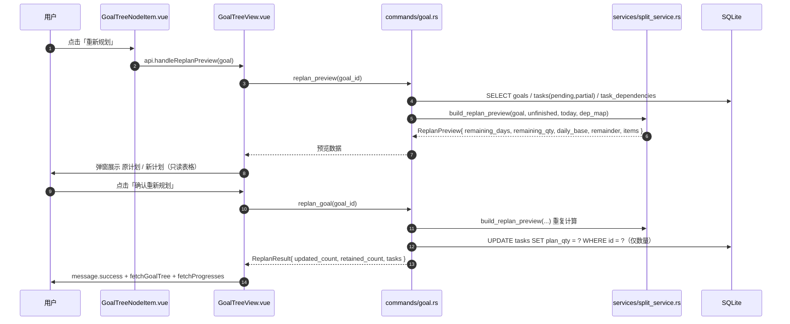

已实现的要素清单：

| 能力 | 代码位置 | 说明 |
|------|----------|------|
| 预览计算 | `split_service::build_replan_preview`（`split_service.rs:372`） | 单目标、按剩余天数均分剩余总量 |
| 手动任务保留 | `is_manual == 1` 过滤（`split_service.rs:392-401`） | 用户在任务编辑中改动 `plan_qty` 即置位（`task.rs:428,490`） |
| 依赖拓扑排序 | `dependency_service::topo_sort_by_dependency`（`dependency_service.rs:144`） | Kahn 算法，同层按 `sort_order` 稳定排序，环兜底 |
| 余数分配 | 余数优先分给拓扑序靠前的任务（`split_service.rs:466-470`） | 只影响数量，不影响日期 |
| 跨目标负载感知 | `get_daily_load`（`stats.rs:443`）、`DailyLoad`/`GoalLoad` 模型 | 仅用于日历色阶与拆解前**警告**，不参与规划 |
| 速度预测 | `get_completion_prediction`（`stats.rs:199-420`） | EWMA 无关的 7 日算术平均，仅用于文案提示 |
| 触发方式 | `GoalTreeNodeItem.vue:470-480` | 单一手动入口，`:disabled="!node.goal.deadline"` |

#### 1.1.2 现有算法形式化描述

设目标 $g$ 的总量为 $T$，截止日期为 $D$，今天为 $t_0$，未完成任务集合 $U = \{u_1,\dots,u_n\}$（`status IN ('pending','partial')`），手动任务集合 $M \subseteq U$。

现有算法为：

$$
\text{remaining\_days} = D - t_0, \qquad
Q = T - \sum_{m \in M} m.\text{plan\_qty}
$$

$$
\text{daily\_base} = \left\lfloor \frac{Q}{n - |M|} \right\rfloor, \qquad
r = \text{round}\left(Q - \text{daily\_base} \cdot (n - |M|)\right)
$$

对拓扑序第 $i$ 个待重排任务（$0$-based）：

$$
\text{new\_plan\_qty}_i =
\begin{cases}
\text{daily\_base} + 1, & i < r \\
\text{daily\_base}, & \text{otherwise}
\end{cases}
$$

落库副作用：`UPDATE tasks SET plan_qty = ?`，**不修改 `plan_date`**。

该算法是"**按任务条数均分剩余总量**"，其隐含假设是"每个任务恰好占用一天"，与真实业务中的半天任务、隔日任务、依赖串行、多目标并行天然冲突。

#### 1.1.3 现状问题清单（代码级证据）

| 编号 | 问题 | 证据 | 业务后果 |
|------|------|------|----------|
| **G-01** | **历史完成量未回填，剩余量虚高** | `split_service.rs:404` 硬编码 `let completed_qty: f64 = 0.0;`，注释承认"已完成任务不在 unfinished_tasks 中" | 已完成 80% 的目标重新规划后，剩余总量仍按 100% 计算，新计划量整体偏大 |
| **G-02** | **部分完成量被丢弃** | 查询含 `status='partial'`（`goal.rs:857`），但 `Q` 只扣减手动任务 `plan_qty`，未扣 `actual_qty` | 已完成一半的任务被要求重做全部工作量 |
| **G-03** | **分配天数口径错误** | `replan_days = to_replan.len()`（`split_service.rs:416`）用任务条数当可用天数 | 40 个任务 / 剩 5 天 ⇒ 每天 8 个任务，彻底过载；10 个任务 / 剩 30 天 ⇒ 只用 10 天，剩余 20 天空置 |
| **G-04** | **不改计划日期，无法消化逾期** | `replan_goal` 仅 `UPDATE ... SET plan_qty`（`goal.rs:901`） | 逾期任务永远停留在过去日期，重新规划无法"赶回进度" |
| **G-05** | **不支持时间窗与产能约束** | 无 `estimated_hours` 参与运算；`daily_capacity` 完全未被 `build_replan_preview` 读取 | 时间预算型目标（`by_capacity` 拆解的）重新规划后退化为数量均分，语义丢失 |
| **G-06** | **依赖仅排序，未约束日期** | `topo_sort_by_dependency` 输出只用于决定余数归属 | 前置任务被排到后继任务之后，而 `complete_task` 有硬阻塞校验（`task.rs:90`）⇒ **用户被死锁** |
| **G-07** | **单目标视野，多目标不协同** | `replan_preview(goal_id)` 作用域仅单目标 | 多目标同日叠加过载，`get_daily_load` 报警后用户无处置手段 |
| **G-08** | **无自动触发，纯手动** | 仅 `GoalTreeNodeItem.vue` 按钮；且**无截止日期时按钮禁用** | 无 deadline 目标的逾期累积无人治理；滞后发现依赖用户主动查看 |
| **G-09** | **无个性化，参数为常数** | 无用户画像、无节奏偏好；`is_manual` 是唯一人工信号 | 无法表达"周末可用、工作日只能 1 小时""偏好上午"等真实约束 |
| **G-10** | **无决策留痕，不可回滚** | 无 replan 历史表，成功后仅 `message.success` | 误操作不可撤销；无法回答"为什么这天变成 12 个" |
| **G-11** | **预览无价值信息，无 what-if** | `ReplanPreviewItem` 仅 `old/new_plan_qty`（`models.rs:467-476`），只读表格 | 用户无法预判改动对日历的影响，只能"盲确认" |
| **G-12** | **预览与执行重复计算，存在竞态** | `replan_preview` 与 `replan_goal` 各自调用一次 `build_replan_preview`（`goal.rs:865` / `891`） | 两次计算间数据变化则预览与实际不符；且规划无幂等保证 |
| **G-13** | **子目标树结构未参与规划** | `replan_preview` 只取 `goal_id = ?` 的直属任务 | 父目标重新规划忽略子目标任务，树级进度仍失衡 |
| **G-14** | **大数据量无验收指标** | 无性能测试；预览项逐条渲染 `NDataTable` | 500 任务目标预览卡顿风险 |

### 1.2 业务场景与需求

#### 1.2.1 场景矩阵

下表为重构必须覆盖的真实业务场景，编号 `SC-xx` 在后续各章（算法、界面、测试、验收）中逐项追溯。

| 编号 | 场景名称 | 触发情境 | 现状表现 | 目标表现 |
|------|----------|----------|----------|----------|
| **SC-01** | 阶段性冲刺（考研/考证） | 3 个月前定 200 小时，已学 90 小时，剩 45 天 | G-01/G-02：剩余按 200 算 | 按剩余 110 小时、按 45 天可用容量重排，输出每日时长 |
| **SC-02** | 连续中断后恢复 | 出差 7 天，累积 12 个逾期任务 | G-04：逾期任务日期不动 | 逾期任务自动前移，并在不破坏截止日的前提下稀释到剩余天数 |
| **SC-03** | 依赖链刚性（课程 A→B→C） | C 需 B 完成后开始 | G-06：可能把 C 排到 B 之前 | 依赖边生成日期下界约束，保证 `plan_date(B) < plan_date(C)` |
| **SC-04** | 多目标并行 | 考研 + 健身 + 副业三门目标同一天叠加 | G-07：各自独排，单日 9+ 任务 | 跨目标公平分摊每日配额，单日负载 ≤ 用户上限 |
| **SC-05** | 时间预算型目标 | 每日仅 2 小时可投入 | G-05：重新规划按"数量"均分 | 按 `estimated_hours` / `daily_capacity` 分摊，尊重产能 |
| **SC-06** | 周末型学习者 | 仅周末有 4 小时，工作日 0.5 小时 | G-09：无法表达 | 按 weekday 节奏画像分配，周末多排 |
| **SC-07** | 长期无截止目标 | 目标未设 deadline | G-08：按钮禁用，无法规划 | 引入滚动窗口（默认 30 天），持续滚动规划 |
| **SC-08** | 临时插入高优任务 | 中途加入"模考"需 5 小时 | 无处置手段 | 支持锁定既有任务，仅重排未锁定部分 |
| **SC-09** | 超额完成者再平衡 | 本周提前完成，后续天可减负 | 无自动适应 | 事件触发再规划，自动松弛后续负载 |
| **SC-10** | 频繁改期（抖动） | 反复编辑任务导致反复重排 | 无自动触发，尚不显现 | 幂等 + 迟滞 + 冷却期，避免计划抖动 |
| **SC-11** | 目标改期 | 截止日从 6/30 延至 8/31 | 需手动重新规划且语义不清 | 改期事件自动触发，预览差异并一键应用 |
| **SC-12** | 冲突不可行 | 剩 100 小时、只剩 10 天、每日最多 2 小时 | 不检测，静默产出荒谬计划 | 提前判定不可行，给出三选一处置（延期/提高强度/裁剪范围） |

#### 1.2.2 功能性需求

| 编号 | 需求 | 优先级 | 覆盖场景 | 对应问题 |
|------|------|--------|----------|----------|
| **FR-1** | 重新规划须按**真实剩余工作量**计算：`剩余量 = Σplan − Σactual`，覆盖全部状态任务 | P0 | SC-01, SC-09 | G-01, G-02 |
| **FR-2** | 重新规划须按**真实可用容量**分配：可用天数 × 每日额度（时长或数量），而非任务条数 | P0 | SC-01, SC-05 | G-03 |
| **FR-3** | 重新规划须可**调整计划日期**，支持逾期任务的日期前移与负载稀释 | P0 | SC-02 | G-04 |
| **FR-4** | 依赖关系须转化为**日期约束**，保证前置任务完成日期 ≤ 后继任务开始日期 | P0 | SC-03 | G-06 |
| **FR-5** | 可行性须**前置判定**；不可行时给出结构化处置方案而非静默输出 | P0 | SC-12 | G-05, G-07 |
| **FR-6** | 支持**跨目标协同规划**：多目标共享每日配额，按公平算法分摊 | P1 | SC-04 | G-07 |
| **FR-7** | 支持**事件驱动自动触发**：任务变更、逾期累积、目标改期、周期性复评 | P1 | SC-08, SC-09, SC-11 | G-08 |
| **FR-8** | 支持**个性化规划**：学习节奏画像（可用时长节奏）、强度偏好、连续性偏好、锁定偏好 | P1 | SC-06 | G-09 |
| **FR-9** | 支持**无截止日目标**的滚动窗口规划 | P1 | SC-07 | G-08 |
| **FR-10** | 支持**任务锁定**（`schedule_locked`），锁定项在重排中保持不变 | P1 | SC-08 | — |
| **FR-11** | 重新规划须**幂等**：相同输入产出相同结果；重复执行不产生副作用 | P0 | SC-10 | G-12 |
| **FR-12** | 须有**决策留痕与回滚**：记录触发原因、输入摘要、变更 diff，支持撤销 | P1 | 全部 | G-10 |
| **FR-13** | 预览须提供**影响可视化**：日历负载前后对比、按变更类型筛选、逐项 accept/reject | P1 | SC-04, SC-12 | G-11 |
| **FR-14** | 支持**what-if 仿真**：调整参数（截止日/每日容量/强度）即时重算预览，不落库 | P2 | SC-12 | G-11 |
| **FR-15** | 大数据量下预览须**流畅**：500 任务目标预览 P95 < 200 ms | P1 | — | G-14 |

#### 1.2.3 非功能性需求

| 维度 | 指标 | 说明 |
|------|------|------|
| 性能 | 单目标 500 任务重排 < 200 ms；跨目标 10 目标 / 2000 任务 < 800 ms | 桌面端单机 SQLite，纯内存求解 |
| 确定性 | 相同 `(snapshot, profile, policy)` 必产出**逐字节一致**的 `Plan` | 禁止哈希序迭代（现有 `HashMap` 使用需审查） |
| 幂等性 | 同一 `snapshot_hash` 重复触发只落库一次 | 触发层去重 |
| 可解释 | 每个排期决策可输出人类可读理由链 | 支撑 UI 与信任 |
| 可逆 | 每次 replan 生成反向 diff，支持一键撤销 | `replan_events` |
| 兼容 | 旧库升级后旧功能语义不劣化；旧备份可导入 | 迁移 021+ 全部带默认值 |
| 安全 | 新入参全部接入 `validator` 校验；SQL 全部 bind 参数化 | 延续 `S-05 (SEC-M-05)` 约束 |
| 可测试 | 核心求解器为**纯函数**，无 IO，可属性测试 | 见 §7.2 |

### 1.3 需求追溯矩阵

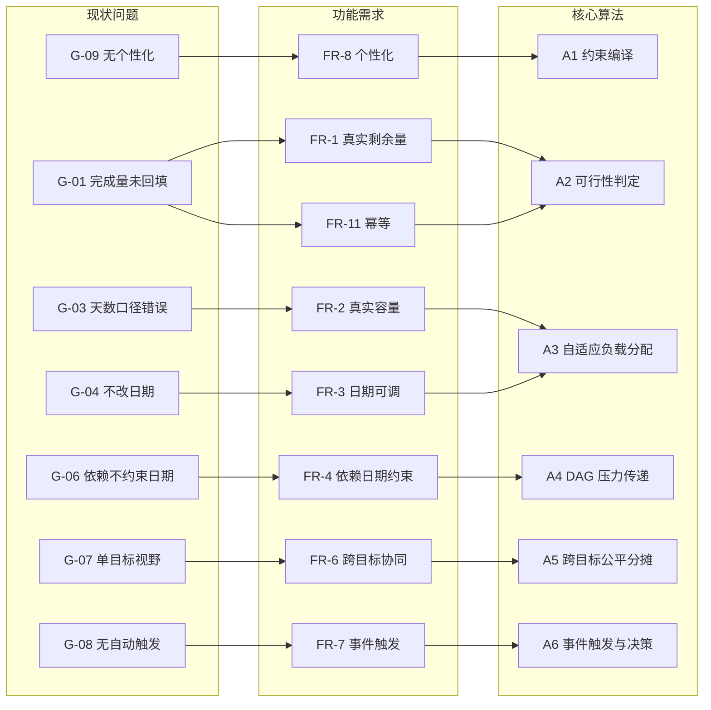

---

## 2. 系统架构设计

### 2.1 设计原则

| 原则 | 含义 | 落地手段 |
|------|------|----------|
| **求解器纯函数化** | 核心规划不碰数据库、不读时钟、不生成 UUID | `fn solve(snapshot, profile, policy, today) -> Plan` |
| **快照与规划分离** | 数据加载与算法求解解耦 | `PlanSnapshot` 聚合根 |
| **触发与执行分离** | 何时规划 ≠ 如何规划 | `TriggerGateway` → `ReplanPipeline` |
| **预览与提交同源** | 预览即"计划"，提交即"应用" | 一次求解 + `plan_hash` 校验 |
| **可解释优先** | 每个决策携带理由 | `DecisionTrace` |
| **渐进增强** | 旧命令保持兼容，新引擎以新命令并行上线 | 保留 `replan_preview` / `replan_goal` 语义 |

### 2.2 分层架构

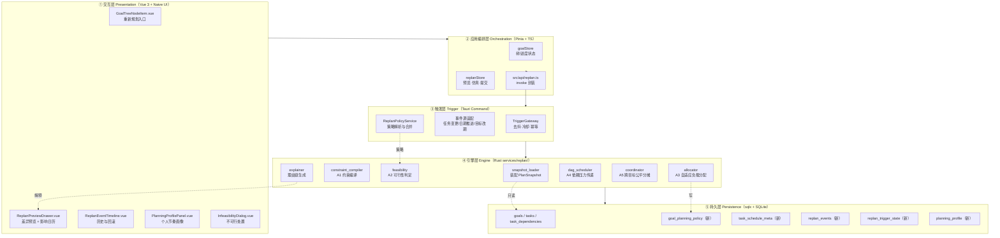

### 2.3 核心组件职责

| 组件 | 文件（新增/改造） | 职责 | 输入 | 输出 |
|------|-------------------|------|------|------|
| `TriggerGateway` | `services/replan/trigger.rs` | 事件归一、去抖、冷却判定、幂等键生成 | `ReplanTriggerEvent` | `Option<ReplanRequest>` |
| `ReplanPolicyService` | `services/replan/policy.rs` | 三级策略合并（全局默认 ← 目标策略 ← 本次覆盖） | `goal_id`, `PolicyOverride` | `EffectivePolicy` |
| `snapshot_loader` | `services/replan/snapshot.rs` | 一次性装配目标子树 + 任务 + 依赖 + 画像 + 外部负载 | `goal_id` / `scope` | `PlanSnapshot` |
| `constraint_compiler` | `services/replan/constraint.rs` | 生成可用日集合、每日额度、锁定集合、依赖下界 | `PlanSnapshot` | `ConstraintSet` |
| `feasibility` | `services/replan/feasibility.rs` | 容量充分性判定 + 处置候选生成 | `ConstraintSet` | `FeasibilityReport` |
| `allocator` | `services/replan/allocator.rs` | 加权公平配额 + 余数分配 + 平滑 | `ConstraintSet` | `Vec<DayQuota>` |
| `dag_scheduler` | `services/replan/dag.rs` | 依赖下界传播、拓扑分配、日期回填 | `Vec<DayQuota>`, DAG | `Vec<TaskPlacement>` |
| `coordinator` | `services/replan/coordinator.rs` | 跨目标最大最小公平分摊 + 迭代再平衡 | 多目标请求 | `MultiGoalPlan` |
| `explainer` | `services/replan/explain.rs` | 变更理由链、影响统计 | `Plan` | `DecisionTrace` |
| `planner`（门面） | `services/replan/mod.rs` | 编排全流程，暴露 `solve()` 纯函数 | `PlanSnapshot`, `EffectivePolicy` | `Plan` |

### 2.4 关键设计决策

| 决策 | 选项 A | 选项 B | 选择 | 理由 |
|------|--------|--------|------|------|
| 求解范式 | 贪心逐日填充 | 全局最优（LP/CP-SAT） | **A（贪心 + 迭代精化）** | 无外部依赖、可确定、可解释、毫秒级；引入求解器违背桌面端轻量约束 |
| 日期分配粒度 | 连续实数分配 | 离散到日 | **B** | `plan_date` 为离散 TEXT，且用户按天执行 |
| 依赖处理 | 求解后校验重试 | 编译期生成日期下界 | **B** | 一次性保证可行，避免重试不收敛 |
| 跨目标协同 | 全局单次求解 | 分治：先分摊配额再各自求解 | **B** | 保留单目标求解器复用性；用外层迭代修正偏差 |
| 预览与执行 | 两次独立计算 | 一次计算 + `plan_hash` 校验 | **B** | 消除 G-12 竞态；`plan_hash` 不匹配则拒绝提交并提示刷新 |
| 算法落点 | 前端 TS | 后端 Rust | **后端 Rust** | 与现有 `split_service` 一致；纯函数便于属性测试；避免前端重复实现 |
| 兼容策略 | 原地替换旧命令 | 新增命令 + 旧命令转调 | **B** | 旧前端/旧备份不炸；旧命令内部改调新引擎以获得 G-01/G-02 修复 |

### 2.5 规划流水线

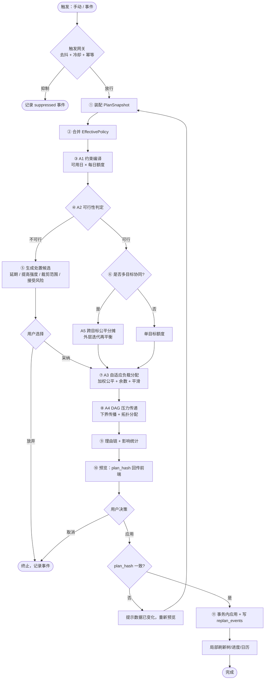

---

## 3. 核心算法说明

> 本章所有算法均定义在 `src-tauri/src/services/replan/`，**纯函数、无 IO、无时钟依赖**。`today` 由调用方注入。

### 3.1 统一术语与数据结构

```text
PlanSnapshot                       // 输入聚合根（只读）
├─ today: NaiveDate
├─ root_goal: Goal                // 规划根（可为总目标，递归含子树）
├─ goals: Vec<Goal>               // 子树内全部目标（含 root）
├─ tasks: Vec<Task>               // 子树内全部任务 + 外部同窗口任务（用于负载）
├─ deps: HashMap<TaskId, Vec<TaskId>>   // task → 其前置集合
├─ profile: PlanningProfile       // 用户节奏画像
├─ policy: EffectivePolicy        // 已合并策略
└─ external_load: HashMap<Date, f64>    // 规划范围外目标的既有日负载

EffectivePolicy
├─ intensity: f64                 // 强度系数 0.5~1.5
├─ max_daily_hours: Option<f64>   // 单日硬上限（小时）
├─ max_daily_tasks: Option<f64>   // 单日硬上限（任务条数）
├─ prefer_contiguous: bool        // 偏好连续排期（减少碎片日）
├─ rest_days: Vec<u8>             // 休息日（0=周日）
├─ window_cap_days: u32           // 无 deadline 时的滚动窗口上限，默认 30
├─ smoothing: SmoothingPolicy     // 平滑与迟滞参数
└─ respect_locks: bool            // 是否尊重 schedule_locked

ConstraintSet                      // A1 输出
├─ horizon: Vec<DaySlot>          // 有序可用日
├─ total_capacity: f64            // Σ 每日额度
├─ locked: HashSet<TaskId>
└─ dep_lower_bound: HashMap<TaskId, Date>  // 依赖下界

DaySlot
├─ date: NaiveDate
├─ capacity: f64                  // 当日额度（小时或数量，由 unit_mode 决定）
├─ reserved: f64                  // 已被锁定/外部占用的额度
├─ available: f64 = capacity - reserved
├─ weight: f64                    // 当日可加权（强度 × 节奏）
└─ is_rest: bool

Plan                               // 输出
├─ goal_id: String
├─ feasible: bool
├─ placements: Vec<TaskPlacement>
├─ day_load: BTreeMap<Date, f64>
├─ warnings: Vec<PlanWarning>
├─ traces: Vec<DecisionTrace>
└─ plan_hash: String              // 内容摘要，用于提交校验
```

### 3.2 A1 约束编译算法

**目的**：把"日历 + 用户节奏 + 目标策略 + 既有占用"编译成逐日的可用额度序列，替代现有的"任务条数当天数"（G-03）。

**输入**：`PlanSnapshot`　**输出**：`ConstraintSet`

```text
算法 A1 compile_constraints(S) -> ConstraintSet
 1  horizon_end ← S.root_goal.deadline
 2  if horizon_end = None then
 3      horizon_end ← S.today + S.policy.window_cap_days        // FR-9 滚动窗口
 4  else
 5      horizon_end ← max(horizon_end, S.today + 1)              // 保底 1 天
 6
 7  units_mode ← resolve_unit_mode(S.root_goal)                  // Hours | Quantity
 8  days ← []
 9  for d ← S.today + 1 to horizon_end do                        // 与现有「从明天开始」一致
10      if is_rest_day(d, S.policy, S.profile) then
11          days.push(DaySlot{ date: d, capacity: 0, weight: 0, is_rest: true })
12          continue
13      // 节奏画像：周内基准 × 周末系数 × 强度系数
14      base ← S.profile.weekday_hours[d.weekday]                // 缺省回退 daily_capacity
15      raw  ← base × S.profile.weekend_factor[d.weekday] × S.policy.intensity
16      cap  ← min(raw, S.policy.max_daily_hours ?? +inf,
17                      S.policy.max_daily_tasks ?? +inf)
18      res  ← S.external_load[d] + Σ locked_task_on(d).cost
19      days.push(DaySlot{ date: d, capacity: cap, reserved: res,
20                         available: max(0, cap - res),
21                         weight: cap, is_rest: false })
22
23  // 目标自身已排在同窗口的完成/锁定任务也要计入 reserved（由 loader 提供）
24  total_capacity ← Σ days.available
25
26  // 依赖下界：deps 闭合后取 max(前置最晚日 + 1)
27  dep_lb ← compute_dep_lower_bounds(S.deps, S.tasks)
28  return ConstraintSet{ days, total_capacity, locked: S.locked_ids, dep_lb }
```

**关键点**

1. **单位模式判定** `resolve_unit_mode`：若目标或任一子目标存在 `daily_capacity` 或 `estimated_hours` 数据，则为 `Hours`，否则 `Quantity`。这样 SC-05 时间预算型目标保留语义，而纯数量型目标（未设置时长）行为与旧版一致。
2. **`reserved` 是跨目标协同的锚点**：外部目标的既有负载不进入本次分配，但占用当日额度（SC-04）。
3. **`rest_days` 优先于一切**：休息日容量强制为 0，不允许被强度系数放大。
4. **复杂度**：$O(H + |E|)$，其中 $H$ 为窗口天数（≤ 366），$|E|$ 为依赖边数。

### 3.3 A2 可行性判定算法

**目的**：前置拦截 SC-12，杜绝静默产出荒谬计划（G-05）。

**判定条件**：设剩余工作量 $W$、可用总容量 $C$、依赖链关键路径长度 $L_{\text{crit}}$、窗口天数 $H$：

$$
\text{feasible} \iff W \le C \;\wedge\; L_{\text{crit}} \le H_{\text{avail}}
$$

```text
算法 A2 check_feasibility(S, CS, W) -> FeasibilityReport
 1  C ← CS.total_capacity
 2  if W > C then
 3      deficit ← W - C
 4      return Infeasible {
 5          reason: CapacityShortfall,
 6          deficit,
 7          // 处置候选 1：需要的最小延期天数
 8          options: [
 9            ExtendDeadline{
10               days: ceil(deficit / avg_daily_available(CS)),
11               new_deadline: CS.horizon.last.date + days
12            },
13            RaiseIntensity{
14               min_intensity: S.policy.intensity × W / C,     // 建议强度倍率
15               capped: min_intensity > 1.5                   // 超上限需用户显式确认
16            },
17            TrimScope{
18               // 保持 horizon 不变时可承载的最大工作量
19               max_workload: C,
20               suggested_cut: W - C
21            }
22          ]
23      }
24
25  // 关键路径检查（A4 预演，仅算长度不算分配）
26  L_crit ← longest_chain_length(S.deps, S.tasks)      // 节点数
27  H_avail ← count(x ∈ CS.horizon where x.available > 0)
28  if L_crit > H_avail then
29      return Infeasible { reason: DependencyChainTooLong,
30                          chain_len: L_crit, available_days: H_avail,
31                          options: [ExtendDeadline{...}, TrimScope{...}] }
32
33  // 裕度评估：用于 UI 提示"紧/松"
34  slack ← if C > 0 { (C - W) / C } else { 0.0 }
35  level ← if slack < 0.05 { Tight } else if slack < 0.25 { Normal } else { Relaxed }
36  return Feasible { slack, level, total_workload: W, total_capacity: C }
```

**关键点**

- `W` 的**正确口径**是修复 G-01/G-02 的核心：

$$
W = \sum_{t \in \text{active}(S)} \max(0,\; t.\text{plan\_qty} - t.\text{actual\_qty})
$$

其中 $\text{active}(S)$ 为 `status NOT IN ('done','skipped')` 的任务集合。`done` 任务的 `actual_qty` 已在历史中，`skipped` 视为不存在（与 `progress_service` 口径一致）。

- **`TrimScope` 与 `RaiseIntensity` 互斥域**：若 `min_intensity > policy.max_intensity_hard`（默认 1.5），只保留 `ExtendDeadline` 与 `TrimScope`，避免系统静默鼓励过度投入。

### 3.4 A3 自适应负载分配算法

**目的**：在可用日之间做**加权公平分摊**，修复 G-03，并支持个性化节奏（G-09）。

#### 3.4.1 加权公平配额

设可用日 $i \in [1,H]$，权重 $w_i$（= `DaySlot.weight`，即当日可承载能力），总权重 $W_{\text{sum}} = \sum w_i$。

基础配额（最大余数法 / Hare quota）：

$$
q_i = \frac{W \cdot w_i}{W_{\text{sum}}}, \qquad
a_i = \lfloor q_i \rfloor, \qquad
f_i = q_i - a_i
$$

余数分配按**小数部分降序**，平局按**日期升序**：

$$
R = W - \sum_i a_i \quad (\text{整数化后的待分配余数})
$$

取 $f$ 降序的前 $R$ 个日各 $+1$。

> 与现有算法对比：旧算法余数给"拓扑序靠前的任务"，新算法余数给"小数部分最大且更早的日期"，语义从"按任务"转为"按日"，且天然满足 $\sum_i a_i + R = W$ 的守恒。

#### 3.4.2 平滑与迟滞（防抖动，SC-10）

对每个任务的**已排日** $d_{\text{old}}$ 与新分配日 $d_{\text{new}}$，引入迁移代价：

$$
\text{cost}(t) = \alpha \cdot \mathbb{1}[d_{\text{new}} \ne d_{\text{old}}] \cdot \text{age}(t) + \beta \cdot |qty_{\text{new}} - qty_{\text{old}}|
$$

**迟滞规则**（`SmoothingPolicy`）：

| 参数 | 默认 | 作用 |
|------|------|------|
| `qty_change_threshold` | 0.15（相对变化） | 变化幅度小于 15% 不调整该任务 |
| `date_move_threshold_days` | 1 | 日期只挪动 1 天且非逾期，则不挪 |
| `cooldown_hours` | 6 | 同一目标两次自动重排最小间隔 |
| `max_moves_per_run` | 30% | 单次重排最多迁移的任务比例，超出则按 cost 升序截断 |

```text
算法 A3 allocate_weights(CS, W, policy) -> Vec<DayQuota>
 1  avail ← [x for x in CS.horizon if x.available > 0 and not x.is_rest]
 2  if avail is empty then return Err(NoAvailableDay)
 3  Wsum ← Σ x.weight for x in avail
 4  if Wsum <= 0 then Wsum ← len(avail); set all weight ← 1   // 退化兜底
 5  for i, x in avail:
 6      q[i] ← W × x.weight / Wsum
 7      a[i] ← floor(q[i]); f[i] ← q[i] - a[i]
 8  R ← W - Σ a[i]                                           // 整数余数
 9  order ← sort avail by (f desc, date asc)
10  for k ← 0 to R-1: a[order[k]] ← a[order[k]] + 1
11  // 硬上限裁剪与再分配（迭代直到收敛或达上限）
12  loop up to MAX_ITER(=64):
13      over ← [i where a[i] > avail[i].available]
14      if over is empty then break
15      surplus ← Σ (a[i] - avail[i].available) for i in over
16      set a[i] ← avail[i].available for i in over
17      redistribute surplus to 未饱和日 by (weight desc, date asc) 比例分配，重复步骤 6-10
18  return [DayQuota{ date, qty: a[i] }]
```

**复杂度**：主体 $O(H \log H)$，裁剪迭代最坏 $O(H \log H \cdot \text{MAX\_ITER})$，实测 $H \le 366$ 时可忽略。

**个性化注入点**（FR-8）：`weight` 的构成直接体现画像——工作日 1 h vs 周末 4 h 时，周末日配额自然是工作日的 4 倍（SC-06）；`rest_days` 直接剔除（容量 0）；`intensity` 全局缩放。

### 3.5 A4 DAG 依赖压力传递算法

**目的**：把依赖从"排序提示"升级为"日期硬约束"，修复 G-06 的死锁风险。

**核心思想**：前向传播**最早可开始日下界**，分配时以拓扑序消费配额，并保证后继任务不早于前置任务完成日。

```text
算法 A4 schedule_dag(tasks, deps, quotas, CS, locked) -> Vec<TaskPlacement>
 1  order ← kahn_topological(tasks, deps)         // 复用 topo_sort_by_dependency 语义
 2  if order.len() < tasks.len() then
 3      return Err(CycleDetected)                  // 防御：set_task_dependency 已防环
 4
 5  est ← HashMap<TaskId, Date>                    // 最早可开始日
 6  for t in tasks: est[t] ← S.today + 1
 7  for t in order:                                // 拓扑序：前置必先于后继
 8      for p in deps[t]:
 9          est[t] ← max(est[t], finish_date(p) + 1)     // 前置完成后次日
10
11  placements ← []
12  // 已锁定任务先占位：消耗对应日配额，形成 reserved
13  for t in locked ∩ tasks:
14      d ← t.plan_date
15      placements.push(Placement{ t, d, qty: t.plan_qty, locked: true, reason: Locked })
16      quotas[d].qty ← max(0, quotas[d].qty - t.cost)
17      est[t] ← d; finish_date(t) ← d
18
19  for t in order:                                // 拓扑序分配
20      if t ∈ locked then continue
21      d ← first day in quotas (从 est[t] 起, 日期升序) with quotas[d].qty > 0
22      if d is None then
23          // 尾部溢出：允许突破每日上限，但记 warning（不可行应由 A2 拦截）
24          d ← quotas.last.date; warnings.push(OverflowTail{ t.id })
25      qty ← min(t.cost, quotas[d].qty)
26      if qty < t.cost then
27          // 剩余量顺延到后续日（稀疏日场景）
28          split_remainder(t, d, qty, quotas, placements)
29      placements.push(Placement{ t, d, qty, reason: DepLowerBound(est[t]) })
30      quotas[d].qty ← quotas[d].qty - qty
31      finish_date(t) ← d                            // 单日完成任务
32
33  // 逾期任务优先压力：plan_date < today 的任务下界强制为 today+1
34  apply_overdue_pull(placements, S.today)           // 修复 G-04
35  return placements
```

**关键点**

| 机制 | 说明 | 覆盖 |
|------|------|------|
| `est[t]` 下界传播 | 保证 `plan_date(p) < plan_date(t)`，与 `complete_task` 的阻塞校验一致 | SC-03, G-06 |
| 拓扑序消费配额 | 前置任务优先拿到更早的日期，避免"后置任务抢占早期额度" | G-06 |
| 锁定任务预占位 | 锁定项先落位并扣减配额，重排只动未锁定部分 | SC-08, FR-10 |
| 逾期前移 `apply_overdue_pull` | `plan_date < today` 的未完成任务下界置为 `today + 1`，从而**真正改写 `plan_date`** | SC-02, G-04 |
| 尾部溢出告警 | A2 已拦截不可行，此分支仅防御性兜底，必须产生 `PlanWarning` 供 UI 展示 | SC-12 |
| 单日完成不变式 | 每个任务只在一天完成（与现有 `plan_date` 单值模型一致） | 兼容性 |

**复杂度**：$O(|V| + |E| + |V| \cdot H)$ 最坏，实际因配额递减近似 $O(|V| + |E|)$。

### 3.6 A5 跨目标协同规划算法

**目的**：多目标共享每日额度，修复 G-07，落地 SC-04。

**分治策略**：外层按目标做**最大最小公平（Max-Min Fairness）**的日额度分摊，内层调用单目标 A3+A4；迭代修正偏差。

```text
算法 A5 coordinate(requests[], global_cap_by_day) -> MultiGoalPlan
 1  // 阶段一：计算各目标的需求权重
 2  for r in requests:
 3      W[r.goal] ← Σ max(0, plan_qty - actual_qty)          // 剩余工作量
 4      Pri[r.goal] ← r.root_goal.priority ?? 1.0           // 目标优先级（新增字段）
 5  // 阶段二：最大最小公平分摊每日额度
 6  alloc ← { }                                            // (goal, date) -> quota
 7  for d in global_cap_by_day.dates:
 8      # 目标按当前满足率升序，逐个喂饱直到当日额度耗尽
 9      demand ← sort requests by (W[g] / Pri[g]) desc
10      remaining ← global_cap_by_day[d] - external_reserved[d]
11      while remaining > 0 and demand is not empty:
12          g ← demand.next_round_robin()                    // 轮转，保证小目标不被饿死
13          take ← min(remaining, fair_share(g, d))
14          alloc[g][d] ← alloc[g][d] + take
15          remaining ← remaining - take
16
17  // 阶段三：各目标内部求解
18  for r in requests:
19      CS_r ← A1.compile(r.snapshot, quotas = alloc[r.goal])
20      plan_r ← A3 + A4
21      if plan_r 有 OverflowTail warning then
22          shortfall[r.goal] ← plan_r.overflow_qty
23
24  // 阶段四：迭代再平衡（最多 MAX_ROUNDS = 5 轮）
25  for round ← 1 to MAX_ROUNDS:
26      if Σ shortfall = 0 then break
27      donors ← [g where slack[g] > 0]                      // 有余量的目标
28      if donors is empty then break                        // 全局不可行，交 A2 报告
29      transfer ← min(Σ shortfall, Σ slack[donors])
30      reducer 按 donor 的 slack 比例扣减其日额度
31      augment 按 shortfall 比例增加缺口目标的日额度
32      重算受影响目标的 A3+A4
33
34  return MultiGoalPlan{ per_goal: plans, global_day_load, fairness_index }
```

**公平性度量**：采用 Jain 公平指数评估分摊质量

$$
\mathcal{J}(x_1,\dots,x_n) = \frac{\left(\sum_i x_i\right)^2}{n \sum_i x_i^2}, \qquad x_i = \frac{\text{已分配}_i}{\text{需求}_i}
$$

- $\mathcal{J} = 1$：完全公平；$\mathcal{J} \to 1/n$：极度不公。
- 验收要求：$n \ge 3$ 时 $\mathcal{J} \ge 0.85$。

**关键点**

- **轮转而非一次性分完**：避免小目标（需求 2 h）在大目标（需求 200 h）面前被完全饿死。
- **迭代再平衡上限 5 轮**：保证终止性与性能；不收敛时输出 `fairness_index` 与 `PlanWarning`，由 UI 提示用户手动裁决。
- **`external_reserved` 兼容既有实现**：直接复用 `get_daily_load`（`stats.rs:443`）的按日聚合结果，无需新查询。

### 3.7 A6 事件触发与决策引擎

**目的**：从"用户想起来才点"升级为"系统感知变化主动规划"，修复 G-08。

#### 3.7.1 事件模型

| 事件类型 | 来源 | 触发条件 | 默认动作 |
|----------|------|----------|----------|
| `TaskCompleted` | `complete_task` 后置钩子 | 完成量 ≥ 当日计划 120% | 静默**松弛**后续负载（降低后续日配额） |
| `TaskSkipped` | `skip_task` 后置钩子 | 累计跳过 ≥ 3 个 | 触发**再分配**（跳过量转为剩余量） |
| `OverdueAccumulated` | 每日首启 / 日期推进 | 逾期任务数 ≥ `overdue_threshold`（默认 3） | 触发**逾期回收**规划 |
| `GoalDeadlineChanged` | `update_goal` 后置钩子 | deadline 变动 ≥ 1 天 | 触发**全量重排** |
| `GoalTotalChanged` | `update_goal` 后置钩子 | total_qty 变动 | 触发**全量重排** |
| `ProgressLag` | 与 `get_completion_prediction` 联动 | `need_speed` 状态出现 | 触发**提速建议**（不自动改计划） |
| `LoadOverload` | 与 `get_daily_load` 联动 | 单日负载 ≥ 阈值 | 触发**跨目标再平衡** |
| `PeriodicReview` | 每日首次启动 | 距上次自动规划 ≥ 24 h | 触发**滚动窗口复评** |
| `ManualRequest` | UI 按钮 | 用户点击 | 全量重排（尊重锁定） |

#### 3.7.2 决策引擎伪代码

```text
算法 A6 should_replan(event, state) -> Decision{ Proceed | Suppress(reason) | AutoApply }
 1  if event.severity = Info then return Suppress(NotActionable)
 2  goal ← load_goal(event.goal_id)
 3  if goal.auto_replan = false and event.type ≠ ManualRequest then
 4      return Suppress(AutoReplanDisabled)                 // 用户关闭自动规划
 5  // 冷却期：阻止抖动
 6  last ← state.last_auto_replan_at[goal.id]
 7  if last ≠ None and now - last < policy.cooldown_hours then
 8      return Suppress(Cooldown{ remaining: ... })
 9  // 幂等：snapshot 未变化则不重复规划
10  h ← snapshot_hash(load_snapshot(goal.id))
11  if h = state.last_snapshot_hash[goal.id] then
12      return Suppress(NoMaterialChange)
13  // 影响面评估：变化太小则不做全量重排
14  impact ← estimate_impact(event, goal)                  // 受影响任务数 / 总量占比
15  if impact.ratio < policy.min_impact_ratio(默认 0.10) then
16      return Suppress(BelowImpactThreshold)
17  // 自动应用 vs 待确认
18  if event.type ∈ policy.auto_apply_events and goal.auto_apply = true then
19      return AutoApply{ plan_hash: h }
20  return Proceed{ reason: event.type, plan_hash: h }
```

#### 3.7.3 触发状态机

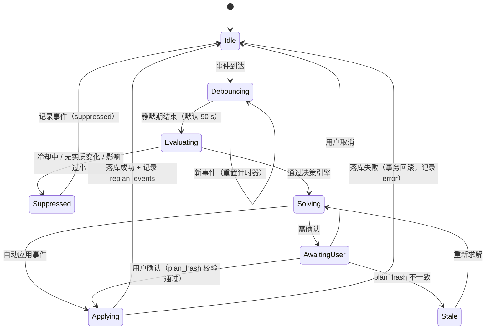

### 3.8 算法对比总览

| 维度 | 现有算法 | 新引擎 | 改进幅度 |
|------|----------|--------|----------|
| 剩余量口径 | $\sum \text{plan\_qty}$（忽略已完成与部分完成） | $\sum \max(0, \text{plan}-\text{actual})$ | 修复 G-01/G-02 |
| 分配基数 | 任务条数 $n$ | 可用容量 $C = \sum_i \text{cap}_i$ | 修复 G-03 |
| 日期处理 | 不改日期 | 逾期前移 + 依赖下界 + 尾部稀释 | 修复 G-04/G-06 |
| 多目标 | 不感知 | 最大最小公平 + 迭代再平衡（$\mathcal{J} \ge 0.85$） | 修复 G-07 |
| 触发 | 手动 | 9 类事件 + 去抖 + 冷却 + 幂等 | 修复 G-08 |
| 个性化 | 常量 | 5 维画像（节奏/时长/强度/休息/连续性） | 修复 G-09 |
| 可解释 | 无 | 每任务 `DecisionTrace` + 全局 `warnings` | 修复 G-11 |
| 幂等/可逆 | 重复执行覆盖 | `plan_hash` + 反向 diff + 事件流水 | 修复 G-10/G-12 |
| 复杂度 | $O(n)$ | $O(H \log H + V + E)$ | 毫秒级 |

### 3.9 算法正确性论证

| 不变式 | 陈述 | 保障 |
|--------|------|------|
| **INV-1 工作量守恒** | $\sum \text{placements.qty} = W$（可行时） | A3 最大余数法 $\sum a_i + R = W$；A4 超额分支触发 warning |
| **INV-2 容量不越界** | $\forall d: \text{day\_load}[d] \le \text{cap}_d$（除尾部溢出告警） | A3 步骤 12-17 裁剪迭代 |
| **INV-3 依赖有序** | $\forall (p \to t) \in E: \text{date}(p) < \text{date}(t)$ | A4 `est[t]` 下界 + 拓扑序分配 |
| **INV-4 锁定不变** | $\forall t \in \text{locked}: \text{placement}(t) = \text{original}(t)$ | A4 步骤 13-17 预占位 |
| **INV-5 确定性** | 同一输入必产同一 `plan_hash` | 所有排序显式指定全序（日期/`sort_order`/`id`），禁止 `HashMap` 迭代序参与决策 |
| **INV-6 幂等** | 以同一 `plan_hash` 提交两次，第二次为空操作 | 提交前比对当前任务状态；差异为空则跳过写库 |

> **INV-5 的工程注意**：现有 `build_tree_nodes`（`goal.rs:130`）已因 `HashMap` 迭代序踩过"子目标顺序随机抖动"的坑。新引擎所有中间集合若需有序遍历，一律使用 `BTreeMap` / 显式 `sort_by`。

---

## 4. 界面交互设计

### 4.1 入口与触发矩阵

| 入口 | 位置 | 现状 | 目标 |
|------|------|------|------|
| 目标节点按钮 | `GoalTreeNodeItem.vue:470` | 存在，`:disabled="!node.goal.deadline"` | 保留；**移除 disabled**，无 deadline 走滚动窗口（FR-9） |
| 总目标批量规划 | 目标树顶部工具栏 | 无 | 新增「协同规划」按钮（跨目标，SC-04） |
| 事件通知条 | `DashboardView` | 无 | 新增可折叠「规划建议」条（带触发原因与「查看/忽略」） |
| 日历视图 | `CalendarView` | 仅展示负载色阶 | 色阶叠加「规划后预测」虚线层（what-if 预览） |
| 设置页 | `SettingsView` | 无规划设置 | 新增「规划偏好」分区（画像 + 自动化开关，FR-8/FR-7） |

### 4.2 重新规划预览抽屉（核心交互）

用**抽屉（Drawer）替代现有 720px 弹窗**，因为需要同时承载差异表、影响日历与参数试算。

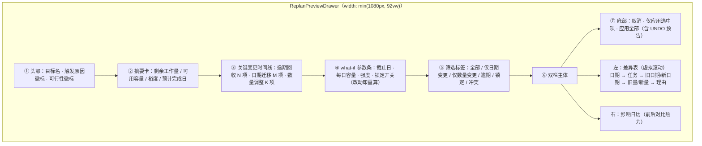

#### 4.2.1 交互流程

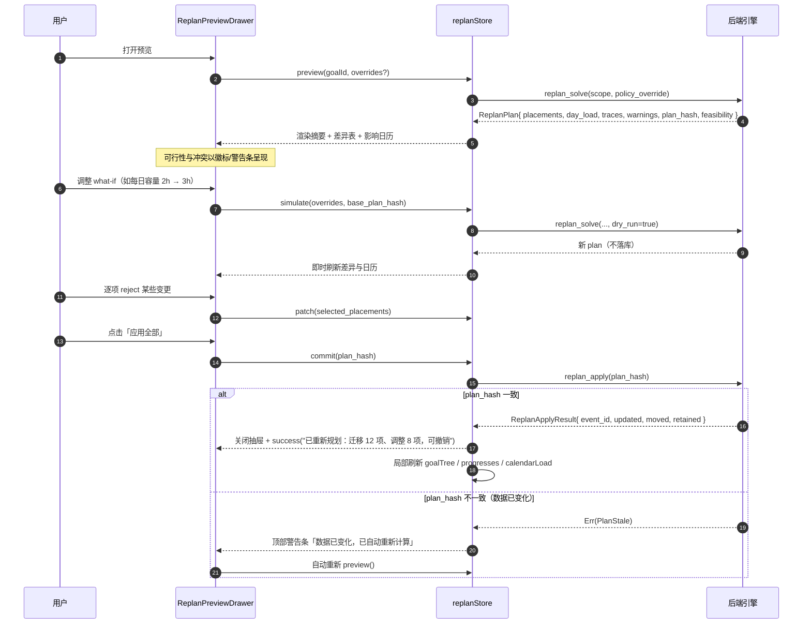

#### 4.2.2 差异表列定义

| 列 | 字段 | 渲染规则 | 宽度 |
|----|------|----------|------|
| 状态图标 | `change_type` | 新增/迁移/改量/保留/冲突，用 `mdi` 图标 + 语义色 | 40 |
| 原日期 | `old_plan_date` | 逾期项红色 + 「逾期 N 天」副标签 | 110 |
| 新日期 | `new_plan_date` | 变更时高亮（`type=primary`），相同显示 `—` | 110 |
| 任务名 | `name` | 超长省略 + tooltip（延续 `ellipsis: {tooltip:true}` 规范） | flex |
| 原计划 | `old_plan_qty` + `unit` | 数字右对齐 | 90 |
| 新计划 | `new_plan_qty` + `unit` | 变化量以 `(+2)` 上标显示 | 100 |
| 理由 | `reason` | 徽标：`依赖下界` / `逾期回收` / `负载均衡` / `锁定` / `节奏画像` | 120 |
| 操作 | — | 复选框（参与/排除本次应用） | 50 |

#### 4.2.3 影响日历（前后对比）

沿用 `CalendarMonthView` 的负载色阶规范（绿/黄/红，阈值 `4`/`7` 见 `p2-5` 文档），叠加**规划后预测层**：

| 视觉元素 | 含义 |
|----------|------|
| 上三角色块 | 规划**前**负载等级 |
| 下三角色块 | 规划**后**预测负载等级 |
| 中间箭头 | 负载变化方向（↓缓解 / ↑加重 / =持平） |
| 悬浮卡片 | `规划前 5 个任务 → 规划后 3 个任务（目标A 3→1，目标B 2→2）` |

### 4.3 不可行处置弹窗（SC-12）

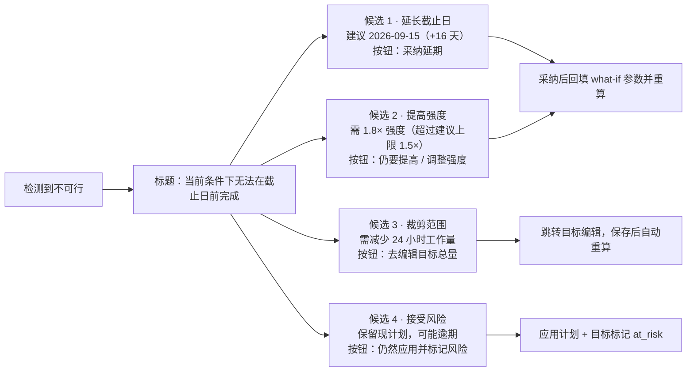

**设计要求**：
- 每个候选必须给出**量化后果**（新截止日、所需强度倍率、需削减量），不允许只给文案。
- 候选 2 在 `min_intensity > 1.5` 时必须显示风险提示（`type=warning`）。
- 候选 4 落库后写入 `goals.risk_flag = 'at_risk'`，树节点显示黄色风险角标。

### 4.4 事件时间线（可解释与回滚）

`ReplanEventTimeline.vue` 展示 `replan_events` 流水：

| 元素 | 内容 |
|------|------|
| 时间 | 本地时间（相对格式：3 小时前） |
| 触发徽标 | `手动` / `逾期回收` / `目标改期` / `周期复评` / `负载过载` |
| 摘要 | `迁移 12 项 · 调整 8 项 · 剩余工作量 110h → 110h` |
| 可展开 diff | 复用差异表组件（只读模式） |
| 操作 | 「撤销此次规划」（若其后无新规划且无任务完成） |

**撤销约束**：仅当满足全部条件时允许——① 该事件是最新一次规划事件；② 其后无任务状态变更（`tasks.updated_at` 无更新，需新增该列）；③ 目标仍存在。不满足时按钮禁用并给出原因 tooltip。

### 4.5 规划偏好设置（FR-8）

`SettingsView` 新增「规划偏好」分区：

| 分组 | 控件 | 字段 |
|------|------|------|
| 每日节奏 | 7×数字输入（周一~周日小时数） | `profile.weekday_hours` |
| 强度偏好 | 滑条 0.5× ~ 1.5×（默认 1.0×） | `policy.intensity` |
| 休息日 | 星期多选 | `policy.rest_days` |
| 连续性 | 开关「避免碎片化排期」 | `policy.prefer_contiguous` |
| 自动化 | 开关「允许自动重新规划」+ 事件多选 | `goal.auto_replan` / `policy.auto_apply_events` |
| 上限 | 单日最大时长 / 最大任务数 | `policy.max_daily_hours` / `max_daily_tasks` |
| 阈值 | 逾期触发数 / 负载过载阈值 | `policy.overdue_threshold` / `load_threshold` |

> 阈值项直接复用 `.trae/documents/p2-5-cross-goal-load-balance.md` 中已定义的 `LOAD_THRESHOLD_MEDIUM=4` 与 `LOAD_THRESHOLD_HIGH=7` 作为默认值，保证与日历色阶一致。

### 4.6 交互可用性要求

| 要求 | 验收方式 |
|------|----------|
| 键盘可达 | `Tab` 遍历差异表行，`Space` 切换参与状态，`Ctrl+Enter` 应用 |
| 深色模式 | 沿用现有 `dark:` 类；新增热力色需在深色下对比度 ≥ 4.5:1 |
| 空状态 | 无变更时显示「当前计划已是最优，无需调整」而非空白表 |
| 加载态 | 预览计算 > 300 ms 时显示骨架屏，禁用「应用」按钮 |
| 危险操作 | 涉及 > 20 项变更时「应用全部」按钮转为 `type=warning` 并二次确认 |
| 消息规范 | 成功文案包含变更统计与可撤销提示，延续现有 `message.success` 风格 |

---

## 5. 数据模型定义

### 5.1 模型总览（ER 图）

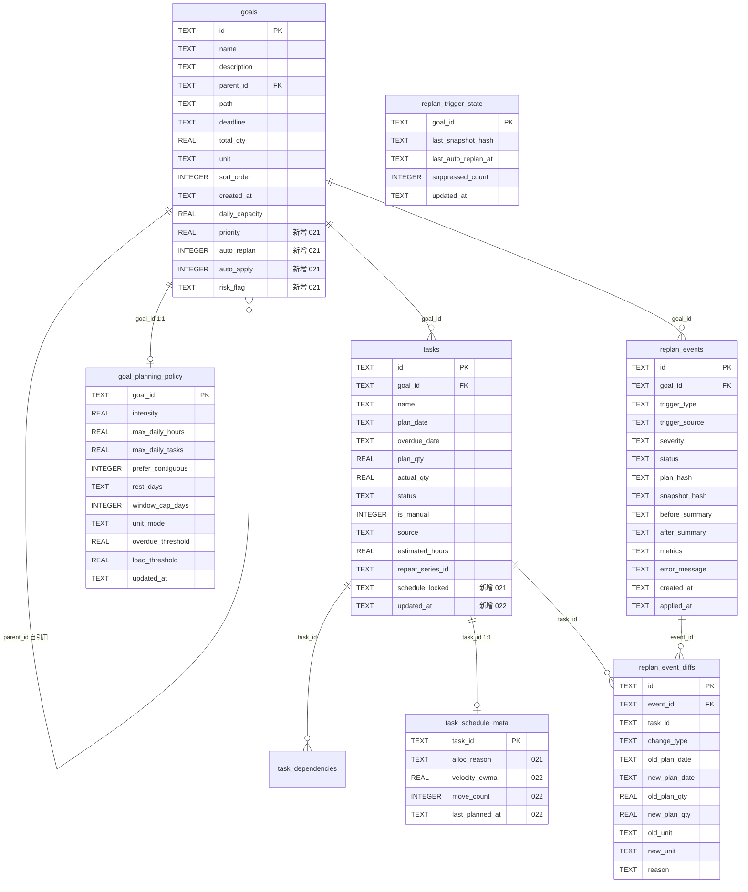

### 5.2 新增表 DDL

#### 5.2.1 迁移 `021_replan_core.sql`

```sql
-- ============================================================
-- 021 重新规划重构 · 核心模型
-- 目标策略 / 任务排期元数据 / 目标级自动化开关
-- ============================================================

-- 1) 目标级规划策略（未设置行时回退全局默认，见 settings）
CREATE TABLE IF NOT EXISTS goal_planning_policy (
    goal_id            TEXT PRIMARY KEY,
    -- 强度系数 0.5 ~ 1.5
    intensity          REAL    NOT NULL DEFAULT 1.0,
    -- 单日硬上限（小时 / 数量），NULL = 不限
    max_daily_hours    REAL,
    max_daily_tasks    REAL,
    -- 是否偏好连续排期（减少碎片日）
    prefer_contiguous  INTEGER NOT NULL DEFAULT 0,
    -- 休息日 JSON 数组，元素 0~6（0=周日）
    rest_days          TEXT    NOT NULL DEFAULT '[]',
    -- 无 deadline 时的滚动窗口天数
    window_cap_days    INTEGER NOT NULL DEFAULT 30,
    -- 单位模式：hours | quantity | auto
    unit_mode          TEXT    NOT NULL DEFAULT 'auto'
        CHECK(unit_mode IN ('hours','quantity','auto')),
    -- 逾期任务数达到该值触发自动规划
    overdue_threshold  REAL    NOT NULL DEFAULT 3,
    -- 单日负载（任务数）达到该值视为过载
    load_threshold     REAL    NOT NULL DEFAULT 7,
    updated_at         TEXT    NOT NULL,
    FOREIGN KEY (goal_id) REFERENCES goals(id) ON DELETE CASCADE
);

-- 2) goals 扩展：优先级、自动化、风险标记
ALTER TABLE goals ADD COLUMN priority    REAL    NOT NULL DEFAULT 1.0;
ALTER TABLE goals ADD COLUMN auto_replan INTEGER NOT NULL DEFAULT 1;
ALTER TABLE goals ADD COLUMN auto_apply  INTEGER NOT NULL DEFAULT 0;
ALTER TABLE goals ADD COLUMN risk_flag   TEXT;

CREATE INDEX IF NOT EXISTS idx_goals_risk_flag ON goals(risk_flag);
CREATE INDEX IF NOT EXISTS idx_goals_auto_replan ON goals(auto_replan);

-- 3) 任务排期元数据（与 tasks 1:1，避免 tasks 表过度膨胀）
CREATE TABLE IF NOT EXISTS task_schedule_meta (
    task_id         TEXT PRIMARY KEY,
    -- 最近一次排期决策理由：locked | dep_lower_bound | overdue_pull |
    --                       load_balance | profile_rhythm | smoothing_retain | manual
    alloc_reason    TEXT,
    last_planned_at TEXT,
    -- 任务被重排迁移的累计次数（用于迁移代价评估）
    move_count      INTEGER NOT NULL DEFAULT 0,
    FOREIGN KEY (task_id) REFERENCES tasks(id) ON DELETE CASCADE
);

-- 4) tasks 扩展：排期锁定 + 更新时间（撤销可行性判定依赖）
ALTER TABLE tasks ADD COLUMN schedule_locked TEXT;
ALTER TABLE tasks ADD COLUMN updated_at      TEXT;

UPDATE tasks SET updated_at = created_at WHERE updated_at IS NULL;

CREATE INDEX IF NOT EXISTS idx_tasks_schedule_locked ON tasks(schedule_locked);
CREATE INDEX IF NOT EXISTS idx_tasks_goal_status_date ON tasks(goal_id, status, plan_date);
```

#### 5.2.2 迁移 `022_replan_events.sql`

```sql
-- ============================================================
-- 022 重新规划 · 事件流水与差异留痕（可解释 + 可回滚）
-- ============================================================

CREATE TABLE IF NOT EXISTS replan_events (
    id              TEXT PRIMARY KEY,
    goal_id         TEXT NOT NULL,
    -- 触发类型：manual | task_completed | task_skipped | overdue_accumulated |
    --           goal_deadline_changed | goal_total_changed | progress_lag |
    --           load_overload | periodic_review
    trigger_type    TEXT NOT NULL,
    -- 触发来源：user | system | scheduler
    trigger_source  TEXT NOT NULL DEFAULT 'user',
    -- 严重度：info | warning | critical
    severity        TEXT NOT NULL DEFAULT 'info',
    -- 状态：previewed | applied | reverted | suppressed | failed
    status          TEXT NOT NULL DEFAULT 'previewed',
    -- 计划内容摘要（提交校验）与快照摘要（幂等去重）
    plan_hash       TEXT,
    snapshot_hash   TEXT,
    -- 变更前/后摘要 JSON
    before_summary  TEXT,
    after_summary   TEXT,
    -- 指标 JSON：{workload, capacity, slack, jain_index, moved, updated, feasibility}
    metrics         TEXT,
    error_message   TEXT,
    created_at      TEXT NOT NULL,
    applied_at      TEXT,
    FOREIGN KEY (goal_id) REFERENCES goals(id) ON DELETE CASCADE
);

CREATE INDEX IF NOT EXISTS idx_replan_events_goal_created
    ON replan_events(goal_id, created_at DESC);
CREATE INDEX IF NOT EXISTS idx_replan_events_status
    ON replan_events(status);

-- 差异明细：一行 = 一个任务的字段级变更
CREATE TABLE IF NOT EXISTS replan_event_diffs (
    id            TEXT PRIMARY KEY,
    event_id      TEXT NOT NULL,
    task_id       TEXT NOT NULL,
    -- 变更类型：date_moved | qty_changed | both | retained | locked | split | new
    change_type   TEXT NOT NULL,
    old_plan_date TEXT,
    new_plan_date TEXT,
    old_plan_qty  REAL,
    new_plan_qty  REAL,
    old_unit      TEXT,
    new_unit      TEXT,
    -- 决策理由：locked | dep_lower_bound | overdue_pull | load_balance |
    --           profile_rhythm | smoothing_retain | capacity_trim
    reason        TEXT,
    FOREIGN KEY (event_id) REFERENCES replan_events(id) ON DELETE CASCADE
);

CREATE INDEX IF NOT EXISTS idx_replan_diffs_event ON replan_event_diffs(event_id);
CREATE INDEX IF NOT EXISTS idx_replan_diffs_task  ON replan_event_diffs(task_id);

-- 触发状态：冷却与幂等判定依据
CREATE TABLE IF NOT EXISTS replan_trigger_state (
    goal_id              TEXT PRIMARY KEY,
    last_snapshot_hash   TEXT,
    last_auto_replan_at  TEXT,
    suppressed_count     INTEGER NOT NULL DEFAULT 0,
    updated_at           TEXT NOT NULL,
    FOREIGN KEY (goal_id) REFERENCES goals(id) ON DELETE CASCADE
);
```

#### 5.2.3 迁移 `023_replan_profile.sql`

```sql
-- ============================================================
-- 023 重新规划 · 用户规划画像
-- 以单行 JSON 形式存储（key = 'planning_profile'），兼容现有 settings 表
-- 此处仅登记默认值，实际读写复用 get_settings / set_setting 通道
-- ============================================================

INSERT OR IGNORE INTO settings (key, value) VALUES
    ('planning_profile',
     '{"weekday_hours":{"1":1.0,"2":1.0,"3":1.0,"4":1.0,"5":1.0,"6":3.0,"0":3.0},' ||
     '"weekend_factor":1.0,"prefer_morning":false}'),
    ('planning_auto_enabled', 'true'),
    ('planning_cooldown_hours', '6'),
    ('planning_min_impact_ratio', '0.10'),
    ('planning_max_intensity_hard', '1.5'),
    ('planning_smoothing',
     '{"qty_change_threshold":0.15,"date_move_threshold_days":1,"max_moves_per_run":0.30}');
```

> **幂等迁移提示**：`ALTER TABLE ... ADD COLUMN` 在 sqlx 迁移中不可重复执行，若历史库已存在该列会报错。实现时须在 Rust 侧迁移前置检查（`PRAGMA table_info`）或使用 sqlx 的 `migrate!` 版本管理保证仅执行一次。

### 5.3 字段说明

| 表 | 字段 | 类型 | 必填 | 说明 |
|----|------|------|------|------|
| `goals` | `priority` | REAL | 是 | 目标优先级权重，默认 `1.0`，用于 A5 公平分摊的需求加权 |
| `goals` | `auto_replan` | INTEGER | 是 | 是否允许自动触发重排，默认 `1` |
| `goals` | `auto_apply` | INTEGER | 是 | 是否允许无需确认直接应用，默认 `0`（安全默认） |
| `goals` | `risk_flag` | TEXT | 否 | `at_risk` = 用户选择"接受风险" |
| `tasks` | `schedule_locked` | TEXT | 否 | 非 NULL 表示锁定；值记录锁定来源 `manual` / `pin_date` |
| `tasks` | `updated_at` | TEXT | 是 | 任何字段变更时刷新，撤销可行性判定依赖 |
| `task_schedule_meta` | `alloc_reason` | TEXT | 否 | 最近一次排期理由枚举，驱动 UI 理由徽标 |
| `task_schedule_meta` | `move_count` | INTEGER | 是 | 迁移次数，参与 A3 迁移代价计算 |
| `goal_planning_policy` | `unit_mode` | TEXT | 是 | `hours` 按 `estimated_hours`；`quantity` 按 `plan_qty`；`auto` 自动判定 |
| `replan_events` | `plan_hash` | TEXT | 否 | 提交校验用内容摘要（对 placements 排序后哈希） |
| `replan_events` | `snapshot_hash` | TEXT | 否 | 幂等去重用输入摘要 |
| `replan_events` | `metrics` | TEXT | 否 | JSON，含 `workload/capacity/slack/jain_index/moved/updated/feasibility` |
| `replan_event_diffs` | `reason` | TEXT | 否 | 单任务决策理由，与 `DecisionTrace` 对齐 |

### 5.4 Rust 数据结构定义（`src-tauri/src/db/models.rs` 追加）

```rust
/// 重新规划请求（统一入口参数）
#[derive(Debug, Clone, Deserialize, Validate)]
pub struct ReplanSolveInput {
    pub goal_id: String,
    /// 规划范围：single（单目标）| subtree（含子目标）| coordinate（跨目标协同）
    #[serde(default = "default_scope")]
    #[validate(custom(function = "validate_replan_scope"))]
    pub scope: String,
    /// 协同规划时的目标 ID 列表（scope=coordinate 时必填）
    #[serde(default)]
    pub goal_ids: Option<Vec<String>>,
    /// 是否仅仿真（不落库）
    #[serde(default)]
    pub dry_run: bool,
    /// 本次覆盖策略（what-if 参数，不写回数据库）
    #[serde(default)]
    pub overrides: Option<ReplanOverrides>,
    /// 提交校验：预览时返回的 plan_hash
    #[serde(default)]
    pub expected_plan_hash: Option<String>,
}

/// what-if 覆盖参数（全部可选，None = 使用生效策略值）
#[derive(Debug, Clone, Deserialize, Validate)]
pub struct ReplanOverrides {
    #[validate(custom(function = "validate_date_format"))]
    pub deadline: Option<String>,
    #[validate(custom(function = "validate_qty"))]
    pub daily_capacity: Option<f64>,
    #[validate(custom(function = "validate_qty"))]
    pub intensity: Option<f64>,
    #[serde(default)]
    pub respect_locks: Option<bool>,
    /// 逐任务排除本次调整（用户 reject 的项）
    #[serde(default)]
    pub excluded_task_ids: Option<Vec<String>>,
}

/// 单任务放置结果
#[derive(Debug, Clone, Serialize, Deserialize)]
pub struct TaskPlacement {
    pub task_id: String,
    pub name: String,
    pub old_plan_date: Option<String>,
    pub new_plan_date: Option<String>,
    pub old_plan_qty: f64,
    pub new_plan_qty: f64,
    pub unit: String,
    /// date_moved | qty_changed | both | retained | locked | new
    pub change_type: String,
    /// 决策理由枚举
    pub reason: String,
    /// 人类可读理由
    pub reason_text: String,
    pub locked: bool,
    /// 依赖下界（若由依赖产生）
    pub dep_lower_bound: Option<String>,
}

/// 可行性报告
#[derive(Debug, Clone, Serialize, Deserialize)]
pub struct FeasibilityReport {
    pub feasible: bool,
    pub workload: f64,
    pub capacity: f64,
    /// 裕度 (capacity - workload) / capacity
    pub slack: f64,
    /// tight | normal | relaxed
    pub level: String,
    /// 不可行时的原因：capacity_shortfall | dependency_chain_too_long
    pub reason: Option<String>,
    pub options: Vec<ReplanOption>,
}

/// 不可行处置候选
#[derive(Debug, Clone, Serialize, Deserialize)]
pub struct ReplanOption {
    /// extend_deadline | raise_intensity | trim_scope | accept_risk
    pub kind: String,
    pub label: String,
    /// 量化后果，如 { "days": 16, "new_deadline": "2026-09-15" }
    pub payload: serde_json::Value,
    /// 是否含风险（超强度上限等）
    pub risky: bool,
}

/// 重新规划完整计划（预览与提交共用）
#[derive(Debug, Clone, Serialize, Deserialize)]
pub struct ReplanPlan {
    pub goal_id: String,
    pub scope: String,
    pub feasibility: FeasibilityReport,
    pub placements: Vec<TaskPlacement>,
    /// 日期 → 规划后负载（含外部目标）
    pub day_load: Vec<DayLoadAfter>,
    pub warnings: Vec<PlanWarning>,
    pub metrics: ReplanMetrics,
    /// 内容摘要，提交时校验
    pub plan_hash: String,
    /// 本次触发原因（用于 UI 徽标）
    pub trigger: Option<String>,
}

/// 规划后单日负载
#[derive(Debug, Clone, Serialize, Deserialize)]
pub struct DayLoadAfter {
    pub date: String,
    pub before_tasks: i64,
    pub before_qty: f64,
    pub after_tasks: i64,
    pub after_qty: f64,
}

/// 计划指标
#[derive(Debug, Clone, Serialize, Deserialize)]
pub struct ReplanMetrics {
    pub moved: usize,
    pub qty_changed: usize,
    pub retained: usize,
    pub locked: usize,
    pub overdue_recovered: usize,
    /// 跨目标协同时的 Jain 公平指数
    pub jain_index: Option<f64>,
    /// 预计完成日期
    pub predicted_finish: Option<String>,
    /// 求解耗时（毫秒，用于性能观测）
    pub elapsed_ms: u64,
}

/// 计划告警
#[derive(Debug, Clone, Serialize, Deserialize)]
pub struct PlanWarning {
    /// overflow_tail | capacity_tight | cycle_detected | iteration_capped | low_fairness
    pub kind: String,
    pub message: String,
    pub task_ids: Vec<String>,
}

/// 提交结果
#[derive(Debug, Clone, Serialize, Deserialize)]
pub struct ReplanApplyResult {
    pub event_id: String,
    pub goal_id: String,
    pub moved: usize,
    pub qty_changed: usize,
    pub retained: usize,
    /// 受影响目标 ID（供前端局部刷新进度链）
    pub affected_goal_ids: Vec<String>,
    pub tasks: Vec<Task>,
}
```

### 5.5 索引与性能设计

| 索引 | 支撑查询 | 预期收益 |
|------|----------|----------|
| `idx_tasks_goal_status_date(goal_id, status, plan_date)` | 快照加载任务集合 | 消除现有全表扫描 + 应用层过滤 |
| `idx_replan_events_goal_created(goal_id, created_at DESC)` | 时间线拉取最新事件 | 覆盖排序，避免临时 B 树 |
| `idx_replan_diffs_event(event_id)` | 事件 diff 展开 | O(log n) 定位 |
| `idx_goals_auto_replan` | 周期性复评扫描 | 快速筛出允许自动规划的目标 |
| `idx_tasks_schedule_locked` | 锁定任务集合加载 | 稀疏索引（多为 NULL），代价低 |

### 5.6 数据兼容与迁移策略

| 场景 | 处理 |
|------|------|
| 旧库升级 | 021~023 全部带 `DEFAULT`，`risk_flag`/`schedule_locked` 为 NULL 表示未设置 |
| `updated_at` 回填 | 迁移内 `UPDATE tasks SET updated_at = created_at` |
| 旧备份导入 | `ExportData` 新增可选字段（`#[serde(default)]`），旧 JSON 解析不失败；导入时为缺失的 `task_schedule_meta` 补默认行 |
| 导出扩展 | `ExportData` 追加 `goal_planning_policy`、`replan_events`（可选）、`task_schedule_meta`，保持向后兼容 |
| 回滚策略 | 新表可 `DROP`；`goals`/`tasks` 新增列保留（NULL 不影响旧代码） |
| 数据库重置 | `reset_database`（`ResetDatabaseInput`）须同步清理 5 张新表 |

---

## 6. 实施步骤

### 6.1 阶段总览

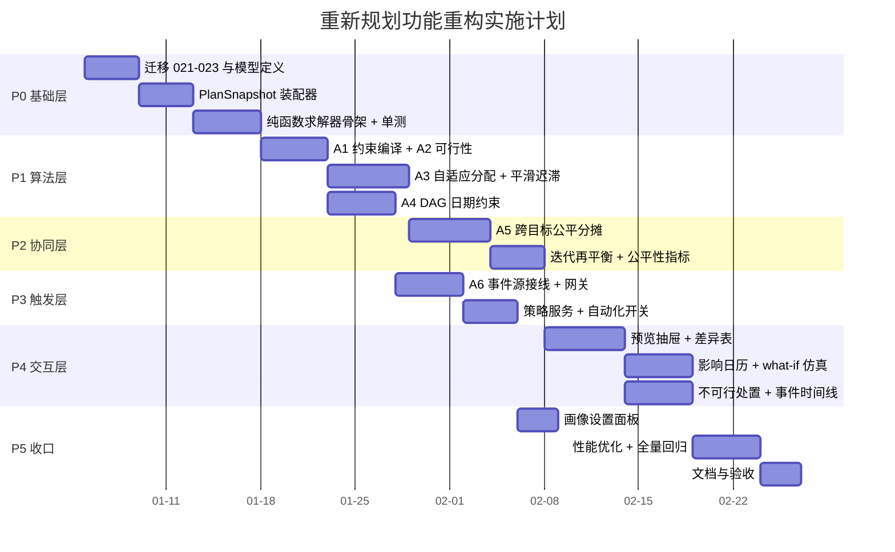

### 6.2 分阶段任务清单

#### 阶段 P0 · 基础层（迁移与模型，约 13 人日）

| 序号 | 任务 | 文件 | 完成判据 |
|------|------|------|----------|
| P0-1 | 编写迁移 021/022/023 | `src-tauri/migrations/` | `cargo test` 下迁移可重复在空库与旧库执行 |
| P0-2 | 扩展 `Goal`/`Task` 模型 | `db/models.rs` | 编译通过；`SELECT *` 映射正确（新增列需与 `sqlx::FromRow` 字段顺序无关，确认按列名映射） |
| P0-3 | 新增 replan 相关 DTO | `db/models.rs` | 见 §5.4，含 `validator` 校验 |
| P0-4 | 实现 `PlanSnapshot` 装配器 | `services/replan/snapshot.rs` | 一次查询装配子树 + 依赖 + 外部负载；有单测覆盖 |
| P0-5 | 实现纯函数求解器骨架与 `plan_hash` | `services/replan/mod.rs` | `solve()` 无 IO；相同输入哈希一致（单测） |
| P0-6 | 旧命令转调新引擎 | `commands/goal.rs` | `replan_preview` 返回结构向后兼容（新增字段均为可选） |

> **P0-2 风险点**：`Goal`/`Task` 使用 `sqlx::FromRow` derive。当前查询均为 `SELECT *`，新增列会自动进入结构体，因此**必须同步扩展结构体字段**，否则 `FromRow` 报缺列。这是本阶段最易遗漏的编译错误来源，需全局检索 `SELECT * FROM tasks` / `SELECT * FROM goals` 的自定义 `FromRow` 实现。

#### 阶段 P1 · 算法层（约 16 人日）

| 序号 | 任务 | 文件 | 完成判据 |
|------|------|------|----------|
| P1-1 | A1 约束编译（含画像节奏、休息日、窗口上限） | `services/replan/constraint.rs` | 单测：工作日 1h/周末 4h 的 horizon 权重比例为 1:4 |
| P1-2 | A2 可行性判定 + 处置候选量化 | `services/replan/feasibility.rs` | 单测：容量不足时 `deficit`、`min_intensity`、`days` 数值正确 |
| P1-3 | A3 加权公平分配 + 裁剪迭代 | `services/replan/allocator.rs` | 属性测试 INV-1/INV-2 |
| P1-4 | A3 平滑与迟滞 | `services/replan/allocator.rs` | 单测：变化 < 15% 不调整；冷却期内不重排 |
| P1-5 | A4 DAG 下界传播 + 逾期前移 + 锁定占位 | `services/replan/dag.rs` | 属性测试 INV-3/INV-4；逾期任务日期确实前移 |
| P1-6 | 理由链生成 | `services/replan/explain.rs` | 每个 placement 的 `reason` 非空且可枚举 |

#### 阶段 P2 · 协同层（约 10 人日）

| 序号 | 任务 | 文件 | 完成判据 |
|------|------|------|----------|
| P2-1 | A5 最大最小公平分摊（轮转） | `services/replan/coordinator.rs` | 单测：3 目标需求 200/4/2，小目标不被饿死 |
| P2-2 | 迭代再平衡（≤5 轮） | 同上 | 单测：一轮转移后 shortfall 归零则提前退出 |
| P2-3 | Jain 公平指数与 `low_fairness` 告警 | 同上 | 单测：$\mathcal{J}$ 计算正确；$\mathcal{J} < 0.85$ 产出告警 |
| P2-4 | 外部负载复用 `get_daily_load` | `commands/stats.rs` 复用 | 不改动现有命令签名 |

#### 阶段 P3 · 触发层（约 9 人日）

| 序号 | 任务 | 文件 | 完成判据 |
|------|------|------|----------|
| P3-1 | `TriggerGateway`（去抖 90s / 冷却 / 幂等） | `services/replan/trigger.rs` | 单测：连续 10 次事件只放行 1 次 |
| P3-2 | 事件源接线（6 处后置钩子） | `commands/task.rs`、`commands/goal.rs` | 完成/跳过/改期/改量均产生事件 |
| P3-3 | 启动期周期性复评 | `lib.rs` setup 钩子 | 距上次自动规划 ≥24h 才触发 |
| P3-4 | `ReplanPolicyService` 三级合并 | `services/replan/policy.rs` | 单测：全局 ← 目标 ← 覆盖 的优先级正确 |
| P3-5 | 事件流水落库 | `commands/replan.rs` | 每次求解/应用/抑制均写入 `replan_events` |

#### 阶段 P4 · 交互层（约 16 人日）

| 序号 | 任务 | 文件 | 完成判据 |
|------|------|------|----------|
| P4-1 | `replanStore` + `api/replan.ts` | `src/stores/`、`src/api/` | 预览/仿真/提交三态管理；`PlanStale` 自动重算 |
| P4-2 | `ReplanPreviewDrawer.vue` 骨架 + 摘要卡 | `src/components/` | 含可行性徽标与警告条 |
| P4-3 | 差异表（虚拟滚动 + 筛选 + 逐项排除） | 同上 | 500 项滚动 60fps |
| P4-4 | 影响日历前后对比 | 同上 | 复用 `CalendarMonthView` 色阶规范 |
| P4-5 | what-if 参数条 | 同上 | 改动后 300ms 内重算（防抖 + 取消在途请求） |
| P4-6 | `InfeasibilityDialog.vue` | `src/components/` | 4 类候选 + 量化后果 + 采纳回填 |
| P4-7 | `ReplanEventTimeline.vue` + 撤销 | `src/components/` | 撤销三条件校验 + 禁用原因 tooltip |
| P4-8 | 入口调整（移除 deadline 禁用、新增协同入口） | `GoalTreeNodeItem.vue`、`GoalTreeView.vue` | 无 deadline 目标可预览（滚动窗口） |

#### 阶段 P5 · 收口（约 11 人日）

| 序号 | 任务 | 文件 | 完成判据 |
|------|------|------|----------|
| P5-1 | 规划偏好设置面板 | `SettingsView.vue` | 7 项设置可读写并持久化 |
| P5-2 | 导出/导入/重置兼容 | `commands/backup.rs` | 5 张新表纳入导出；旧备份可导入 |
| P5-3 | 性能优化（查询合并、虚拟滚动、耗时埋点） | 全链路 | 满足 §1.2.3 性能指标 |
| P5-4 | 文档更新 | `README.md`、`docs/` | 使用说明与算法说明同步 |
| P5-5 | 验收与回归 | — | §8 全部条目通过 |

**总工作量估算**：约 75 人日（单人数约 15 周；2 人并行可压缩至约 8~9 周）。

### 6.3 关键路径与依赖

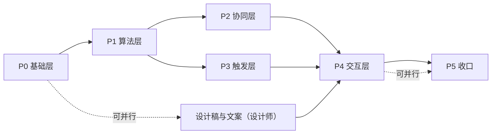

**关键路径**：P0 → P1 → P2 → P4 → P5。P3 可与 P2 并行；P4 的静态骨架可在 P1 期间先行开发（依赖接口契约而非实现）。

### 6.4 风险与缓解

| 编号 | 风险 | 概率 | 影响 | 缓解措施 |
|------|------|------|------|----------|
| R-01 | `sqlx::FromRow` 新增列导致大量编译断裂 | 高 | 中 | P0-2 前置；使用 `cargo check` 快速迭代；集中检索 `SELECT *` |
| R-02 | 自动触发引发"计划抖动"，用户反感 | 中 | 高 | 冷却 6h + 变化阈值 15% + 迁移上限 30% + `dry_run` 默认预览而非直改 |
| R-03 | 跨目标协同不收敛 | 低 | 中 | 硬上限 5 轮；不收敛则输出 `low_fairness` 告警并交用户裁决 |
| R-04 | 迁移在既有用户库上失败 | 中 | 高 | 迁移前自动备份（复用 `ResetDatabaseInput.backup` 能力）；`PRAGMA table_info` 存在性检查 |
| R-05 | 时间预算与数量预算混用导致量纲错误 | 中 | 高 | `unit_mode` 显式判定 + 同目标内单位一致性校验，不一致时降级为 `quantity` 并告警 |
| R-06 | 大量任务的递归子树查询性能 | 中 | 中 | `idx_tasks_goal_status_date`；快照一次性装配；避免 N+1（现有 `calc_goal_progress` 存在逐 goal 循环查询，需在快照层绕开） |
| R-07 | 撤销语义与已完成任务冲突 | 中 | 中 | 撤销三条件校验；不满足时禁用并解释原因 |
| R-08 | 旧命令行为变更引发既有测试/用户预期偏差 | 中 | 中 | 旧命令保留旧签名，仅内部替换算法；对 G-01/G-02 修复在发布说明中明确标注为"修正" |

---

## 7. 测试策略

### 7.1 测试分层

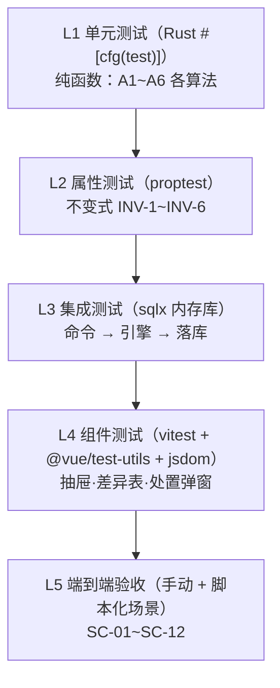

> **现状提示**：项目已有 Rust 内联单测（如 `split_service.rs:643-913`、`dependency_service.rs:220-295`），但**尚无前端测试文件**（`vitest`/`@vue/test-utils`/`jsdom` 已在 `devDependencies` 中，未配置脚本）。L4 需先补 `vitest.config` 与 `npm run test:unit` 脚本。

### 7.2 L1 单元测试用例

#### A1 约束编译

| 用例 | 输入 | 期望 |
|------|------|------|
| 无 deadline | `deadline=None`, `window_cap_days=30` | horizon 长度 30，末日 = today+30 |
| 休息日 | `rest_days=[0]` | 所有周日的 `capacity=0`、`is_rest=true` |
| 节奏画像 | 工作日 1h / 周末 4h | 周六日 `weight = 4×` 工作日 |
| 强度缩放 | `intensity=0.5` | 全部 `capacity` 减半 |
| 硬上限 | `max_daily_hours=2`，画像 4h | `capacity=2` |
| 外部占用 | `external_load[d]=3`，cap=5 | `available=2` |

#### A2 可行性判定

| 用例 | 输入 | 期望 |
|------|------|------|
| 容量不足 | W=100h, C=20h | `feasible=false`, `reason=capacity_shortfall`, `deficit=80` |
| 延期候选 | 同上，日均可用 2h | `options[extend_deadline].payload.days=40` |
| 强度候选超限 | 需 1.8× | `risky=true`，仅保留延期与裁剪 |
| 依赖链过长 | 链长 10，可用日 5 | `reason=dependency_chain_too_long` |
| 正常裕度 | W=50, C=100 | `slack=0.5`, `level=relaxed` |

#### A3 自适应分配

| 用例 | 输入 | 期望 |
|------|------|------|
| 均匀分配 | W=10, 5 日均权重 | 每天 2 |
| 余数分配 | W=12, 5 日等权 | `3,3,2,2,2`（小数部分排序 + 日期升序） |
| 加权分配 | W=10, 权重 `[1,1,1,1,4]` | 约 `1,1,1,1,6`（守恒 10） |
| 上限裁剪 | W=10, cap `[2,2,2,2,2]` 权重偏斜 | 不超 cap，且总量守恒 |
| 迟滞 | 旧值 2.0，新计算 2.2（+10%） | 保留 2.0 |
| 迁移上限 | 100 任务，理论需迁 60 | 实际迁移 ≤ 30 |

#### A4 DAG 日期约束

| 用例 | 输入 | 期望 |
|------|------|------|
| 线性链 | A→B→C，各 1 日 | `date(A) < date(B) < date(C)` |
| 菱形 | A→B, A→C, B&C→D | `date(A) < date(B), date(A) < date(C) < date(D)` |
| 逾期前移 | 任务 `plan_date = today-5` | 新日期 ≥ `today+1`，`reason=overdue_pull` |
| 锁定保留 | `schedule_locked='manual'`，日期 today+10 | 日期与数量完全不变 |
| 跳过透明 | 前置为 `skipped` | 不阻塞后继（与 `BLOCKED_EXISTS_SQL` 语义一致） |
| 环检测 | 人为构造环 | 返回 `CycleDetected` 而非死循环 |

#### A5 跨目标协同

| 用例 | 输入 | 期望 |
|------|------|------|
| 小目标不饿死 | 需求 200/4/2，日额度 10 | 三目标首日均获配额 |
| 公平指数 | 需求 100/100/100，额度充足 | $\mathcal{J} = 1.0$ |
| 低公平告警 | 单目标独占外部占用 | 产出 `low_fairness` |
| 迭代收敛 | 一轮转移后无 shortfall | 提前退出，轮数 = 1 |
| 迭代上限 | 构造持续冲突 | 最多 5 轮，产出告警 |

#### A6 触发决策

| 用例 | 输入 | 期望 |
|------|------|------|
| 关闭自动 | `auto_replan=0`，系统事件 | `Suppress(auto_replan_disabled)` |
| 冷却期 | 上次 2h 前，冷却 6h | `Suppress(cooldown)` |
| 无实质变化 | `snapshot_hash` 相同 | `Suppress(no_material_change)` |
| 影响过小 | 1/50 任务变化（2% < 10%） | `Suppress(below_impact_threshold)` |
| 去抖 | 90s 内 10 次事件 | 仅 1 次 `Proceed` |
| 自动应用 | 事件在 `auto_apply_events` 且 `auto_apply=1` | `AutoApply` |

### 7.3 L2 属性测试（proptest）

| 不变式 | 属性陈述 | 生成器 |
|--------|----------|--------|
| INV-1 | $\sum \text{qty} = W$（`feasible=true` 时） | 随机任务集 + 随机日容量（保证 $C \ge W$） |
| INV-2 | $\forall d: \text{load}[d] \le \text{cap}_d$ | 同上，容量偏紧 |
| INV-3 | 依赖序保持 | 随机 DAG（无环生成器） |
| INV-4 | 锁定项不变 | 随机标记锁定子集 |
| INV-5 | 确定性 | 同输入两次求解 `plan_hash` 相等 |
| INV-6 | 幂等 | 应用后再求解，`moved == 0`（无新事件时） |
| INV-7 | 单调性 | `deadline` 延后 ⇒ `predicted_finish` 不早于原值 |
| INV-8 | 非负性 | 所有 `new_plan_qty >= 0`，日期在 `(today, horizon_end]` |

**新增依赖**：`[dev-dependencies] proptest = "1"`。

### 7.4 L3 集成测试

| 用例 | 步骤 | 期望 |
|------|------|------|
| 端到端重排 | 内存 SQLite → 建目标/任务/依赖 → `replan_solve(dry_run=false)` | 任务表被正确更新，`replan_events` 有 `applied` 记录 |
| 幂等提交 | 同 `plan_hash` 提交两次 | 第二次为 no-op，`replan_events` 记录第二次为 `suppressed` |
| `PlanStale` | 预览后手动改任务，再提交旧 hash | 返回 `PlanStale` 错误，任务未被改动 |
| 撤销 | 应用 → 撤销 | 字段回到 before 状态，事件状态变 `reverted` |
| 事务原子性 | 中途注入 SQL 错误 | 无部分写入（全量回滚） |
| 旧命令兼容 | 调用旧 `replan_goal` | 返回 `ReplanResult` 结构，且 G-01/G-02 已修复 |
| 进度链刷新 | 应用后查询受影响目标进度 | `affected_goal_ids` 覆盖全部祖先链 |
| 导入旧备份 | 不含新字段的 JSON 导入 | 成功且新表补默认行 |

### 7.5 L4 前端组件测试

| 用例 | 断言 |
|------|------|
| 抽屉渲染差异表 | 行数 = `placements.length`；保留项有「保留」标记 |
| 筛选标签 | 切到「仅日期变更」后行数正确 |
| 逐项排除 | 取消勾选后提交 payload 的 `excluded_task_ids` 含该项 |
| what-if 防抖 | 连续改 5 次参数只发 1 次请求（fake timers） |
| 不可行弹窗 | `feasible=false` 时渲染 4 个候选且含量化数字 |
| `PlanStale` 处理 | 提交返回 stale 时渲染警告条并触发重新预览 |
| 空状态 | 无变更时显示既定文案 |
| 撤销按钮禁用 | 条件不满足时 `disabled` 且 tooltip 有原因 |

### 7.6 L5 场景验收测试（手工 + 脚本）

对 SC-01 ~ SC-12 逐场景编写可复现步骤，见 §8.3。

### 7.7 性能测试

| 场景 | 数据规模 | 目标 |
|------|----------|------|
| 单目标重排 | 500 任务 / 365 天窗口 | P95 < 200 ms |
| 跨目标协同 | 10 目标 / 2000 任务 | P95 < 800 ms |
| 快照装配 | 2000 任务 + 5000 依赖 | < 100 ms |
| 差异表渲染 | 500 行变更 | 滚动 60 fps（虚拟滚动） |
| 事件流水 | 1000 条历史事件 | 时间线首屏 < 150 ms（分页 20） |
| 幂等判定 | 重复触发 100 次 | 单次 `snapshot_hash` 计算 < 5 ms |

### 7.8 回归范围

| 回归对象 | 原因 | 用例 |
|----------|------|------|
| `split_goal_into_tasks` / `by_daily_capacity` / `by_date_range` | 共用 `Task` 结构与单位语义 | 现有 12 个单测全绿 |
| `topo_sort_by_dependency` | 被 A4 复用 | 现有 4 个单测全绿 |
| `calc_goal_progress` / `calc_all_goals_progress` | 新表可能影响口径 | 进度百分比与完成判定不变 |
| `complete_task` 依赖阻塞 | A4 生成的日期必须与阻塞规则自洽 | 无"日期冲突 + 阻塞"死锁 |
| `repeat_series` / `update_repeat_series` | `Task` 新增列 | 现有单测 + 手工回归 |
| 备份导出导入 | `ExportData` 扩展 | 新旧 JSON 双向 |
| 日历负载色阶 | `get_daily_load` 复用 | 色阶与阈值不变 |

### 7.9 测试环境与工具

| 层 | 工具 | 命令 |
|----|------|------|
| L1/L2/L3 | `cargo test` + `proptest` + `sqlx` 内存库 | `cargo test --manifest-path src-tauri/Cargo.toml` |
| L4 | `vitest` + `@vue/test-utils` + `jsdom` | `npm run test:unit`（需新增脚本） |
| 类型检查 | `vue-tsc` | `npx vue-tsc --noEmit` |
| 构建 | Vite + Tauri | `npm run build` / `npm run tauri:build` |
| L5 | 手工 + 测试数据库种子脚本 | `testdata/` 目录（现有） |

---

## 8. 验收标准

### 8.1 功能验收（Given-When-Then）

| 编号 | 需求 | Given | When | Then |
|------|------|-------|------|------|
| **AC-01** | FR-1 | 目标总量 100，已完成任务 `actual_qty` 合计 60，剩 4 个未完成任务 | 触发重新规划 | `remaining_qty = 40`（非 100）；UI 摘要显示「剩余工作量 40」 |
| **AC-02** | FR-1 | 某任务 `plan_qty=10, actual_qty=4, status=partial` | 触发重新规划 | 该任务参与剩余量计算时贡献 6；`new_plan_qty + 4 = 原计划 10`（不重复计工） |
| **AC-03** | FR-2 | 10 个任务，剩 30 天，每日容量 1 | 触发重新规划 | 计划**铺满 30 天**（而非 10 天）；每日量 ≈ 总剩余量/30 |
| **AC-04** | FR-2 | 40 个任务，剩 5 天，每日容量 8 | 触发重新规划 | 每日量 ≤ 8，不产生"每天 8 个任务"的过载（旧算法产出） |
| **AC-05** | FR-3 | 3 个任务 `plan_date < today` 且未完成 | 触发重新规划 | 这 3 个任务的新 `plan_date ≥ today+1`；`reason = overdue_pull` |
| **AC-06** | FR-4 | 任务 B 依赖任务 A（A 未完成） | 触发重新规划 | `plan_date(A) < plan_date(B)`；随后完成 A 可正常标记 B 完成（无阻塞死锁） |
| **AC-07** | FR-5 | 剩 100h、10 天、每日 2h | 触发重新规划 | 返回 `feasible=false`，弹窗给出延期/提强度/裁剪/接受风险四候选，且含量化数字 |
| **AC-08** | FR-6 | 3 个目标同窗口，单日上限 8 任务 | 协同规划 | 当日总负载 ≤ 8；Jain 指数 ≥ 0.85；任一目标首日均获配额 |
| **AC-09** | FR-7 | 目标未设 deadline 且已有 3 个逾期任务 | 每日首启 | 自动触发滚动窗口规划（30 天）；`replan_events` 有 `periodic_review` 记录 |
| **AC-10** | FR-7 | 用户连续 10 次编辑同一任务（2 分钟内） | 观察触发 | 仅触发 1 次自动规划；其余记为 `suppressed` |
| **AC-11** | FR-8 | 画像设为工作日 1h / 周末 4h | 触发重新规划 | 周末日配额为工作日约 4 倍（同一周内可见） |
| **AC-12** | FR-8 | 休息日设为周日 | 触发重新规划 | 周日无任何新任务（锁定项除外） |
| **AC-13** | FR-9 | 目标无 deadline | 点击「重新规划」 | 按钮**可点击**（不再 disabled）；预览基于 30 天滚动窗口 |
| **AC-14** | FR-10 | 某任务 `schedule_locked='manual'`，日期为 today+10 | 触发重新规划 | 该任务日期与数量完全不变；UI 标记「锁定」 |
| **AC-15** | FR-11 | 数据未变化的同一目标 | 连续调两次 `replan_solve` | `plan_hash` 完全相同；第二次提交为空操作 |
| **AC-16** | FR-11 | 预览后用户手动改动某任务 | 用旧 `plan_hash` 提交 | 返回 `PlanStale`，任务未被改动，UI 提示重新预览并自动重算 |
| **AC-17** | FR-12 | 刚应用一次规划 | 打开事件时间线 → 点击撤销 | 所有字段回滚到 before 状态；事件状态为 `reverted`；提示成功 |
| **AC-18** | FR-12 | 撤销前完成了一个任务 | 查看撤销按钮 | 按钮禁用，tooltip 说明「已有任务变更，无法撤销」 |
| **AC-19** | FR-13 | 存在日期迁移与数量调整 | 打开预览抽屉 | 差异表按类型筛选可用；影响日历显示前后对比；每行有理由徽标 |
| **AC-20** | FR-13 | 预览显示 20 项变更 | 取消勾选 3 项后应用 | 仅 17 项落库，3 项保留原值 |
| **AC-21** | FR-14 | 预览中把每日容量从 2h 改到 3h | 松开滑条 | 300 ms 内刷新差异与日历；**数据库未被修改**（`dry_run`） |
| **AC-22** | FR-15 | 500 任务目标 | 打开预览 | P95 求解 < 200 ms；差异表滚动 60 fps；无卡死 |
| **AC-23** | 全部 | 旧版本备份文件（无新字段） | 导入 | 成功，无报错；新表补默认行 |
| **AC-24** | 全部 | 应用一次规划 | 观察目标树 | 仅受影响目标与祖先链进度刷新（局部更新而非全量重拉） |
| **AC-25** | 全部 | 任意不可行场景 | 选择「接受风险」应用 | 计划落库，目标标记 `risk_flag='at_risk'`，树节点显示风险角标 |

### 8.2 非功能验收

| 编号 | 维度 | 指标 | 验证方法 |
|------|------|------|----------|
| **AC-N1** | 性能 | 单目标 500 任务 P95 < 200 ms | 基准测试脚本（`cargo test --release` + 计时断言） |
| **AC-N2** | 性能 | 10 目标 2000 任务 P95 < 800 ms | 同上 |
| **AC-N3** | 确定性 | 100 次求解 `plan_hash` 全等 | 属性测试 INV-5 |
| **AC-N4** | 幂等 | 重复提交无副作用 | 集成测试 |
| **AC-N5** | 稳定性 | 连续 200 次重排无 panic、无内存增长 | 压力脚本 |
| **AC-N6** | 类型安全 | `npx vue-tsc --noEmit` 零错误 | CI |
| **AC-N7** | 编译 | `cargo check` 零警告（新增代码） | CI |
| **AC-N8** | 兼容 | 现有 Rust 单测 100% 通过 | `cargo test` |
| **AC-N9** | 数据安全 | 迁移前自动备份，迁移失败可恢复 | 手工注入失败验证 |
| **AC-N10** | 可访问性 | 深色模式对比度 ≥ 4.5:1；键盘可完成全流程 | 人工 + 对比度工具 |

### 8.3 场景验收脚本（精选）

#### SC-02 连续中断后恢复

```text
前置：
  目标「考研数学」，deadline = today + 20，total_qty = 100（小时）
  已有 12 个任务 plan_date ∈ [today-7, today-1]，均 pending，每个 2 小时
  每日容量 2 小时

操作：
  1. 点击目标节点「重新规划」
  2. 观察抽屉摘要与差异表
  3. 点击「应用全部」

期望：
  ├─ 摘要：剩余工作量 24 小时，可用容量 40 小时，裕度 relaxed
  ├─ 差异表：12 项 change_type = date_moved，reason = overdue_pull
  ├─ 新日期全部 ≥ today+1 且 ≤ deadline，无单日超过 2 小时
  ├─ 影响日历：过去 7 天负载清零，未来 12 天各 2 小时
  └─ 应用后事件时间线出现「逾期回收 · 迁移 12 项」，可撤销
```

#### SC-04 多目标并行协同

```text
前置：
  目标 A「考研」剩余 60h，目标 B「健身」剩余 6h，目标 C「英语」剩余 3h
  三者 deadline 均为 today + 15
  每日上限 max_daily_tasks = 6，外部无占用

操作：
  1. 目标树顶部点击「协同规划」并勾选 A/B/C
  2. 查看全局负载日历
  3. 应用

期望：
  ├─ 每日总任务数 ≤ 6
  ├─ 三个目标在首日均获得配额（无目标被饿死）
  ├─ metrics.jain_index ≥ 0.85
  ├─ 目标 C（需求最小）在 1~2 天内排完，不被拖到末尾
  └─ 每个目标的依赖链仍然有序
```

#### SC-12 冲突不可行

```text
前置：
  目标「雅思写作」，deadline = today + 10，total_qty = 100（小时）
  每日容量 2 小时，无已完成

操作：
  点击「重新规划」

期望：
  ├─ 抽屉顶部红色徽标「不可行」
  ├─ 弹窗列出四候选：
  │   延期：需 +40 天 → 建议 today + 50
  │   提强度：需 5.0×，超过建议上限 1.5×，标记 risky
  │   裁剪：需减少 80 小时工作量
  │   接受风险：保留计划并标记 at_risk
  ├─ 选择「提强度」时显示风险警告
  ├─ 选择「采纳延期」后 what-if 截止日自动回填并重算为可行
  └─ 选择「接受风险」应用后，目标树显示风险角标
```

### 8.4 验收清单（发布门禁）

- [ ] AC-01 ~ AC-25 全部通过
- [ ] AC-N1 ~ AC-N10 全部通过
- [ ] §7.8 回归范围全绿
- [ ] 迁移在「空库」「旧版生产库副本」两类环境均成功
- [ ] 文档更新完成（README + 本设计文档状态置为「已实现」）
- [ ] 无 P0/P1 未关闭缺陷
- [ ] 性能埋点数据已归档（用于后续调参）

---

## 9. 附录

### 9.1 术语表

| 术语 | 英文 | 定义 |
|------|------|------|
| 目标树 | Goal Tree | `goals` 表通过 `parent_id` 自引用形成的层级结构（总目标 → 子目标 → 任务） |
| 重新规划 | Replanning | 在既有任务计划基础上，根据最新进度与约束重新生成排期的过程 |
| 快照 | PlanSnapshot | 一次规划所需的全部只读输入数据的聚合 |
| 约束集 | ConstraintSet | 由快照编译出的可用日、每日额度、锁定集合、依赖下界 |
| 放置 | Placement | 单个任务在规划结果中的落位（日期 + 数量 + 理由） |
| 裕度 | Slack | $(C - W)/C$，容量相对工作量的相对冗余 |
| 最大最小公平 | Max-Min Fairness | 一种资源分配准则：在不损害他人前提下无法再提升任一方的分配 |
| Jain 公平指数 | Jain's Fairness Index | 衡量分配公平性的归一化指标，取值 $(1/n, 1]$ |
| 迟滞 | Hysteresis | 通过阈值与冷却期抑制系统在临界点反复切换 |
| 滚动窗口 | Rolling Window | 无固定截止日时，以固定天数（默认 30）为规划视界并随日期推进 |
| 计划摘要 | plan_hash | 对规划结果内容计算的内容哈希，用于提交时的一致性校验 |
| 快照摘要 | snapshot_hash | 对规划输入内容计算的哈希，用于幂等去重 |
| 幂等 | Idempotence | 同一操作重复执行与执行一次效果相同 |
| 单位模式 | unit_mode | 规划以「小时」（`estimated_hours`）还是「数量」（`plan_qty`）为量纲 |

### 9.2 参数默认值速查

| 参数 | 默认值 | 位置 | 依据 |
|------|--------|------|------|
| `intensity` | `1.0` | `goal_planning_policy` | 中性默认 |
| `max_daily_hours` | `NULL`（不限） | 同上 | 避免误限制 |
| `max_daily_tasks` | `NULL`（不限） | 同上 | 同上 |
| `rest_days` | `[]` | 同上 | 不预设休息日 |
| `window_cap_days` | `30` | 同上 | 与 `get_completion_trend` 的 30 天口径一致 |
| `overdue_threshold` | `3` | 同上 | 少量逾期不打扰 |
| `load_threshold` | `7` | 同上 | 与 `LOAD_THRESHOLD_HIGH = 7` 一致 |
| `load_threshold_medium` | `4` | 前端常量 | 与 `LOAD_THRESHOLD_MEDIUM = 4` 一致 |
| `cooldown_hours` | `6` | `settings` | 抑制抖动 |
| `min_impact_ratio` | `0.10` | `settings` | 10% 以下变化不重排 |
| `max_intensity_hard` | `1.5` | `settings` | 防过度投入 |
| `qty_change_threshold` | `0.15` | `settings` | 15% 以下不调量 |
| `date_move_threshold_days` | `1` | `settings` | 1 天内不挪 |
| `max_moves_per_run` | `0.30` | `settings` | 单次最多迁移 30% |
| `debounce_seconds` | `90` | 常量 | 合并突发编辑 |
| `MAX_ITER`（配额裁剪） | `64` | 常量 | 收敛保护 |
| `MAX_ROUNDS`（协同再平衡） | `5` | 常量 | 收敛与性能平衡 |

### 9.3 枚举值定义

| 枚举 | 取值 |
|------|------|
| `change_type` | `date_moved` \| `qty_changed` \| `both` \| `retained` \| `locked` \| `new` |
| `reason` | `locked` \| `dep_lower_bound` \| `overdue_pull` \| `load_balance` \| `profile_rhythm` \| `smoothing_retain` \| `capacity_trim` \| `manual` |
| `trigger_type` | `manual` \| `task_completed` \| `task_skipped` \| `overdue_accumulated` \| `goal_deadline_changed` \| `goal_total_changed` \| `progress_lag` \| `load_overload` \| `periodic_review` |
| `event.status` | `previewed` \| `applied` \| `reverted` \| `suppressed` \| `failed` |
| `feasibility.reason` | `capacity_shortfall` \| `dependency_chain_too_long` |
| `feasibility.level` | `tight` \| `normal` \| `relaxed` |
| `warning.kind` | `overflow_tail` \| `capacity_tight` \| `cycle_detected` \| `iteration_capped` \| `low_fairness` |
| `option.kind` | `extend_deadline` \| `raise_intensity` \| `trim_scope` \| `accept_risk` |
| `unit_mode` | `hours` \| `quantity` \| `auto` |
| `scope` | `single` \| `subtree` \| `coordinate` |

### 9.4 新增 Tauri 命令清单

| 命令 | 入参 | 出参 | 说明 |
|------|------|------|------|
| `replan_solve` | `ReplanSolveInput` | `ReplanPlan` | 统一求解入口，`dry_run=true` 即仿真预览 |
| `replan_apply` | `goal_id`, `plan_hash`, `event_id?` | `ReplanApplyResult` | 提交应用，校验 `plan_hash` |
| `replan_revert` | `event_id` | `ReplanApplyResult` | 撤销指定规划事件 |
| `replan_list_events` | `goal_id`, `limit`, `offset` | `Vec<ReplanEvent>` | 事件时间线分页 |
| `replan_event_detail` | `event_id` | `ReplanEventDetail` | 事件 diff 详情 |
| `replan_get_profile` | — | `PlanningProfile` | 读取画像与全局默认 |
| `replan_set_profile` | `PlanningProfile` | `PlanningProfile` | 写入画像（接入 `validator`） |
| `replan_get_policy` | `goal_id` | `EffectivePolicy` | 读取生效策略（含合并结果） |
| `replan_set_policy` | `ReplanPolicyInput` | `EffectivePolicy` | 写入目标级策略 |
| `replan_pending_suggestions` | — | `Vec<ReplanSuggestion>` | 首页「规划建议」条数据源 |

**注册位置**：`src-tauri/src/commands/mod.rs` 的 `build_handler()`（当前位于 `mod.rs:15-32` 的 `generate_handler!` 宏），新增 `replan` 模块并追加注册。

### 9.5 与现有代码的映射对照

| 现有实现 | 重构后 | 变更性质 |
|----------|--------|----------|
| `split_service::build_replan_preview`（`split_service.rs:372`） | `replan::planner::solve` + `explain` | **重写**，旧函数保留供旧命令转调（内部改调新引擎） |
| `commands::goal::replan_preview`（`goal.rs:849`） | `commands::replan::replan_solve(dry_run=true)` | 签名兼容，出参扩展（新增字段可选） |
| `commands::goal::replan_goal`（`goal.rs:871`） | `commands::replan::replan_apply` | 签名兼容，内部改调新引擎 |
| `dependency_service::topo_sort_by_dependency`（`dependency_service.rs:144`） | 被 `replan::dag` 复用 | **保留**（已有 4 个单测） |
| `dependency_service::load_goal_dependency_map`（`dependency_service.rs:114`） | 被 `snapshot_loader` 复用 | **保留** |
| `stats::get_daily_load`（`stats.rs:443`） | 被 `coordinator` 复用为 `external_load` | **保留**，不改签名 |
| `stats::get_completion_prediction`（`stats.rs:199`） | `progress_lag` 事件源；EWMA 建议被 A3 吸收 | **保留**，另加 EWMA 实现 |
| `GoalTreeNodeItem.vue:470-480`（重新规划按钮） | 移除 `:disabled`，改开抽屉 | 改造 |
| `GoalTreeView.vue:1969-2006`（预览弹窗） | 替换为 `ReplanPreviewDrawer.vue` | 替换 |
| `ReplanPreview` / `ReplanPreviewItem`（`models.rs:467-490`） | 扩展为 `ReplanPlan` / `TaskPlacement` | 扩展（旧结构保留过渡） |

### 9.6 开放问题（待评审决策）

| 编号 | 问题 | 选项 | 建议 |
|------|------|------|------|
| Q-1 | 自动应用（`auto_apply`）是否默认开启？ | A: 默认关（安全） B: 默认开（省心） | **A**：默认关，用户显式开启；SC-09 的"超额完成松弛"作为唯一默认自动场景 |
| Q-2 | 多目标协同的范围如何确定？ | A: 用户勾选 B: 自动按 deadline 聚类 C: 全部目标 | **B 为主 + A 可覆盖**：自动筛选 deadline 在 90 天内的目标 |
| Q-3 | EWMA 平滑系数的取值 | $\alpha \in [0.2, 0.5]$ | **0.3**（半衰期约 2 天），并在设置中可调 |
| Q-4 | 是否允许一个任务跨多天（拆分）？ | A: 允许（生成多个子任务） B: 不允许（单日完成） | **B（本期）**：保持 `plan_date` 单值模型，避免破坏进度统计；记录为后续演进项 |
| Q-5 | 撤销窗口期 | A: 永久（受三条件约束） B: 24 小时内 | **A**：条件约束已足够，避免时间维度增加复杂度 |
| Q-6 | 时间预算与数量型目标混合的子树如何处理？ | A: 分区域规划 B: 统一降级为数量 | **A**：按子目标分别规划，父层仅汇总负载 |
| Q-7 | 事件流水保留策略 | A: 永久 B: 保留 N 条/天 | **B**：每目标保留最近 200 条，超出归档至备份 |

### 9.7 参考与依据

| 来源 | 用途 |
|------|------|
| `自学计划任务规划桌面应用_PRD.md` §4.2 模块二/四 | 拆解与重新规划的原始需求定义 |
| `.trae/documents/p2-5-cross-goal-load-balance.md` | 负载阈值（4/7/5）与 `get_daily_load` 设计依据 |
| `src-tauri/src/services/split_service.rs` | 现有分配算法（`floor` + 余数分前）与单测风格 |
| `src-tauri/src/services/dependency_service.rs` | 拓扑排序与阻塞语义（`skipped` 不阻塞） |
| `src-tauri/src/services/progress_service.rs` | 进度口径（`status != 'skipped'`，`percentage ≤ 1.0`） |
| `src-tauri/src/commands/stats.rs` | 速度预测与日报聚合口径 |
| `SelfPilot_代码优化与安全加固迭代计划.md` | 入参校验（`S-05 / SEC-M-05`）与工程约束 |
| `tech-stack-detail.md` | 技术栈与架构约定 |

---

**文档结束**

| 版本 | 日期 | 修订说明 |
|------|------|----------|
| v1.0 | — | 首次定稿：完成需求分析、架构、算法、交互、数据模型、实施、测试与验收八部分 |
